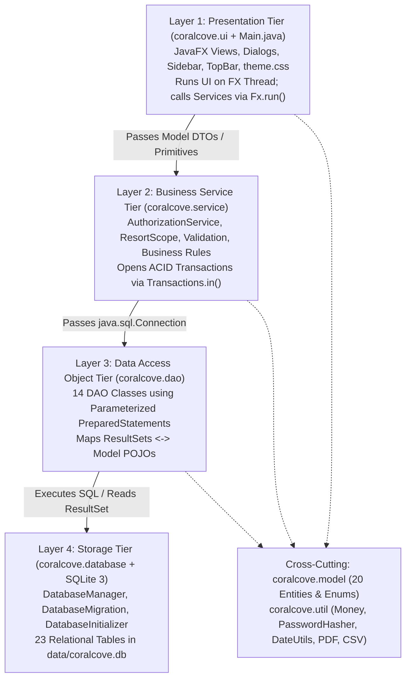
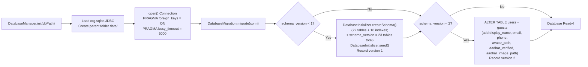

# CoralCove — Complete Phase-by-Phase Viva & Exam Study Guide

> **Who this guide is for:** You and your 3 teammates preparing for your project viva, demo, and technical exam.
> **Assumed prior knowledge:** Zero JavaFX experience. Every framework, library, inbuilt JavaFX/Java/SQLite class, architectural layer, pipeline, and public method across all **97 main Java files** and **7 test files** is explained from scratch in plain English.
> **How to study this:** Read **Part 0** first so JavaFX and JDBC click immediately. Then read **Phases 1 → 8** in order (the exact order the project was built from Day 1 to finish), answer the **Viva Checkpoint** at the end of each phase, and memorize the **End-to-End Pipelines** in **Part 3**.

---

## Table of Contents

- [4-Member Viva Ownership Cheat Sheet](#4-member-viva-ownership-cheat-sheet)
- [Part 0: Beginner's Crash Course — JavaFX, Tech Stack & All Inbuilt APIs](#part-0-beginners-crash-course--javafx-tech-stack--all-inbuilt-apis)
  - [0.1 What is JavaFX? (The Theater Analogy)](#01-what-is-javafx-the-theater-analogy)
  - [0.2 Every Technology Used & Why We Chose It](#02-every-technology-used--why-we-chose-it)
  - [0.3 Master Dictionary of Key Inbuilt JavaFX, Java, JDBC & Crypto APIs (111 Imports)](#03-master-dictionary-of-key-inbuilt-javafx-java-jdbc--crypto-apis-111-imports)
- [Part 1: Problem Statement, Solution & Overall Architecture](#part-1-problem-statement-solution--overall-architecture)
  - [1.1 The Real-World Problem](#11-the-real-world-problem)
  - [1.2 How CoralCove Solves It](#12-how-coralcove-solves-it)
  - [1.3 Four-Layer Clean Architecture](#13-four-layer-clean-architecture)
- [Part 2: Phase-by-Phase Build Walkthrough (Phases 1 → 8)](#part-2-phase-by-phase-build-walkthrough-phases-1--8)
  - [Phase 1: Project Bootstrapping, Maven & Application Entry](#phase-1-project-bootstrapping-maven--application-entry)
  - [Phase 2: Domain Models & Enums (`coralcove.model`)](#phase-2-domain-models--enums-coralcovemodel)
  - [Phase 3: Database Engine, Schema & Migrations (`coralcove.database`)](#phase-3-database-engine-schema--migrations-coralcovedatabase)
  - [Phase 4: Data Access Layer (`coralcove.dao`)](#phase-4-data-access-layer-coralcovedao)
  - [Phase 5: Security & Utility Layer (`coralcove.util`)](#phase-5-security--utility-layer-coralcoveutil)
  - [Phase 6: Business Logic & Service Layer (`coralcove.service`)](#phase-6-business-logic--service-layer-coralcoveservice)
  - [Phase 7: JavaFX Presentation Layer (`coralcove.ui`)](#phase-7-javafx-presentation-layer-coralcoveui)
  - [Phase 8: Automated Testing (`src/test/java/coralcove`)](#phase-8-automated-testing-srctestjavacoralcove)
- [Part 3: End-to-End Master Pipelines (Input → Processing → Output)](#part-3-end-to-end-master-pipelines-input--processing--output)

---

## 4-Member Viva Ownership Cheat Sheet

If the examiner divides questions among all 4 teammates, split deep ownership like this (while everyone still reads Part 0 & Part 1):

| Teammate | Primary Phases to Master | Key Codebase Ownership | Signature Viva Talking Points |
| :--- | :--- | :--- | :--- |
| **Member 1** | Part 0, Part 1, Phase 1, Phase 2 | `pom.xml`, `Main.java`, `AppConfig.java`, `coralcove.model.*` | Why offline desktop over web? 4-layer architecture, JavaFX Stage/Scene lifecycle, Maven build, multi-resort scoping. |
| **Member 2** | Phase 3 & Phase 4 | `coralcove.database.*`, `coralcove.dao.*` | 23 SQLite tables, `PRAGMA foreign_keys = ON`, `Transactions.in()`, schema versioning (`v1 -> v2`), SQL date-overlap math, Aadhaar storage. |
| **Member 3** | Phase 5 & Phase 6 | `coralcove.util.*`, `coralcove.service.*` | `BigDecimal` money math, PBKDF2-HMAC-SHA256 (210k rounds), RBAC matrix, `LodgeStatusSync` priority machine, zero-dependency PDF 1.4 compiler. |
| **Member 4** | Phase 7 & Phase 8 | `coralcove.ui.*`, `src/test/java/coralcove/*` | JavaFX UI thread vs `Fx.run()` background worker, `Session.dataChanged()` reactive refresh, `Dialogs.form()` spacing/scrolling, 18 JUnit 5 tests on temp DBs. |

---

# Part 0: Beginner's Crash Course — JavaFX, Tech Stack & All Inbuilt APIs

## 0.1 What is JavaFX? (The Theater Analogy)

If you have never used JavaFX before, think of it like a **stage play in a theater**:

```
+-------------------------------------------------------------------+
|  STAGE  (javafx.stage.Stage)   = The Desktop Window (title, icon) |
|  +-------------------------------------------------------------+  |
|  |  SCENE (javafx.scene.Scene) = Everything inside the window  |  |
|  |   + theme.css stylesheet                                    |  |
|  |  +-------------------------------------------------------+  |  |
|  |  |  ROOT NODE (Layout Container, e.g., BorderPane)       |  |  |
|  |  |  +-------------+-----------------------------------+  |  |  |
|  |  |  | TopBar      | (HBox: title, resort picker, user)|  |  |  |
|  |  |  +------+------+-----------------------------------+  |  |  |
|  |  |  |Side  | Center Content (ScrollPane -> VBox)      |  |  |  |
|  |  |  |bar   |  - ScreenHeader (photo banner)           |  |  |  |
|  |  |  |(VBox)|  - Toolbar (FlowPane of buttons/inputs)  |  |  |  |
|  |  |  |      |  - TableView (rows of stays/guests/etc.) |  |  |  |
|  |  |  +------+------------------------------------------+  |  |  |
|  |  +-------------------------------------------------------+  |  |
|  +-------------------------------------------------------------+  |
+-------------------------------------------------------------------+
```

### The 5 Golden Rules of JavaFX You MUST Know for Viva

1. **`Application` & `start(Stage primary)`**: Every JavaFX app extends `javafx.application.Application`. Your `main()` method calls `launch(args)`. JavaFX starts its internal graphics engine, creates the main window (`Stage`), and calls your `start(Stage primary)` method.
2. **Scene Graph (Tree of `Node`s)**: Every visible thing — a button, label, table, photo, or container — is a `Node`. Containers (`VBox`, `HBox`, `BorderPane`, `GridPane`, `StackPane`) hold child nodes in a tree called the **Scene Graph**.
3. **Layout Containers Instead of Pixel Coordinates**: We never hardcode `(x=140, y=300)`. We use layouts:
   - `VBox` stacks children **vertically** (top to bottom).
   - `HBox` lines children up **horizontally** (left to right).
   - `BorderPane` splits space into 5 slots: `top`, `left`, `center`, `right`, `bottom`.
   - `GridPane` arranges labels and text fields in rows and columns (like a form table).
   - `StackPane` stacks children **on top of each other** (great for putting text on top of a background photo, as in `ScreenHeader`).
   - `FlowPane` places buttons side-by-side and automatically wraps them onto a second row if the window gets narrower.
4. **JavaFX CSS (`theme.css`)**: Just like HTML websites use CSS for colors, fonts, borders, and rounded corners, JavaFX supports CSS! The only difference is JavaFX CSS property names start with `-fx-` (e.g., `-fx-background-color`, `-fx-font-size`, `-fx-padding`). You attach CSS classes in Java via `node.getStyleClass().add("primary")`.
5. **The Golden Threading Rule (`FX Application Thread`)**:
   - JavaFX has **ONE special thread** that draws the screen and listens to clicks: the **JavaFX Application Thread**.
   - **Rule A:** Never run slow work (like SQLite database queries) on the JavaFX Application Thread, or the entire window will freeze ("Not Responding").
   - **Rule B:** Never modify a UI node (like updating a table or label) from a background thread, or JavaFX will throw `IllegalStateException: Not on FX application thread`.
   - **How CoralCove obeys both rules:** Our helper `Fx.run(backgroundWork, onUiSuccess)` runs the DB query on a background **daemon thread** (a helper thread that automatically shuts down when you close the app window) via `javafx.concurrent.Task`, and automatically hands the result back to the FX thread! And `Platform.runLater(...)` schedules UI updates safely onto the FX thread.

   Here is what that looks like in 4 lines of real CoralCove code:
   ```java
   saveBtn.setOnAction(e -> Fx.run(
       () -> stayService.create(draft),   // 1. Runs on background thread (safe for SQLite!)
       saved -> refresh()                 // 2. Runs back on FX UI thread (safe for TableView!)
   ));
   ```

---

## 0.2 Every Technology Used & Why We Chose It

| Technology | Exact Version (`pom.xml`) | Role in CoralCove | Why We Chose It (and Why Not Alternatives) |
| :--- | :--- | :--- | :--- |
| **Java (OpenJDK LTS)** | Java 21 (`--release 21`) | Core programming language | Strong compile-time typing prevents runtime crashes; modern `record` classes, `switch` expressions, text blocks (`"""`), and long-term support. |
| **JavaFX (`javafx-controls`)** | `21.0.6` | Desktop GUI framework | Modern hardware-accelerated UI with full CSS skinning, charts, animations, and high-DPI scaling. Chosen over **Swing** (dated look, weak CSS) and over **React/Web** (requires hosting a server or internet). |
| **SQLite + `sqlite-jdbc`** | `3.49.1.0` | Embedded relational database | Stores the entire database in one local file (`data/coralcove.db`). Zero installation, zero server admin, works 100% offline, full **ACID** transactions (*Atomicity, Consistency, Isolation, Durability* — all-or-nothing writes) and foreign keys. Chosen over **MySQL/PostgreSQL** (requires installing & running a separate DB server on every resort PC). |
| **JDBC (`java.sql.*`)** | Java 21 Standard Library | Database connectivity | Direct parameterized SQL (`PreparedStatement`) gives complete control over joins, transactions, and zero **ORM** (*Object-Relational Mapping*) magic/overhead. Chosen over **Hibernate/JPA** (too heavy and slow startup for a lean desktop app). |
| **PBKDF2 (`javax.crypto`)** | Java 21 Standard Library | Password hashing | Built directly into Java (zero extra dependencies), NIST SP 800-63B compliant, slow by design (210,000 iterations) to resist brute-force attacks. Chosen over **MD5/SHA-256** (way too fast to crack) and plaintext (completely insecure). |
| **BigDecimal (`java.math`)** | Java 21 Standard Library | Financial & tax calculations | Exact decimal math with `RoundingMode.HALF_UP`. Chosen over `double`/`float` because binary floating-point fails decimal arithmetic (`0.1 + 0.2 = 0.30000000000000004`). |
| **Native PDF 1.4 + AWT Print** | Custom + `java.awt.print` | Invoice PDF & receipt printing | Writes raw valid PDF bytes directly with zero external JARs. Chosen over **iText / Apache PDFBox** (adds megabytes of transitive dependencies and licensing overhead). |
| **Apache Maven + Wrapper (`mvnw`)** | Compiler `3.13.0`, Surefire `3.5.2`, JavaFX plugin `0.0.8` | Build, dependency & test runner | Downloads exact JAR versions automatically and runs tests/app identically on any teammate's laptop via `.\mvnw.cmd javafx:run` even if Maven isn't installed globally. |
| **JUnit Jupiter (JUnit 5)** | `5.11.4` | Automated testing | Runs 18 headless tests in ~13 seconds against fresh temporary SQLite databases without opening any GUI window. |

---

## 0.3 Master Dictionary of Key Inbuilt JavaFX, Java, JDBC & Crypto APIs (111 Imports)

Across all 97 source files, CoralCove imports **111 unique external classes** (the ~102 core classes below plus standard Java collections like `List`/`ArrayList`/`Map`/`Set`/`EnumMap`/`LinkedHashMap` and nested types like `AlertType`/`ExtensionFilter`). If an examiner points to an `import` line in any file, you will know exactly what it does.

### A. JavaFX Core & Windowing (`javafx.application`, `javafx.stage`, `javafx.scene`)

| Inbuilt Class | What It Is & What Its Key Functions Do | Where CoralCove Uses It |
| :--- | :--- | :--- |
| `Application` | Base class for any JavaFX app. `launch(args)` boots JavaFX; you override `start(Stage)`. | `Main.java` |
| `Platform` | Controls the JavaFX UI thread. `Platform.runLater(Runnable)` safely pushes UI updates onto the FX thread; `Platform.isFxApplicationThread()` checks which thread you are on. | `Main.java`, `Fx.java` |
| `Stage` | An actual OS window (has title bar, minimize/maximize/close buttons, taskbar icon). Methods: `setTitle()`, `setMinWidth()`, `getIcons().setAll()`, `setScene()`, `show()`, `initOwner()`, `initModality()`. | `Main.java`, `AadharUtils.java`, `ProfileDialog.java` |
| `Window` | Parent class of `Stage`. `Window.getWindows()` lists all open windows so alerts can attach cleanly to the main window. | `Fx.java` |
| `Modality` | Enum deciding whether a popup blocks other windows (`Modality.APPLICATION_MODAL` blocks interaction with the main desk until the popup closes). | `AadharUtils.java`, `ProfileDialog.java` |
| `FileChooser` | Opens the native Windows/macOS file picker dialog (`showOpenDialog()`, `showSaveDialog()`) with `ExtensionFilter` (e.g., `*.png`, `*.jpg`, `*.csv`, `*.pdf`). | `ProfileDialog`, `GuestDialog`, `ArrivalView`, `BillingView`, `ReportsView` |
| `Scene` | The container inside a `Stage` holding the root `Parent` node and CSS stylesheets (`getStylesheets().add()`, `setRoot()`). | `Main.java`, `AadharUtils`, `ProfileDialog` |
| `Node` | Base class for EVERY visual item in JavaFX (`setOpacity()`, `setTranslateY()`, `getStyleClass()`, `setClip()`, `setOnMouseClicked()`). | Everywhere in `coralcove.ui` |
| `Parent` | A `Node` that can have child nodes (every layout pane extends `Parent`). | `Main`, `LoginView`, `ShellView` |

### B. JavaFX Layouts & Geometry (`javafx.scene.layout`, `javafx.geometry`)

| Inbuilt Class | What It Does | Key Methods Used |
| :--- | :--- | :--- |
| `BorderPane` | 5-zone layout (`top`, `left`, `center`, `right`, `bottom`). | `setTop()`, `setLeft()`, `setCenter()`, `setBottom()` (used in `ShellView`, `ProfileDialog`) |
| `VBox` | Stacks child nodes vertically with spacing. | `new VBox(spacing)`, `getChildren().addAll()`, `VBox.setVgrow(node, Priority.ALWAYS)` |
| `HBox` | Places child nodes horizontally in a row. | `new HBox(spacing)`, `setAlignment()`, `HBox.setHgrow(node, Priority.ALWAYS)` |
| `GridPane` | 2D grid of rows and columns for forms. | `add(node, col, row)`, `setHgap()`, `setVgap()`, `setPadding()`, `getColumnConstraints()` |
| `ColumnConstraints` | Controls width and stretch behavior of each column in a `GridPane`. | `setMinWidth()`, `setPrefWidth()`, `setHgrow(Priority.ALWAYS)` (used in `Dialogs.java`) |
| `StackPane` | Layers child nodes on top of each other (back to front). | Used in `Main` splash, `ScreenHeader` (text over photo), `AvatarUtils` (initials inside circle) |
| `FlowPane` | Arranges nodes horizontally and wraps to next line when full. | `Fx.bar(...)` toolbars |
| `Region` | Base class for layouts & controls; also instantiated directly as an invisible expanding "spacer" (`HBox.setHgrow(spacer, Priority.ALWAYS)`). | `TopBar`, `Sidebar`, `ProfileDialog` |
| `Priority` | Enum (`ALWAYS`, `SOMETIMES`, `NEVER`) telling `HBox`/`VBox`/`GridPane` which child should absorb extra space when resized. | `Dialogs`, `ShellView`, `TopBar`, views |
| `Insets` | Padding or margin spacing in pixels: `new Insets(top, right, bottom, left)`. | `Dialogs`, `ProfileDialog`, `ChangePasswordDialog`, views |
| `Pos` | Alignment enum (`Pos.CENTER`, `Pos.CENTER_LEFT`, `Pos.BOTTOM_LEFT`, `Pos.CENTER_RIGHT`). | Almost every UI view |

### C. JavaFX UI Controls (`javafx.scene.control`)

| Inbuilt Class | What It Is | How CoralCove Uses It |
| :--- | :--- | :--- |
| `Label` | Read-only text (or styled pill badge via CSS class `"chip"`). | Headings, KPI numbers, status chips (`Fx.chip`) |
| `Button` | Clickable button. `setOnAction(e -> ...)` attaches click logic; `setDefaultButton(true)` binds Enter key; `setCancelButton(true)` binds Escape key. | Every view & dialog |
| `TextField` | Single-line editable text box (`getText()`, `setText()`, `setPromptText()`). | Search bars, guest forms, login username |
| `PasswordField` | Like `TextField`, but masks characters with dots (`••••`). | `LoginView`, `ChangePasswordDialog` |
| `TextArea` | Multi-line text input (`setPrefRowCount()`, `setWrapText(true)`). | Notes, addresses, special requests |
| `ComboBox<T>` | Dropdown selector (`getItems().setAll()`, `getValue()`, `getSelectionModel().select()`). | Resort switcher, room status, meal plans, payment methods |
| `CheckBox` | Tick box (`isSelected()`, `setSelected()`). | Aadhaar verified flag, active flags |
| `DatePicker` | Calendar popup for choosing a `LocalDate`. Configured by `Fx.dates(picker)` with a `StringConverter` so dates display as `dd-MM-yyyy`. | `StayView`, `StayDialog`, `ReportsView`, `EmployeeView` |
| `ScrollPane` | Adds vertical/horizontal scrollbars around tall content (`setFitToWidth(true)`, `setHbarPolicy(NEVER)`). | `ShellView`, `Dialogs`, `ProfileDialog` |
| `TableView<T>` | Interactive data table (`getItems().setAll(list)`, `getSelectionModel().getSelectedItem()`). | All 12 module screens |
| `TableColumn<S, T>` | One column in a `TableView`. Uses `setCellValueFactory(...)` to extract cell text via `SimpleStringProperty`. | Built cleanly via `Columns.of(title, lambda)` |
| `TableCell` / `TableRow` | Customizes how individual cells or rows render (e.g., showing colored status chips or highlighting low-stock rows). | `LodgeView`, `StayView`, `GuestView`, `InventoryView` |
| `Dialog<T>` & `DialogPane` | Modal popup window with content + standard OK/Cancel buttons (`showAndWait()`, `lookupButton()`). | `Dialogs.form()`, `ChangePasswordDialog` |
| `ButtonType` | Standard button tokens (`ButtonType.OK`, `ButtonType.CANCEL`). | `Dialogs`, `Fx.confirm`, `Fx.alert` |
| `Alert` | Pre-built popup dialog (`AlertType.ERROR`, `INFORMATION`, `CONFIRMATION`). | `Fx.error()`, `Fx.info()`, `Fx.confirm()` |
| `Control` | Base class of all interactive controls (`TextField`, `ComboBox`, etc.) — used in `Dialogs.java` to stretch column-1 controls to `Double.MAX_VALUE`. | `Dialogs.java` |

### D. JavaFX Media, Charts, Shapes, Animations & Concurrency

| Inbuilt Class | What It Does | Where CoralCove Uses It |
| :--- | :--- | :--- |
| `Image` & `ImageView` | Loads PNG/JPG files (`new Image(url, w, h, preserveRatio, smooth)`) and renders them on screen (`setFitWidth()`, `setPreserveRatio()`, `setViewport()`). | `ResortArt`, `ScreenHeader`, `AvatarUtils`, `AadharUtils`, `LoginView`, `LodgeView` |
| `Circle` & `Rectangle` | Vector shapes used both for drawing borders/emblems and for **clipping** images (`imageView.setClip(circle)` turns a square photo into a circular avatar; rounded `Rectangle` clips hero banners). | `AvatarUtils`, `ScreenHeader`, `LoginView`, `AadharUtils` |
| `BarChart`, `PieChart`, `CategoryAxis`, `NumberAxis`, `XYChart` | Built-in JavaFX data visualization charts for revenue trends, occupancy bars, and lodge category breakdowns. | `DashboardView` |
| `FadeTransition`, `TranslateTransition`, `ParallelTransition`, `Timeline`, `KeyFrame`, `KeyValue`, `Interpolator`, `Duration` | Smooth GPU-accelerated animations. `Fx.fadeIn(node)` runs a 220ms fade (opacity `0→1`) + slide-up (`8px→0px`) in parallel (`ParallelTransition`). `LoginView` uses `Timeline` for subtle coastal backdrop motion. | `Fx.java`, `LoginView.java` |
| `Task<T>` | Background worker class from `javafx.concurrent`. You override `call()` (runs on background thread) and attach `setOnSucceeded` / `setOnFailed` (automatically called back on the JavaFX UI thread!). | `Fx.run(...)` |
| `SimpleStringProperty` | Wraps a plain `String` into an observable JavaFX property (JavaFX `TableColumn` cannot use raw `String` directly because tables listen to observable properties for live updates). | `Columns.java` |
| `ActionEvent` | Event fired when a button is clicked. `Dialogs.form()` attaches an `ActionEvent` filter (which runs **before** JavaFX's built-in dialog close handler) and calls `event.consume()` if `save.run()` throws a validation error, stopping the dialog from closing! | `Dialogs.java`, `ChangePasswordDialog.java` |
| `StringConverter<T>` | Converts between `LocalDate` objects and `dd-MM-yyyy` text in `DatePicker`. | `Fx.dates(...)` |

### E. JDBC & SQLite (`java.sql.*`)

| Inbuilt Class | What It Does | Why It Matters |
| :--- | :--- | :--- |
| `DriverManager` | Opens a database connection via JDBC URL: `DriverManager.getConnection("jdbc:sqlite:" + path)`. | `DatabaseManager.open()` |
| `Connection` | Active session with SQLite. Controls transactions via `setAutoCommit(false)`, `commit()`, `rollback()`. | `DatabaseManager`, `Transactions`, every DAO |
| `Statement` | Executes static SQL without parameters (used for `CREATE TABLE` DDL and `PRAGMA` commands). | `DatabaseInitializer`, `DatabaseMigration` |
| `PreparedStatement` | Executes parameterized SQL with `?` placeholders (`ps.setString(1, val)`, `ps.setLong(2, id)`, `executeQuery()`, `executeUpdate()`). **Prevents SQL injection 100%!** Also supports `Statement.RETURN_GENERATED_KEYS` to get the newly inserted row's `id`. | Every DAO class |
| `ResultSet` | Cursor over rows returned by a `SELECT` query (`while (rs.next()) { rs.getString("col"); }`). `rs.wasNull()` checks if a numeric DB column was SQL `NULL`. | Every DAO + `Jdbc.java` |
| `Types` | SQL type constants (e.g., `Types.INTEGER`) passed to `ps.setNull(index, Types.INTEGER)` for nullable foreign keys. | `Jdbc.nullableLong()` |
| `SQLException` | Checked exception thrown on SQL/constraint failures; caught by `Transactions.in()` and translated into friendly `AppException` messages. | `Transactions.java`, DAOs, Services |

### F. Java Standard Library, Security, Dates, Files & Printing

| Package & Classes | Plain-English Purpose in CoralCove |
| :--- | :--- |
| **`java.math.BigDecimal`, `RoundingMode`** | Exact base-10 arithmetic for all rupee values (`scale = 2`, `RoundingMode.HALF_UP`). Never loses paise. |
| **`java.security.SecureRandom`, `MessageDigest`, `KeySpec`, `javax.crypto.SecretKeyFactory`, `PBEKeySpec`, `java.util.Base64`** | Generates cryptographically strong 16-byte random salts, derives 256-bit PBKDF2-HMAC-SHA256 hashes over 210,000 iterations, encodes them to Base64 strings, and compares hashes in **constant time** (`MessageDigest.isEqual`) to stop timing attacks. |
| **`java.time.LocalDate`, `LocalDateTime`, `YearMonth`, `ZoneId`, `DateTimeFormatter`, `ChronoUnit`** | Modern timezone-aware date/time API (defaults to `Asia/Kolkata`, configurable per resort). Calculates exact stay nights (`ChronoUnit.DAYS.between`) and overlap checks (`aIn.isBefore(bOut) && aOut.isAfter(bIn)`). |
| **`java.nio.file.Files`, `Path`, `StandardCopyOption`, `StandardCharsets`, `java.io.File`** | Creates `data/`, `data/aadhar/`, `data/avatars/` folders, copies uploaded images safely, writes UTF-8 CSVs and ASCII PDF byte arrays. |
| **`java.util.concurrent.CopyOnWriteArrayList`, `ConcurrentHashMap`, `ThreadLocalRandom`** | Thread-safe listener list in `Session`, thread-safe caches in `SettingsService`/`ResortArt`, and lock-free random numbers for generating booking/invoice reference suffixes. |
| **`java.util.function.Supplier`, `Consumer`, `Function`** | Java functional interfaces enabling clean lambdas in `Fx.run(Supplier, Consumer)` and `Columns.of(title, Function)`. |
| **`java.util.logging.Logger`, `FileHandler`, `SimpleFormatter`, `Level`** | Rotating log file at `data/coralcove.log` (max 1 MB × 2 rolling files) recording startup events and stack traces. |
| **`java.awt.print.PrinterJob`, `Printable`, `PrinterException`, `java.awt.Font`** | Opens the OS print dialog and renders monospaced invoice/report lines directly to physical printers (`PDFGenerator.print`). |
| **`java.text.DecimalFormat`, `DecimalFormatSymbols`, `Locale`** | Formats amounts with commas (`₹201,600.00` for UI, `Rs. 201,600.00` for PDF). |

---

# Part 1: Problem Statement, Solution & Overall Architecture

## 1.1 The Real-World Problem

Luxury resort groups operating across remote coastlines (like Kochi, Varkala, or island properties) face **five operational pain points**:

1. **Unstable Internet Kills Cloud PMS Apps:** Coastal properties frequently lose broadband connectivity. Browser-based cloud **PMS** (*Property Management System*) apps freeze during outages, stranding arriving guests at the front desk and blocking check-outs or invoice printing.
2. **Double-Bookings & Date Collisions:** Spreadsheets or paper registers have no relational constraints. Two desk agents can easily assign the same villa on overlapping dates.
3. **Scattered Guest KYC Documents:** Indian hospitality law requires verifying guest **KYC** (*Know Your Customer* — official identity proof, especially 12-digit Aadhaar). Paper photocopies get lost, slow down registration, and create compliance risks.
4. **Billing & Tax Errors:** Combining room nights, discounts, resort-specific tax rates, restaurant/spa add-ons, partial payments, and refunds manually causes rounding errors and lost revenue.
5. **Broken Front-Desk ↔ Housekeeping Handoff:** When a guest departs, if housekeeping isn't notified immediately — or if a room under repair is mistakenly shown as available — arriving guests get sent to dirty or broken lodges.

## 1.2 How CoralCove Solves It

CoralCove replaces fragmented spreadsheets and cloud-dependent web apps with a **single, offline-first, multi-property desktop application**:

- **100% Offline Local Engine:** Embedded SQLite database (`data/coralcove.db`) responds in sub-milliseconds with zero internet needed.
- **Mathematical Overlap Guard:** SQL overlap queries inside ACID transactions guarantee zero double-bookings.
- **Built-in Aadhaar KYC Staging:** Stores verification status + copies uploaded ID scans into `data/aadhar/` with a built-in click-to-zoom viewer.
- **Exact `BigDecimal` Folio Accounting:** Automatically provisions an invoice on check-in, pulls in served restaurant/experience orders on check-out, computes resort tax with `HALF_UP` rounding, rejects overpayments/over-refunds, and exports PDFs/CSVs natively.
- **Automatic Room Status State Machine (`LodgeStatusSync`):** Automatically derives every lodge's live status (`IN_STAY`, `TURNDOWN`, `REPAIR`, `HELD`, `READY`, `CLOSED`) whenever a booking, arrival, departure, cleaning task, or repair changes.
- **Role-Based Security & Multi-Resort Scoping:** 4 staff roles (`ADMIN`, `MANAGER`, `FRONT_DESK`, `ATTENDANT`) enforced at both UI and Service layers, plus PBKDF2-HMAC-SHA256 password hashing.

## 1.3 Four-Layer Clean Architecture

CoralCove enforces **strict top-down unidirectional dependencies**. Lower layers NEVER import or know about upper layers:



**Why this separation is golden (say this in Viva!):**
1. **Atomic Multi-DAO Transactions:** Because Services own the `Connection` (via `Transactions.in`) and pass it down to multiple DAOs, a complex action like `checkOut()` can attach served restaurant orders, update `arrivals`, mark `stay_bookings` as `DEPARTED`, insert a `lodge_care_tasks` cleaning ticket, and recalculate lodge status **all inside ONE atomic transaction**. If step 4 fails, steps 1–3 roll back automatically!
2. **Headless Unit Testing:** Because zero business logic lives inside JavaFX buttons/views, JUnit 5 can test all 18 rules in `service` + `dao` + `database` without ever launching a JavaFX window!

---

# Part 2: Phase-by-Phase Build Walkthrough (Phases 1 → 8)

## Phase 1: Project Bootstrapping, Maven & Application Entry

> **What we built first:** Configured Maven (`pom.xml`), centralized paths/constants (`AppConfig.java`), and built the JavaFX application entry point (`Main.java`) that opens the window, loads CSS & icons, initializes SQLite on a background thread, seeds showcase data on first run, and wires reactive UI refreshes.

### Phase 1 Pipeline Diagram

```
[User runs: .\mvnw.cmd javafx:run]
        |
        v
Main.main(args) --> Application.launch(args) --> JavaFX starts FX Thread
        |
        v
Main.start(Stage primary)
  |-- Sets title ("CoralCove | Resort Management"), min size (1200x750), 7-size app icons
  |-- Shows instant splash Label("Opening the desk...") + loads /coralcove/theme.css
  |-- Registers Session.onDataChanged() listener -> Platform.runLater(shell::refreshVisible)
  |-- Calls Fx.run() on background thread:
  |       1. AppConfig.databasePath() -> checks CORALCOVE_DB env var, else data/coralcove.db
  |       2. DatabaseManager.init(path) -> creates/migrates 23 SQLite tables + default admin
  |       3. Main.ensureShowcaseData() -> if lodges == 0, runs DemoDataService.load()
  v
[UI Callback on FX Thread] --> Replaces splash with LoginView().root() + Fx.fadeIn()
```

### Complete Function & API Reference — Phase 1

#### 1. `coralcove.config.AppConfig`
Centralizes app constants and filesystem paths.

| Public Constant / Method | Input | Processing | Output |
| :--- | :--- | :--- | :--- |
| Constants: `APP_NAME`, `WINDOW_TITLE`, `DEFAULT_ADMIN`, `DEFAULT_PASSWORD` | None | Compile-time constants: `"CoralCove"`, `"CoralCove \| Resort Management"`, `"admin"`, `"Admin@123"`. | `String` |
| `dataDir()` | None | Returns relative `Path.of("data")` folder in working directory. | `Path` |
| `databasePath()` | Env var `CORALCOVE_DB` (optional) | Reads `System.getenv("CORALCOVE_DB")`; if non-blank returns that path, otherwise returns `data/coralcove.db`. | `Path` |
| `preferencesPath()` | None | Resolves `data/preferences.properties`. | `Path` |

#### 2. `coralcove.Main` (extends `javafx.application.Application`)
Desktop entry point and top-level scene router between `LoginView` and `ShellView`.

| Public Method | Input | Processing | Output |
| :--- | :--- | :--- | :--- |
| `main(String[] args)` | CLI args | Calls inherited `Application.launch(args)` to boot JavaFX toolkit. | `void` |
| `stage()` | None | Returns static reference to the primary desktop `Stage` (used by dialogs as `initOwner`). | `Stage` |
| `start(Stage primary)` | Primary OS window from JavaFX | Configures window bounds (`1200x750` min, `1280x800` scene), loads 7 icon sizes (`16`..`256` + full) from `ResortArt.icon()`, attaches `/coralcove/theme.css`, shows splash, binds `Session.onDataChanged`, initializes DB + showcase data asynchronously via `Fx.run()`, then transitions to `LoginView` with `Fx.fadeIn`. | `void` |
| `showLogin()` | None | Sets `shell = null`, clears active user & resort filter via `Session.clear()`, swaps scene root to fresh `new LoginView().root()`. | `void` |
| `showShell()` | None | Stops login background animation (`LoginView.stopMotion()`), constructs `new ShellView()`, sets scene root, plays `Fx.fadeIn(desk)`, and opens the user's first permitted module (`shell.openFirst()`). | `void` |
| *(private)* `ensureShowcaseData()` | None | Queries `SELECT COUNT(*) FROM lodges`; if `0`, temporarily sets `Session` to seeded `admin`, runs `DemoDataService.load()` to populate realistic demo resorts/lodges/stays, then clears `Session`. | `void` |

### Phase 1 — Likely Viva Questions Checkpoint
1. **Q: Why does `Main.start()` show `"Opening the desk..."` and run `DatabaseManager.init()` inside `Fx.run()` instead of running it directly?**
   - *A:* Initializing SQLite, running schema migrations, and seeding demo data takes ~1–2 seconds. Running it directly in `start()` would block the JavaFX Application Thread and make the app appear frozen before the window even paints. Running it on a background thread shows the branded window immediately.
2. **Q: How can you point CoralCove to a different database file without recompiling?**
   - *A:* Set the environment variable `CORALCOVE_DB` before launching. `AppConfig.databasePath()` checks it first and falls back to `data/coralcove.db`.
3. **Q: Why does `Main` pass 7 different icon sizes (`16, 32, 48, 64, 128, 256, full`) to `stage.getIcons()`?**
   - *A:* Windows uses different sizes for the title bar (`16px`), taskbar (`32px`/`48px`), and Alt+Tab switcher (`128px`/`256px`). Passing pre-scaled smooth icons prevents blurry downscaling.

---

## Phase 2: Domain Models & Enums (`coralcove.model`)

> **What we built second:** Plain Java data objects (**POJOs** = *Plain Old Java Objects*, also called **DTOs** = *Data Transfer Objects*) and Enums representing every business concept in a resort. Models contain **zero SQL and zero JavaFX code** — they are pure data carriers passed between UI, Services, and DAOs.

### Why Enums Matter Here
Every status or fixed category in CoralCove is backed by **both** a Java `enum` (compile-time safety) and a SQLite `CHECK (...)` constraint (database-level safety). Invalid values are rejected at both layers.

### Complete Reference — All 7 Enums in `coralcove.model`

| Enum | Allowed Values | Public Methods (`Input → Processing → Output`) |
| :--- | :--- | :--- |
| **`AppModule`** | `DASHBOARD`, `STAYS`, `LODGES`, `GUESTS`, `ARRIVALS`, `BILLING`, `LODGE_CARE`, `EXPERIENCES`, `EMPLOYEES`, `INVENTORY`, `REPORTS`, `SETTINGS` | `label()`: None → returns human-readable sidebar title (e.g., `"Lodge care"`) → `String`. |
| **`Role`** | `ADMIN`, `MANAGER`, `FRONT_DESK`, `ATTENDANT` | `label()`: None → formats `"FRONT_DESK"` to `"Front desk"` → `String`.<br>`parse(String raw)`: raw text → trims, uppercases, `Role.valueOf` → `Role`. |
| **`LodgeStatus`** | `READY`, `IN_STAY`, `HELD`, `TURNDOWN`, `REPAIR`, `CLOSED` | `label()`: None → formats `"IN_STAY"` to `"In stay"` → `String`.<br>`parse(String raw)`: raw text → trims, uppercases, `valueOf` → `LodgeStatus`. |
| **`StayStatus`** | `PENDING`, `CONFIRMED`, `ARRIVED`, `DEPARTED`, `CANCELLED`, `NO_SHOW` | `parse(String raw)`: raw text → trims, uppercases, `valueOf` → `StayStatus`. |
| **`BookingSource`** | `WALK_IN`, `WEBSITE`, `PHONE`, `TRAVEL_AGENT` | `label()`: None → returns display label (e.g., `"Walk-in"`) → `String`.<br>`parse(String raw)`: raw text → trims, uppercases, `valueOf` → `BookingSource`. |
| **`InvoiceStatus`** | `UNPAID`, `PARTIALLY_PAID`, `PAID`, `REFUNDED` | `parse(String raw)`: raw text → trims, uppercases, `valueOf` → `InvoiceStatus`. |
| **`PaymentMethod`** | `CASH`, `CARD`, `UPI`, `BANK_TRANSFER` | `label()`: None → replaces `_` with space (`"BANK TRANSFER"`) → `String`.<br>`parse(String raw)`: raw text → trims, uppercases, replaces space with `_`, `valueOf` → `PaymentMethod`. |

### Complete Reference — All 13 Entity Classes in `coralcove.model`

Every entity below has standard JavaBean `getX()` / `setX(val)` accessors for all listed fields. Non-trivial helper methods (`toString()`, `isLow()`, `getEffectiveName()`) are explicitly highlighted:

| Model Class | Key Fields & Types | Special Public Methods (`Input → Processing → Output`) |
| :--- | :--- | :--- |
| **`Resort`** | `id`, `name`, `location`, `coastline`, `timezone` (default `"Asia/Kolkata"`), `taxPercent` (default `"12"`), `active`, `sample` | `toString()`: None → returns `name` (or `""` if null) so `ComboBox<Resort>` displays resort names cleanly → `String`. |
| **`User`** | `id`, `username`, `passwordHash`, `role` (`Role`), `employeeId` (`Long`), `resortId` (`Long`), `mustChangePassword`, `active`, `createdAt`, `displayName`, `email`, `phone`, `avatarPath` | `getEffectiveName()`: None → returns `displayName` if non-blank, else falls back to `username` → `String`. |
| **`Employee`** | `id`, `resortId`, `name`, `phone`, `email`, `designation`, `department`, `salary` (`BigDecimal`), `joiningDate`, `status` (`"ACTIVE"`/`"INACTIVE"`), `sample` | `toString()`: None → returns `name + " · " + department` for dropdowns → `String`. |
| **`Guest`** | `id`, `fullName`, `phone`, `email`, `gender`, `nationality`, `address`, `idDocType`, `idDocNumber`, `preferences`, `vip` (`"STANDARD"`/`"VIP"`), `registeredOn`, `sample`, `aadharVerified` (`boolean`), `aadharImagePath` (`String`) | `toString()`: None → returns `fullName` + optional `" · " + phone` for `StayDialog` guest selector → `String`. |
| **`LodgeCategory`** | `id`, `name`, `description` | `toString()`: None → returns `name` (e.g., `"Pool Villa"`) → `String`. |
| **`Lodge`** | `id`, `resortId`, `resortName`, `unitCode`, `zone` (`"BEACH"`/`"LAGOON"`/`"GARDEN"`/`"CLIFF"`), `viewAspect` (`"SEA"`/`"GARDEN"`/`"POOL"`), `lodgeCategoryId`, `roomTypeName`, `bedConfig`, `maxGuests`, `pricePerNight` (`BigDecimal`), `description`, `amenities`, `status` (`LodgeStatus`), `sample` | `toString()`: None → returns `unitCode + " · " + roomTypeName` (e.g., `"B01 · Pool Villa"`) → `String`. |
| **`StayBooking`** | `id`, `bookingReference`, `resortId`, `mealPlan` (`"EP"` Room Only / `"CP"` Breakfast / `"MAP"` Breakfast+Dinner / `"AP"` All Meals), `transfer` (`"NONE"`/`"AIRPORT"`/`"JETTY"`), `guestId`, `guestName`, `lodgeId`, `unitCode`, `checkIn` (`LocalDate`), `checkOut` (`LocalDate`), `adults`, `children`, `nights`, `roomPrice`, `discount`, `tax`, `total` (all `BigDecimal`), `source` (`BookingSource`), `status` (`StayStatus`), `specialRequests`, `createdAt`, `sample` | Standard getters/setters for all 23 fields. |
| **`Invoice`** | `id`, `invoiceNumber`, `reservationId`, `guestId`, `guestName`, `subtotal`, `discount`, `tax`, `total`, `amountPaid`, `balance` (all `BigDecimal`), `status` (`InvoiceStatus`), `issuedAt`, `sample` | Standard getters/setters for all 14 fields. |
| **`Payment`** | `id`, `invoiceId`, `amount` (`BigDecimal`, negative for refunds), `method` (`PaymentMethod`), `reference`, `paidAt`, `receivedBy` (`Long`), `note` | Standard getters/setters for all 8 fields. |
| **`Experience`** | `id`, `resortId`, `name`, `category`, `price` (`BigDecimal`), `active` | `toString()`: None → returns `name` (e.g., `"Sunset cruise"`) → `String`. |
| **`ExperienceBooking`** | `id`, `experienceId` *(getters/setters named `getServiceId`/`setServiceId`)*, `reservationId`, `guestId`, `lodgeId`, `unitCode`, `orderType` (`"RESTAURANT"`/`"ROOM_SERVICE"`), `description`, `qty`, `unitPrice`, `lineTotal` (`BigDecimal`), `status`, `invoiceItemId`, `createdAt`, `sample` | Standard getters/setters for all 15 fields. |
| **`LodgeCareTask`** | `id`, `lodgeId`, `unitCode`, `assigneeId`, `assigneeName`, `priority` (`"LOW"`/`"NORMAL"`/`"HIGH"`), `status` (`"PENDING"`/`"ASSIGNED"`/`"IN_PROGRESS"`/`"COMPLETED"`/`"INSPECTION_REQUIRED"`), `notes`, `inspectionStatus` (`"NONE"`/`"PASSED"`/`"FAILED"`), `createdAt`, `completedAt`, `sample` | Standard getters/setters for all 12 fields. |
| **`InventoryItem`** | `id`, `resortId`, `sku`, `name`, `category`, `supplierId`, `supplierName`, `quantity`, `minQuantity`, `unit`, `sample` | `isLow()`: None → returns `quantity < minQuantity` to trigger low-stock UI warning → `boolean`. |

### Phase 2 — Likely Viva Questions Checkpoint
1. **Q: Why do `Employee`, `Guest`, `Lodge`, `Resort`, and `Experience` override `toString()`?**
   - *A:* Because JavaFX `ComboBox<T>` calls `toString()` by default to display each item in a dropdown list. Overriding `toString()` lets us pass real model objects directly into dropdowns while showing clean labels like `"B01 · Pool Villa"`.
2. **Q: Why are `employeeId`, `resortId`, `supplierId`, and `assigneeId` declared as `Long` (wrapper) instead of `long` (primitive)?**
   - *A:* Primitive `long` cannot be `null` (defaults to `0`, which breaks SQLite foreign keys!). Wrapper `Long` can be `null`, representing optional relationships — e.g., an Owner (`admin`) has `resortId = null` meaning access to ALL resorts, or an unassigned housekeeping task has `assigneeId = null`.
3. **Q: Why do operational models carry a `boolean sample` (`is_sample`) flag?**
   - *A:* So `DemoDataService.reset()` can safely delete ONLY demo/sample rows (`WHERE is_sample = 1`) without wiping real resorts, guests, or bookings created by actual users!

---

## Phase 3: Database Engine, Schema & Migrations (`coralcove.database`)

> **What we built third:** The SQLite connection manager, automatic versioned schema migration engine (`v1 -> v2`), 23-table relational schema + seed data, and the reusable ACID transaction wrapper (`Transactions.in`).

### Phase 3 Pipeline Diagram (Startup & Transaction Lifecycle)



### All 23 SQLite Tables & Their Exact Relationships

| # | Table Name | Primary Key & Unique Keys | Foreign Keys (Relations) | Purpose |
| :-: | :--- | :--- | :--- | :--- |
| 1 | `schema_version` | `version` (PK) | None | Tracks applied migration versions (`1`, `2`). |
| 2 | `group_settings` | `key` (PK) | None | Key-value flags (e.g., `demo_loaded = '0'/'1'`). |
| 3 | `resorts` | `id` (PK), `UNIQUE(name)` | None | Resort properties (`CoralCove Beach`, `location`, `timezone`, `tax_percent`). |
| 4 | `lodge_categories` | `id` (PK), `UNIQUE(name)` | None | 7 room types (`Pool Villa`, `Beach Cottage`, `Garden Suite`, `Cliff Cabin`, `Family Lodge`, `Overwater Suite`, `Wellness Villa`). |
| 5 | `lodges` | `id` (PK), `UNIQUE(resort_id, unit_code)` | `resort_id → resorts`, `lodge_category_id → lodge_categories` | Individual rooms/villas, zone, view, max guests, nightly price, live status. Indexed on `unit_code` & `status`. |
| 6 | `employees` | `id` (PK) | `resort_id → resorts` | Staff directory (department, designation, salary, status). |
| 7 | `users` | `id` (PK), `UNIQUE(username)` | `employee_id → employees`, `resort_id → resorts` | Login accounts, PBKDF2 hash, role, `must_change_password`, profile fields, avatar path. |
| 8 | `guests` | `id` (PK) | None | Guest contact details, ID doc, VIP status, `aadhar_verified`, `aadhar_image_path`. Indexed on `phone`. |
| 9 | `stay_bookings` | `id` (PK), `UNIQUE(booking_reference)` | `resort_id → resorts`, `guest_id → guests`, `lodge_id → lodges` | Core reservations (`check_in`, `check_out`, `nights`, pricing, meal plan, transfer, status). 6 indexes (`ref`, `guest`, `lodge`, `in`, `out`, `status`). |
| 10 | `stay_party` | Composite PK `(reservation_id, guest_id)` | `reservation_id → stay_bookings`, `guest_id → guests` | Many-to-many junction table linking guests to a stay (flags `is_primary`). |
| 11 | `arrivals` | `id` (PK), `UNIQUE(reservation_id)` | `reservation_id → stay_bookings`, `performed_by → users` | Audit timestamps of `actual_arrival` and `actual_departure` + which desk user processed it. |
| 12 | `invoices` | `id` (PK), `UNIQUE(invoice_number)` | `reservation_id → stay_bookings`, `guest_id → guests` | Master billing folio (`subtotal`, `discount`, `tax`, `total`, `amount_paid`, `balance`, `status`). |
| 13 | `invoice_items` | `id` (PK) | `invoice_id → invoices` | Individual charge rows (`ROOM`, `RESTAURANT`, `LAUNDRY`, `MINIBAR`, `MISC`). |
| 14 | `payments` | `id` (PK), `UNIQUE(reference)` | `invoice_id → invoices`, `received_by → users` | Payment & refund receipts (refunds stored as negative `amount`). Indexed on `reference`. |
| 15 | `experiences` | `id` (PK) | `resort_id → resorts` | Resort **POS** (*Point-of-Sale*) menu (8 seeded items: Ayurveda hour, Kayak, Sunset cruise, Dining, Laundry, Minibar). |
| 16 | `experience_bookings` | `id` (PK) | `experience_id → experiences`, `reservation_id → stay_bookings`, `guest_id → guests`, `lodge_id → lodges` | Active restaurant/room-service orders (`NEW → PREPARING → READY → SERVED / CANCELLED`) + `invoice_item_id` once billed. |
| 17 | `lodge_care_tasks` | `id` (PK) | `lodge_id → lodges`, `assignee_employee_id → employees` | Housekeeping cleaning queue (`priority`, `status`, `inspection_status`: `NONE`/`PASSED`/`FAILED`). |
| 18 | `estate_repairs` | `id` (PK) | `lodge_id → lodges` | Maintenance defect tickets (`OPEN`, `IN_PROGRESS`, `RESOLVED`). |
| 19 | `suppliers` | `id` (PK) | None | Vendor contacts for warehouse inventory. |
| 20 | `inventory_items` | `id` (PK), `UNIQUE(resort_id, sku)` | `resort_id → resorts`, `supplier_id → suppliers` | Resort stock items (`quantity`, `min_quantity`, `unit`). |
| 21 | `stock_transactions` | `id` (PK) | `item_id → inventory_items` | Immutable stock movement ledger (`qty_delta`, `PURCHASE`/`ADJUSTMENT`/`CONSUMPTION`). |
| 22 | `employee_attendance` | `id` (PK), `UNIQUE(employee_id, work_date)` | `employee_id → employees` | Daily attendance register (`PRESENT`, `ABSENT`, `LEAVE`). |
| 23 | `audit_logs` | `id` (PK) | `user_id → users` | Immutable activity trail (`user_id`, `action`, `entity`, `entity_id`, `detail`, `created_at`). |

### Complete Function & API Reference — Phase 3

#### 1. `coralcove.database.DatabaseManager`
| Public Method | Input | Processing | Output |
| :--- | :--- | :--- | :--- |
| `init(Path dbFile)` | Target SQLite file path | Synchronized startup: loads `org.sqlite.JDBC`, creates parent directories, stores normalized path, opens a connection, runs `DatabaseMigration.migrate(conn)`, logs readiness. Wraps failures in `AppException`. | `void` |
| `databaseFile()` | None | Returns active DB `Path` (throws `AppException` if `init()` was not called). | `Path` |
| `getConnection()` | None | Calls private `open()`, which connects via `DriverManager.getConnection("jdbc:sqlite:" + databaseFile)` and executes `PRAGMA foreign_keys = ON` + `PRAGMA busy_timeout = 5000` on EVERY connection. | `Connection` |

#### 2. `coralcove.database.DatabaseInitializer`
| Public Method | Input | Processing | Output |
| :--- | :--- | :--- | :--- |
| `createSchema(Connection connection)` | Active `Connection` | Enables `PRAGMA foreign_keys = ON` and runs all 32 **DDL** (*Data Definition Language*, i.e., `CREATE TABLE`/`CREATE INDEX`) statements (22 tables + 10 indexes; plus `schema_version` created by `DatabaseMigration` = 23 tables total) with `IF NOT EXISTS`. | `void` |
| `seed(Connection connection)` | Active `Connection` | Inserts `demo_loaded = '0'`, 7 `lodge_categories`, default resort `CoralCove Beach (Kochi, 12% tax)`, default `admin` user (`Admin@123` PBKDF2-hashed with `must_change_password = 1`, display name `Aniket Sharma (Owner)`), and 8 starter `experiences` menu items (**idempotent** — safe to run repeatedly without creating duplicates). | `void` |

#### 3. `coralcove.database.DatabaseMigration`
| Public Method / Constant | Input | Processing | Output |
| :--- | :--- | :--- | :--- |
| `CURRENT` | Constant | Equals `2` (latest schema version). | `int` |
| `migrate(Connection connection)` | Active `Connection` | Ensures `schema_version` table exists; reads max version. If `< 1`, runs `createSchema()` + `seed()` and records version `1`. If `< 2`, safely inspects `PRAGMA table_info` via `addColumnIfNotExists` to add user profile columns (`display_name`, `email`, `phone`, `avatar_path`) and guest Aadhaar columns (`aadhar_verified`, `aadhar_image_path`), backfills admin profile, and records version `2`. | `void` |

#### 4. `coralcove.database.Transactions`
| Public Method / Interface | Input | Processing | Output |
| :--- | :--- | :--- | :--- |
| `Work<T>` (functional interface) | `Connection connection` | Single abstract method `T run(Connection connection) throws SQLException`. | `T` |
| `in(Work<T> work)` | Lambda performing 1+ DAO calls | Opens a `Connection`, sets `autoCommit = false`, runs `work.run(conn)`, calls `conn.commit()`. On any `RuntimeException` or `SQLException`, calls `conn.rollback()` so zero partial writes escape! Restores `autoCommit`, closes connection, and converts `SQLException` into friendly `AppException` via `sqlMessage()`. | `T` |
| `sqlMessage(SQLException ex)` | Raw `SQLException` | Translates raw SQLite errors into clean user messages: `"unique"` → `"That value is already in use."`; `"foreign key"` → `"This record has related history and cannot be deleted."`; else `"Database error: ..."`. | `String` |

### Phase 3 — Likely Viva Questions Checkpoint
1. **Q: Why does `DatabaseManager.open()` execute `PRAGMA foreign_keys = ON` on EVERY new connection instead of just once at creation?**
   - *A:* In SQLite, foreign key enforcement is a **per-connection** setting that defaults to `OFF` for backwards compatibility. Running it in `open()` guarantees every query respects foreign keys. `PRAGMA busy_timeout = 5000` tells SQLite to wait up to 5 seconds instead of crashing immediately if two threads write at the exact same millisecond.
2. **Q: Why are monetary columns (`price_per_night`, `total`, `amount`) stored as `TEXT` instead of `REAL` in SQLite?**
   - *A:* SQLite's `REAL` is a 64-bit IEEE-754 floating-point number, which introduces decimal precision drift. Storing scale-2 strings like `"4500.00"` and parsing them into Java `BigDecimal` guarantees exact paise accuracy.
3. **Q: How do schema migrations work without wiping existing resort data when upgrading the app?**
   - *A:* `DatabaseMigration` checks `MAX(version)` in `schema_version` and only applies steps higher than the current version. Version 2 checks `PRAGMA table_info(...)` before running `ALTER TABLE ADD COLUMN`, making upgrades completely safe and idempotent.

---

## Phase 4: Data Access Layer (`coralcove.dao`)

> **What we built fourth:** 14 DAO classes encapsulating **100% of the SQL queries** in the project. Notice the crucial design rule: DAOs accept an active `java.sql.Connection` parameter rather than opening their own — this lets Services chain multiple DAOs inside a single `Transactions.in(...)` transaction!

### Phase 4 Pipeline Diagram (How Every DAO Call Works)

```
[Service calls DAO(connection, args...)]
        |
        v
1. Read Session.resortFilter() (if scoped query) to restrict rows to active resort(s)
2. Build parameterized SQL with '?' placeholders (NEVER string-concatenate user input!)
3. Bind parameters via PreparedStatement (ps.setString / ps.setLong / Jdbc.money / Jdbc.nullableLong)
4. Execute query (executeQuery -> ResultSet) OR mutation (executeUpdate -> RETURN_GENERATED_KEYS)
5. Map ResultSet rows -> Model objects (or return generated long id / boolean / int)
```

### Complete Function & API Reference — All 14 DAO Classes

#### 1. `coralcove.dao.Jdbc` *(package-private helper used by all DAOs)*
| Method | Input | Processing | Output |
| :--- | :--- | :--- | :--- |
| `money(ps, index, value)` | `PreparedStatement`, `int`, `BigDecimal` | Calls `Money.store(value)` and binds scale-2 string to `?` parameter. | `void` |
| `money(rs, column)` | `ResultSet`, column name | Reads string column and parses into `BigDecimal` via `Money.parse()`. | `BigDecimal` |
| `nullableLong(ps, index, value)` | `PreparedStatement`, `int`, `Long` | Binds `SQL NULL` (`Types.INTEGER`) if null, else `ps.setLong`. | `void` |
| `longOrNull(rs, column)` | `ResultSet`, column name | Reads `rs.getLong(col)`; returns `null` if `rs.wasNull()` is true. | `Long` |

#### 2. `coralcove.dao.AuditDAO`
| Public Method | Input | Processing | Output |
| :--- | :--- | :--- | :--- |
| `log(userId, action, entity, entityId, detail)` | `Long`, 4 `String`s | Opens its own connection and delegates to overloaded `log(conn, ...)`. | `void` |
| `log(conn, userId, action, entity, entityId, detail)` | `Connection`, `Long`, 4 `String`s | `INSERT INTO audit_logs(user_id, action, entity, entity_id, detail, created_at)` using `DateUtils.nowStamp()`. | `void` |

#### 3. `coralcove.dao.SettingsDAO`
| Public Method | Input | Processing | Output |
| :--- | :--- | :--- | :--- |
| `get(conn, key)` | `Connection`, `String key` | `SELECT value FROM group_settings WHERE key = ?`. Returns `null` if missing. | `String` |
| `put(conn, key, value)` | `Connection`, `String key`, `String value` | SQLite **upsert** (*INSERT, or UPDATE if key already exists*): `INSERT INTO group_settings(key, value) VALUES (?, ?) ON CONFLICT(key) DO UPDATE SET value = excluded.value`. | `void` |

#### 4. `coralcove.dao.ResortDAO`
| Public Method | Input | Processing | Output |
| :--- | :--- | :--- | :--- |
| `list(conn, activeOnly)` | `Connection`, `boolean` | `SELECT * FROM resorts [WHERE active=1] ORDER BY name`. | `List<Resort>` |
| `find(conn, id)` | `Connection`, `long id` | `SELECT * FROM resorts WHERE id=?`. | `Resort` (or `null`) |
| `insert(conn, resort)` | `Connection`, `Resort` | Inserts new resort row and returns auto-generated primary key. | `long` |
| `update(conn, resort)` | `Connection`, `Resort` | Updates name, location, coastline, timezone, tax_percent, active, is_sample by `id`. | `void` |

#### 5. `coralcove.dao.UserDAO`
| Public Method | Input | Processing | Output |
| :--- | :--- | :--- | :--- |
| `findByUsername(conn, username)` | `Connection`, `String` | `SELECT * FROM users WHERE username = ?`. Maps role enum + profile fields. | `User` (or `null`) |
| `findById(conn, id)` | `Connection`, `long id` | `SELECT * FROM users WHERE id = ?`. | `User` (or `null`) |
| `list(conn)` | `Connection` | `SELECT * FROM users ORDER BY username`. | `List<User>` |
| `insert(conn, user)` | `Connection`, `User` | Inserts user (username, PBKDF2 hash, role, employee_id, resort_id, flags, profile fields); returns generated ID. | `long` |
| `updatePassword(conn, id, hash, mustChange)` | `Connection`, `long`, `String`, `boolean` | `UPDATE users SET password_hash = ?, must_change_password = ? WHERE id = ?`. | `void` |
| `update(conn, user)` | `Connection`, `User` | Updates role, employee_id, resort_id, active, and `must_change_password`. | `void` |
| `updateProfile(conn, id, displayName, email, phone, avatarPath)` | `Connection`, `long`, 4 `String`s | `UPDATE users SET display_name=?, email=?, phone=?, avatar_path=? WHERE id=?`. | `void` |

#### 6. `coralcove.dao.GuestDAO`
| Public Method | Input | Processing | Output |
| :--- | :--- | :--- | :--- |
| `findById(conn, id)` | `Connection`, `long id` | `SELECT * FROM guests WHERE id=?`. | `Guest` (or `null`) |
| `search(conn, text)` | `Connection`, `String` (optional) | Searches `guests` with `LIKE` across `full_name`, `phone`, `email`, `id_doc_number` ordered by `full_name`. | `List<Guest>` |
| `insert(conn, guest)` | `Connection`, `Guest` | Inserts full guest profile including `aadhar_verified` and `aadhar_image_path`; returns generated ID. | `long` |
| `update(conn, guest)` | `Connection`, `Guest` | Updates all guest details + VIP tier + Aadhaar fields by `id`. | `void` |
| `updateAadhar(conn, guestId, verified, imagePath)` | `Connection`, `long`, `boolean`, `String` | Fast targeted `UPDATE guests SET aadhar_verified=?, aadhar_image_path=? WHERE id=?` (used by one-click KYC check on Arrivals). | `void` |
| `countReservations(conn, guestId)` | `Connection`, `long` | `SELECT COUNT(*) FROM stay_bookings WHERE guest_id=?` (prevents deleting guests with history). | `int` |
| `delete(conn, id)` | `Connection`, `long` | `DELETE FROM guests WHERE id=?`. | `void` |
| `countAll(conn)` | `Connection` | `SELECT COUNT(*) FROM guests`. | `int` |

#### 7. `coralcove.dao.LodgeDAO`
| Public Method | Input | Processing | Output |
| :--- | :--- | :--- | :--- |
| `types(conn)` | `Connection` | `SELECT * FROM lodge_categories ORDER BY id`. | `List<LodgeCategory>` |
| `findById(conn, id)` | `Connection`, `long` | Joins `lodges` with `lodge_categories` and `resorts` by `r.id = ?`. | `Lodge` (or `null`) |
| `findByNumber(conn, resortId, number)` | `Connection`, `long`, `String` | Finds lodge by unique `(resort_id, unit_code)` to prevent duplicate unit codes. | `Lodge` (or `null`) |
| `search(conn, text, zone, typeId, status)` | `Connection`, optional filters | Dynamic SQL builder scoped to `Session.resortFilter()` (or active resorts), filtering by unit_code/description, zone, category ID, and status. | `List<Lodge>` |
| `insert(conn, room)` | `Connection`, `Lodge` | Inserts new lodge record with `Jdbc.money` for `price_per_night`; returns ID. | `long` |
| `update(conn, room)` | `Connection`, `Lodge` | Updates lodge configuration, capacity, price, and status by `id`. | `void` |
| `updateStatus(conn, lodgeId, status)` | `Connection`, `long`, `LodgeStatus` | `UPDATE lodges SET status=? WHERE id=?`. | `void` |
| `countReservations(conn, lodgeId)` | `Connection`, `long` | `SELECT COUNT(*) FROM stay_bookings WHERE lodge_id=?` (blocks unsafe delete). | `int` |
| `delete(conn, id)` | `Connection`, `long` | `DELETE FROM lodges WHERE id=?`. | `void` |
| `countByStatus(conn, status)` | `Connection`, `String` (nullable) | Counts all lodges (if status null) or lodges matching given status. | `int` |

#### 8. `coralcove.dao.StayBookingDAO`
| Public Method | Input | Processing | Output |
| :--- | :--- | :--- | :--- |
| `overlaps(conn, lodgeId, checkIn, checkOut, excludeId)` | `Connection`, `long`, 2 `LocalDate`, `Long` | **Core Double-Booking Guard:** Checks `SELECT COUNT(*) FROM stay_bookings WHERE lodge_id=? AND status IN ('PENDING','CONFIRMED','ARRIVED') AND check_in < ? AND check_out > ? [AND id <> ?]`. Back-to-back stays (`checkOut == nextCheckIn`) are allowed! | `boolean` |
| `referenceExists(conn, reference, excludeId)` | `Connection`, `String`, `Long` | Checks if a `booking_reference` already exists (optionally excluding current booking during edits). | `boolean` |
| `insert(conn, reservation)` | `Connection`, `StayBooking` | Inserts booking contract into `stay_bookings`; returns generated ID. | `long` |
| `update(conn, reservation)` | `Connection`, `StayBooking` | Updates dates, guests, meal plan, transfer, pricing, and requests by `id`. | `void` |
| `updateStatus(conn, id, status)` | `Connection`, `long`, `StayStatus` | `UPDATE stay_bookings SET status=? WHERE id=?`. | `void` |
| `linkGuest(conn, reservationId, guestId, primary)` | `Connection`, `long`, `long`, `boolean` | Upserts into `stay_party(reservation_id, guest_id, is_primary)`. | `void` |
| `findById(conn, id)` | `Connection`, `long` | Joins `stay_bookings` with `guests` and `lodges` to return populated `StayBooking`. | `StayBooking` |
| `findByReference(conn, reference)` | `Connection`, `String` | Same join lookup by unique `booking_reference` (used on Arrivals check-in desk). | `StayBooking` |
| `search(conn, reference, guest, from, to, status)` | `Connection`, optional filters | Dynamic multi-criteria search scoped by `Session.resortFilter()`. | `List<StayBooking>` |
| `forGuest(conn, guestId)` | `Connection`, `long` | All stays for a guest ordered newest first (`ORDER BY check_in DESC`). | `List<StayBooking>` |
| `hasActiveCheckedIn(conn, lodgeId, excludeReservation)` | `Connection`, `long`, `Long` | Checks if any `ARRIVED` stay currently occupies this lodge. | `boolean` |
| `hasUpcomingHold(conn, lodgeId, today)` | `Connection`, `long`, `LocalDate` | Checks if a `PENDING`/`CONFIRMED` booking covers `today` (`check_in <= today AND check_out > today`), used by `LodgeStatusSync` to set `HELD`. | `boolean` |

#### 9. `coralcove.dao.InvoiceDAO`
| Public Method | Input | Processing | Output |
| :--- | :--- | :--- | :--- |
| `findByReservation(conn, reservationId)` | `Connection`, `long` | Fetches latest invoice joined with guest name for a reservation. | `Invoice` |
| `findById(conn, id)` | `Connection`, `long` | Fetches invoice by ID. | `Invoice` |
| `list(conn, guestText, status)` | `Connection`, optional filters | Scoped to active resort(s), filters invoices by guest name/invoice number and `InvoiceStatus`. | `List<Invoice>` |
| `insert(conn, invoice)` | `Connection`, `Invoice` | Inserts new folio row; returns generated ID. | `long` |
| `updateTotals(conn, invoice)` | `Connection`, `Invoice` | Updates `subtotal`, `discount`, `tax`, `total`, `amount_paid`, `balance`, `status`. | `void` |
| `addItem(conn, invoiceId, kind, description, qty, unit, line)` | `Connection`, `long`, 2 `String`, `int`, 2 `BigDecimal` | Inserts itemized charge row into `invoice_items`; returns generated item ID. | `long` |
| `items(conn, invoiceId)` | `Connection`, `long` | Returns list of `[kind, description, qty, unit_price, line_total]` arrays. | `List<String[]>` |
| `sumItems(conn, invoiceId)` | `Connection`, `long` | Reads all `line_total` strings for `invoice_id` and sums them in Java `BigDecimal` (zero SQL float rounding!). | `BigDecimal` |
| `numberExists(conn, number)` | `Connection`, `String` | Checks uniqueness of generated `INV-YYYYMMDD-XXXX` invoice number. | `boolean` |
| `addPayment(conn, payment)` | `Connection`, `Payment` | Inserts payment or refund row into `payments`; returns ID. | `long` |
| `payments(conn, invoiceId)` | `Connection`, `long` | Lists all `Payment` records for an invoice ordered by `id`. | `List<Payment>` |
| `sumPayments(conn, invoiceId)` | `Connection`, `long` | Sums all `payments.amount` in Java `BigDecimal` (refunds are negative, so net paid is exact!). | `BigDecimal` |
| `paymentReferenceExists(conn, reference)` | `Connection`, `String` | Checks unique payment receipt reference to prevent duplicate recording. | `boolean` |

#### 10. `coralcove.dao.LodgeCareDAO`
| Public Method | Input | Processing | Output |
| :--- | :--- | :--- | :--- |
| `search(conn, status, priority)` | `Connection`, optional filters | Joins `lodge_care_tasks` with `lodges` & `employees`, scoped by active resort(s). | `List<LodgeCareTask>` |
| `find(conn, id)` | `Connection`, `long` | Fetches single housekeeping task with lodge code & assignee name. | `LodgeCareTask` |
| `hasOpenTask(conn, lodgeId)` | `Connection`, `long` | Checks if any task for `lodge_id` is not completed or failed inspection. | `boolean` |
| `insert(conn, task)` | `Connection`, `LodgeCareTask` | Inserts new cleaning task; returns ID. | `long` |
| `update(conn, task)` | `Connection`, `LodgeCareTask` | Updates assignee, priority, status, notes, `inspection_status`, and `completed_at`. | `void` |
| `addMaintenance(conn, lodgeId, reportedBy, description, status, createdAt, sample)` | `Connection`, `long`, 4 `String`, `boolean` | Inserts defect ticket into `estate_repairs`. | `void` |
| `openMaintenance(conn)` | `Connection` | Lists unresolved (`status <> 'RESOLVED'`) repair tickets joined with `lodges.unit_code`. | `List<String[]>` |
| `hasOpenMaintenance(conn, lodgeId)` | `Connection`, `long` | Returns `true` if `estate_repairs` has any non-resolved ticket for `lodge_id`. | `boolean` |
| `resolveMaintenance(conn, id)` | `Connection`, `long` | `UPDATE estate_repairs SET status='RESOLVED' WHERE id=?`. | `void` |

#### 11. `coralcove.dao.ExperienceDAO`
| Public Method | Input | Processing | Output |
| :--- | :--- | :--- | :--- |
| `menu(conn, activeOnly)` | `Connection`, `boolean` | Lists resort menu items from `experiences`, scoped by `Session.resortFilter()`. | `List<Experience>` |
| `insertItem(conn, item)` / `updateItem(conn, item)` | `Connection`, `Experience` | Creates (returns ID) or updates a spa/dining/activity catalog item. | `long` / `void` |
| `insertOrder(conn, order)` | `Connection`, `ExperienceBooking` | Creates a restaurant or room-service order; returns ID. | `long` |
| `orders(conn, status)` | `Connection`, `String` (optional) | Lists orders joined with `lodges.unit_code`, filtered by resort and optional status. | `List<ExperienceBooking>` |
| `find(conn, id)` | `Connection`, `long` | Fetches single `ExperienceBooking` by ID. | `ExperienceBooking` |
| `updateStatus(conn, id, status, invoiceItemId)` | `Connection`, `long`, `String`, `Long` | Advances pipeline status (`NEW -> PREPARING -> READY -> SERVED / CANCELLED`) and links `invoice_item_id` once billed. | `void` |
| `unbilledServed(conn, reservationId)` | `Connection`, `long` | Finds all `SERVED` orders for a reservation where `invoice_item_id IS NULL` so `BillingService.attachServedOrders` can post them to the folio. | `List<ExperienceBooking>` |

#### 12. `coralcove.dao.EmployeeDAO`
| Public Method | Input | Processing | Output |
| :--- | :--- | :--- | :--- |
| `search(conn, text, department)` | `Connection`, optional filters | Searches employees scoped to active resort(s), filtering by name/designation and department. | `List<Employee>` |
| `find(conn, id)` | `Connection`, `long` | Fetches single `Employee` by ID. | `Employee` |
| `insert(conn, employee)` / `update(conn, employee)` | `Connection`, `Employee` | Inserts (returns ID) or updates staff record including `BigDecimal` salary. | `long` / `void` |
| `markAttendance(conn, employeeId, date, status, note)` | `Connection`, `long`, 3 `String`s | SQLite upsert on `(employee_id, work_date)`: inserts or updates attendance for that day. | `void` |
| `attendance(conn, date)` | `Connection`, `String` (ISO date) | Joins `employees` with `employee_attendance` for that date (`[name, dept, status, note]`). | `List<String[]>` |

#### 13. `coralcove.dao.InventoryDAO`
| Public Method | Input | Processing | Output |
| :--- | :--- | :--- | :--- |
| `search(conn, text, category)` | `Connection`, optional filters | Lists `inventory_items` left-joined with `suppliers.name`, scoped by resort. | `List<InventoryItem>` |
| `addSupplier(conn, name, phone, email, sample)` | `Connection`, 3 `String`, `boolean` | Inserts new vendor into `suppliers`; returns ID. | `long` |
| `suppliers(conn)` | `Connection` | Lists `[id, name]` of all suppliers sorted alphabetically. | `List<String[]>` |
| `insert(conn, item)` / `update(conn, item)` | `Connection`, `InventoryItem` | Creates (returns ID) or updates **SKU** (*Stock Keeping Unit* — unique item code) details and thresholds. | `long` / `void` |
| `adjust(conn, itemId, delta, reason, note, at)` | `Connection`, `long`, `int`, 3 `String`s | Atomically runs `UPDATE inventory_items SET quantity = quantity + ? WHERE id=?` AND appends an immutable row in `stock_transactions`. | `void` |
| `history(conn, itemId)` | `Connection`, `long` | Reads `[created_at, reason, qty_delta, note]` ledger for one SKU. | `List<String[]>` |
| `find(conn, id)` | `Connection`, `long` | Fetches single `InventoryItem` with supplier name. | `InventoryItem` |

#### 14. `coralcove.dao.ReportDAO` (Analytics & BI — *Business Intelligence* — Aggregation Engine)
| Public Method | Input | Processing | Output |
| :--- | :--- | :--- | :--- |
| `countRooms(conn, status)` | `Connection`, `String` (nullable) | Scoped room count (all or by status). | `int` |
| `countGuests(conn)` | `Connection` | Total registered guests count. | `int` |
| `paymentsOn(conn, day)` | `Connection`, `LocalDate` | Sums net payments received on a specific day (`BigDecimal`). | `BigDecimal` |
| `arrivals(conn, day)` / `departures(conn, day)` | `Connection`, `LocalDate` | Lists expected check-ins / check-outs on `day` for Dashboard tables. | `List<String[]>` |
| `recentReservations(conn)` / `recentPayments(conn)` | `Connection` | Top latest bookings and payment receipts for Dashboard feed. | `List<String[]>` |
| `monthlyRevenue(conn, months)` | `Connection`, `int` | Aggregates net payments per `YYYY-MM` over the last `N` months (`LinkedHashMap`). | `Map<String, BigDecimal>` |
| `bookingsByMonth(conn, months)` | `Connection`, `int` | Counts non-cancelled bookings grouped by `YYYY-MM`. | `Map<String, Integer>` |
| `roomsByType(conn)` | `Connection` | Counts lodges per `lodge_categories.name` for Dashboard PieChart. | `Map<String, Integer>` |
| `occupancy(conn, from, to)` | `Connection`, 2 `LocalDate` | Computes `[roomNightsAvailable, roomNightsSold, occupancyPercent]` across date range. | `String[]` |
| `revenueReport(conn, from, to, grain)` | `Connection`, 2 `LocalDate`, `"DAY"`/`"MONTH"` | Groups collected revenue by day or month for Reports screen & CSV/PDF export. | `List<List<String>>` |
| `reservationTrend(conn, from, to)` | `Connection`, 2 `LocalDate` | Summarizes reservation counts by date and status. | `List<List<String>>` |
| `outstanding(conn)` | `Connection` | Lists all invoices with unpaid balance (`balance > 0`). | `List<List<String>>` |
| `guestHistory(conn)` | `Connection` | Aggregates every guest's visit count and lifetime spend. | `List<List<String>>` |
| `roomPerformance(conn, from, to)` | `Connection`, 2 `LocalDate` | Nights sold and revenue generated per lodge unit. | `List<List<String>>` |
| `inventory(conn)` | `Connection` | Full stock snapshot (SKU, name, category, quantity, min, unit). | `List<List<String>>` |
| `attendance(conn, from, to)` | `Connection`, 2 `LocalDate` | Staff attendance rows across date range. | `List<List<String>>` |
| `occupancyByDay(conn, month)` | `Connection`, `YearMonth` | Daily occupancy percentage (0–100) for every day of the month (Dashboard chart). | `List<Integer>` |

### Phase 4 — Likely Viva Questions Checkpoint
1. **Q: How does `StayBookingDAO.overlaps()` prevent double-booking while still allowing Guest B to check in on the exact day Guest A checks out?**
   - *A:* It uses **strict inequalities**: `check_in < requestedCheckOut AND check_out > requestedCheckIn` (ignoring `CANCELLED`, `DEPARTED`, and `NO_SHOW` stays). If Guest A is `Nov 10 → Nov 12` and Guest B is `Nov 12 → Nov 15`, `Nov 10 < Nov 15` is true, but `Nov 12 > Nov 12` is **false**, so no overlap!
2. **Q: Why does `InvoiceDAO.sumItems()` sum `line_total` in a Java loop instead of using SQL `SUM(line_total)`?**
   - *A:* SQLite's `SUM()` converts text strings to floating-point `REAL` internally, risking decimal drift. Reading each text string and adding with Java `BigDecimal` keeps precision 100% exact.
3. **Q: How does CoralCove protect against SQL Injection?**
   - *A:* Every user-supplied value is bound using `PreparedStatement` `?` placeholders (`ps.setString`, `ps.setLong`), never concatenated directly into SQL strings.

---

## Phase 5: Security & Utility Layer (`coralcove.util`)

> **What we built fifth:** Pure, stateless helper utilities for password cryptography, exact money arithmetic, resort-timezone dates, input validation, native PDF generation, RFC 4180 CSV export, structured logging, and domain exceptions.

### Complete Function & API Reference — All 9 Utility Classes

#### 1. `coralcove.util.AppException` (extends `RuntimeException`)
Domain exception whose message is safe and clean to display directly in an error popup (`Fx.error()`).
- `AppException(String message)` / `AppException(String message, Throwable cause)` — constructs unchecked domain validation/rule exception.

#### 2. `coralcove.util.AppLogger`
Static initializer sets up a `java.util.logging.FileHandler` writing to `data/coralcove.log` (1 MB rotation, 2 rolling files).
| Public Method | Input | Processing | Output |
| :--- | :--- | :--- | :--- |
| `info(String message)` | Log text | Writes `Level.INFO` record to console + `data/coralcove.log`. | `void` |
| `error(String message, Throwable error)` | Text + exception | Writes `Level.SEVERE` record + full stack trace to `data/coralcove.log`. | `void` |

#### 3. `coralcove.util.PasswordHasher` (NIST SP 800-63B Cryptography)
- **Format:** `pbkdf2$210000$<base64-16-byte-salt>$<base64-256-bit-hash>`
| Public Method | Input | Processing | Output |
| :--- | :--- | :--- | :--- |
| `hash(String password)` | Plaintext password | Generates 16 random salt bytes via `SecureRandom`, runs `SecretKeyFactory("PBKDF2WithHmacSHA256")` for `210,000` iterations (`256`-bit key), Base64-encodes salt & hash into `$`-delimited string. | `String` |
| `verify(String password, String stored)` | Candidate password + stored hash | Rejects null/malformed strings; splits on `$`, parses iteration count, Base64-decodes salt & expected hash, re-derives actual hash, and compares with **constant-time** `MessageDigest.isEqual(expected, actual)`. | `boolean` |
| `isHashed(String stored)` | String | Returns `stored != null && stored.startsWith("pbkdf2$")`. | `boolean` |

#### 4. `coralcove.util.Money`
| Public Method | Input | Processing | Output |
| :--- | :--- | :--- | :--- |
| `zero()` | None | Returns `new BigDecimal("0.00")`. | `BigDecimal` |
| `of(String raw)` | User-entered text | Trims & parses to `BigDecimal` with `scale=2, HALF_UP`; blank → `0.00`; invalid → throws `AppException`. | `BigDecimal` |
| `of(double ignored)` | `double` | **Intentionally throws `UnsupportedOperationException("Use BigDecimal for money")`** to trap accidental developer use of floats! | *(Throws)* |
| `store(BigDecimal value)` | `BigDecimal` | Converts to plain scale-2 string (`"1250.50"`, never scientific notation) for SQLite storage. | `String` |
| `parse(String stored)` | DB string | Parses stored text back into scale-2 `BigDecimal`. | `BigDecimal` |
| `add(a, b)` | 2 `BigDecimal` | Null-safe addition rounded to scale 2 (`HALF_UP`). | `BigDecimal` |
| `multiply(amount, qty)` | `BigDecimal`, `int` | Rejects negative `qty`; multiplies & rounds to scale 2. | `BigDecimal` |
| `percent(base, percent)` | 2 `BigDecimal` | Computes `base * percent / 100` rounded to scale 2 (`HALF_UP`). | `BigDecimal` |
| `requireNonNegative(value, field)` | `BigDecimal`, `String` | Throws `AppException(field + " cannot be negative.")` if null or `< 0`. | `void` |

#### 5. `coralcove.util.CurrencyUtils`
| Public Method | Input | Processing | Output |
| :--- | :--- | :--- | :--- |
| `format(BigDecimal amount)` | `BigDecimal` | Thread-safe (`synchronized`) formatting with `₹` prefix and commas (e.g., `"₹201,600.00"`). | `String` |
| `formatPlain(BigDecimal amount)` | `BigDecimal` | Same formatting with `"Rs. "` prefix (e.g., `"Rs. 201,600.00"`) because PDF built-in Helvetica lacks the `₹` glyph! | `String` |

#### 6. `coralcove.util.DateUtils`
| Public Method | Input | Processing | Output |
| :--- | :--- | :--- | :--- |
| `zone()` | None | Reads active resort's timezone via `SettingsService.timezoneOrNull()`, falling back to `Asia/Kolkata`. | `ZoneId` |
| `today()` | None | Returns `LocalDate.now(zone())` (resort local date, not blindly UTC). | `LocalDate` |
| `iso(LocalDate date)` | `LocalDate` | Formats to `"YYYY-MM-DD"` for SQLite storage & sorting. | `String` |
| `parse(String iso)` | `"YYYY-MM-DD"` or `"dd-MM-yyyy"` | Accepts both ISO and Indian display formats; throws friendly `AppException` if invalid. | `LocalDate` |
| `display(String)` / `display(LocalDate)` | String or `LocalDate` | Formats date as `"dd-MM-yyyy"` for UI tables & pickers. | `String` |
| `nowStamp()` | None | Resort-timezone ISO timestamp (`"2026-11-18T19:30:00"`, nanos stripped). | `String` |
| `nights(checkIn, checkOut)` | 2 `LocalDate` | Verifies `checkOut.isAfter(checkIn)` and returns `ChronoUnit.DAYS.between(checkIn, checkOut)`. | `int` |
| `overlaps(aIn, aOut, bIn, bOut)` | 4 `LocalDate` | Pure overlap predicate: `aIn.isBefore(bOut) && aOut.isAfter(bIn)`. | `boolean` |

#### 7. `coralcove.util.ValidationUtils`
| Public Method | Input | Processing | Output |
| :--- | :--- | :--- | :--- |
| `required(value, field)` | `String`, field name | Throws `AppException` if null/blank; returns trimmed string. | `String` |
| `optional(value)` | `String` (nullable) | Returns `""` if null, else trimmed string. | `String` |
| `maxLength(value, max, field)` | `String`, `int`, `String` | Throws `AppException` if `value.length() > max`. | `void` |
| `username(value)` | `String` | Enforces 3–30 chars matching `[A-Za-z0-9._-]+`. | `void` |
| `password(value)` | `String` | Enforces `>= 8` chars AND at least 1 letter AND at least 1 digit. | `void` |
| `email(value, required)` | `String`, `boolean` | Validates `[^@\s]+@[^@\s]+\.[^@\s]+` when present (or required). | `void` |
| `positiveInt(raw, field)` | `String`, `String` | Parses integer `> 0`; else throws `AppException`. | `int` |
| `nonNegativeInt(raw, field)` | `String`, `String` | Parses integer `>= 0`; else throws `AppException`. | `int` |
| `money(raw, field, allowZero)` | `String`, `String`, `boolean` | Parses via `Money.of()`, enforces `> 0` (or `>= 0` if `allowZero`). | `BigDecimal` |

#### 8. `coralcove.util.CSVExporter`
| Public Method | Input | Processing | Output |
| :--- | :--- | :--- | :--- |
| `write(Path file, List<String> columns, List<List<String>> rows)` | Target file, header list, row matrix | Escapes cells containing `,`, `"`, or `\n` per RFC 4180 (doubling internal `"` and quoting cell), creates parent directories, writes UTF-8 file. | `void` |

#### 9. `coralcove.util.PDFGenerator` (Zero-Dependency Raw PDF 1.4 Compiler)
| Public Method | Input | Processing | Output |
| :--- | :--- | :--- | :--- |
| `write(Path file, String title, List<String> lines)` | Target `.pdf` path, title, body lines | Calls package-private `build(title, lines)` to construct valid `%PDF-1.4` binary objects (A4 `595×842` pages, 46 lines/page, Helvetica 11pt, exact byte-offset `xref` table, `trailer`, `%%EOF`), writes bytes to disk. | `void` |
| `print(String title, List<String> lines)` | Title, body lines | Uses `java.awt.print.PrinterJob`, paginates at 42 monospaced lines/page, opens native OS print dialog, and prints if user confirms. | `void` |

### Phase 5 — Likely Viva Questions Checkpoint
1. **Q: Why does `PasswordHasher.verify()` use `MessageDigest.isEqual()` instead of `Arrays.equals()` or `String.equals()`?**
   - *A:* Normal equality stops at the first mismatching byte, leaking timing differences (a timing side-channel attack). `MessageDigest.isEqual()` checks every byte in constant time.
2. **Q: Why does `CurrencyUtils` have TWO methods — `format()` (`₹`) and `formatPlain()` (`Rs.`)?**
   - *A:* JavaFX UI renders full Unicode (`₹`), whereas the built-in PDF Type1 Helvetica font only supports ASCII/WinAnsi characters and cannot display the Indian rupee glyph — so PDF invoices use `Rs.`.
3. **Q: Why does `Money.of(double)` exist just to throw `UnsupportedOperationException`?**
   - *A:* It acts as a defensive guardrail so no teammate accidentally passes a `double` to `Money.of(...)` and introduces floating-point rounding bugs.

---

## Phase 6: Business Logic & Service Layer (`coralcove.service`)

> **What we built sixth:** 19 Service classes that sit between the UI and DAOs. Every single business rule, permission check, multi-resort ownership guard, ACID transaction, audit log entry, and UI refresh signal lives here.

### The Standard 5-Step Service Pattern (Every Mutating Method Follows This!)

```
UI calls Service method (on background thread via Fx.run)
   |
   1. AuthorizationService.require(AppModule.X)     <-- RBAC check
   2. Validate inputs (ValidationUtils / Money / DateUtils)
   3. Transactions.in(connection -> {               <-- BEGIN SQLite Transaction
        a. ResortScope.assertOwns(...)              <-- Multi-resort guard
        b. Execute 1..N DAO reads/writes
        c. LodgeStatusSync.apply(...) (if lodge affected)
        d. AuditDAO.log(...) (for audited mutations)
      })                                            <-- COMMIT (or ROLLBACK on any error)
   4. Session.dataChanged()                         <-- Notifies ShellView to refresh visible screen!
   5. Return saved Model / DTO back to UI callback
```

### Complete Function & API Reference — All 19 Service Classes

#### 1. `coralcove.service.Session` (Active User & Reactive Broadcast Bus)
| Public Method | Input | Processing | Output |
| :--- | :--- | :--- | :--- |
| `get()` / `set(User user)` | None / `User` | Gets or sets the currently signed-in `User` in memory. | `User` / `void` |
| `clear()` | None | Resets `current = null` and `resortFilter = null` on logout. | `void` |
| `resortFilter()` / `setResortFilter(Long resortId)` | None / `Long` (`null` = all resorts) | Gets or sets active resort scope and clears `SettingsService` cache (`clearCache()`) so timezone/tax refresh immediately. | `Long` / `void` |
| `onDataChanged(Runnable listener)` | Callback | Adds listener to thread-safe `CopyOnWriteArrayList`. | `void` |
| `dataChanged()` | None | Fires every registered listener (in `Main.java`, triggers `Platform.runLater(shell::refreshVisible)`). | `void` |

#### 2. `coralcove.service.AuthorizationService` (RBAC Matrix Engine)
| Public Method | Input | Processing | Output |
| :--- | :--- | :--- | :--- |
| `allows(Role role, AppModule module)` | `Role`, `AppModule` | `ADMIN` → all 12 modules; `MANAGER` → all except `SETTINGS`; `FRONT_DESK` → 8 modules (`DASHBOARD`, `STAYS`, `LODGES`, `GUESTS`, `ARRIVALS`, `BILLING`, `LODGE_CARE`, `EXPERIENCES`); `ATTENDANT` → only `DASHBOARD` & `LODGE_CARE`. | `boolean` |
| `require(AppModule module)` | `AppModule` | Checks `Session.get()` is non-null, active, and `allows(role, module)`; otherwise throws `AppException("You do not have access to ...")`. | `void` |
| `requireRoomWrite()` | None | Calls `require(LODGES)` AND rejects `FRONT_DESK` (front desk can view lodges, not edit/delete them). | `void` |
| `requireHousekeepingWrite()` | None | Allows only `ADMIN`, `MANAGER`, and `ATTENDANT` (blocks `FRONT_DESK` from editing cleaning tasks). | `void` |

#### 3. `coralcove.service.ResortScope` (Multi-Property Isolation Guard)
| Public Method | Input | Processing | Output |
| :--- | :--- | :--- | :--- |
| `assertOwns(long resortId)` | Target record's `resortId` | If `Session.resortFilter()` is non-null and `!= resortId`, throws `AppException("That record belongs to another resort.")`. | `void` |
| `resolve(Connection conn, long chosen)` | `Connection`, chosen ID | Returns `Session.resortFilter()` if pinned; else `chosen` if `> 0`; else first active resort in DB (throws if none). | `long` |

#### 4. `coralcove.service.LodgeStatusSync` (Priority State Machine)
| Public Method | Input | Processing | Output |
| :--- | :--- | :--- | :--- |
| `apply(Connection conn, long lodgeId)` | `Connection`, `long` | Computes operational lodge status in strict priority order: (1) If `CLOSED`, leave untouched; (2) If active `ARRIVED` stay → `IN_STAY`; (3) Else if open cleaning task → `TURNDOWN`; (4) Else if open repair → `REPAIR`; (5) Else if non-cancelled booking covers `today` → `HELD`; (6) Else → `READY`. | `void` |

#### 5. `coralcove.service.AuthenticationService`
| Public Method | Input | Processing | Output |
| :--- | :--- | :--- | :--- |
| `login(String username, String password)` | Credentials | Finds user via `UserDAO.findByUsername`; rejects missing, inactive, or `PasswordHasher.verify == false` with uniform `"Username or password is incorrect."` (prevents username enumeration!). | `User` |
| `changePassword(long userId, String current, String next)` | ID + old & new passwords | Validates `next` strength (`ValidationUtils.password`), verifies `current`, blocks reusing same password, saves new PBKDF2 hash with `must_change_password = 0`, refreshes `Session` if self. | `void` |
| `listUsers()` | None | Requires `SETTINGS`; returns all users sorted by username. | `List<User>` |
| `createUser(String username, String password, Role role)` | User details | Requires `SETTINGS`; validates username/password/role, rejects duplicates, hashes password, inserts user, writes `AuditDAO` log. | `void` |
| `updateUser(User user)` | Modified `User` | Requires `SETTINGS`; blocks admin from deactivating self or removing own `ADMIN` role, updates DB, logs audit. | `void` |
| `updateProfile(long userId, String displayName, String email, String phone, String avatarPath)` | Profile fields | Validates email/name, updates user profile columns in transaction, updates active `Session` object if self, fires `Session.dataChanged()`. | `void` |
| `findById(long userId)` | `long` | Loads fresh `User` record from `UserDAO.findById`. | `User` |

#### 6. `coralcove.service.ResortService` & `SettingsService`
| Class & Public Method | Input | Processing | Output |
| :--- | :--- | :--- | :--- |
| `ResortService.list(boolean activeOnly)` | `boolean` | Lists all resorts (or active only). | `List<Resort>` |
| `ResortService.save(Resort resort)` | `Resort` | Requires `SETTINGS`; validates name, location, valid `ZoneId`, numeric tax `0..100`, inserts or updates resort, logs audit, clears `SettingsService` cache, fires `Session.dataChanged()`. | `Resort` |
| `SettingsService.timezoneOrNull()` | None | Returns cached timezone for active resort (reads DB if cache cold). | `String` |
| `SettingsService.clearCache()` | None | Empties in-memory cache (`ConcurrentHashMap`) whenever resort changes. | `void` |
| `SettingsService.taxPercent()` | None | Returns active resort's `tax_percent` as `BigDecimal` (default `12`). | `BigDecimal` |
| `SettingsService.hotelName()` | None | Returns active resort's display name (or `"CoralCove"` for All Resorts). | `String` |
| `SettingsService.demoLoaded()` | None | Reads `group_settings('demo_loaded') == '1'`. | `boolean` |

#### 7. `coralcove.service.LodgeService`
| Public Method | Input | Processing | Output |
| :--- | :--- | :--- | :--- |
| `types()` | None | Requires `LODGES`; returns all 7 `LodgeCategory` records. | `List<LodgeCategory>` |
| `search(text, zone, typeId, status)` | Optional filters | Requires `LODGES`; runs scoped `LodgeDAO.search`. | `List<Lodge>` |
| `findById(long id)` | `long` | Loads single `Lodge` by ID. | `Lodge` |
| `availableForStay(checkIn, checkOut, ignoreRes)` | 2 `LocalDate`, `Long` | Requires `LODGES`; returns all non-`CLOSED`/non-`REPAIR` lodges where `StayBookingDAO.overlaps(...) == false` (populates `StayDialog` dropdown!). | `List<Lodge>` |
| `save(Lodge room, boolean create)` | `Lodge`, flag | Calls `requireRoomWrite()`, checks resort ownership & duplicate `unit_code`, inserts/updates lodge, logs audit, fires `dataChanged()`. | `Lodge` |
| `changeStatus(long lodgeId, LodgeStatus status)` | ID + status | Calls `requireRoomWrite()`, blocks manual `IN_STAY`, blocks changing a lodge with an active checked-in guest, updates status, fires `dataChanged()`. | `void` |
| `delete(long lodgeId)` | `long` | Calls `requireRoomWrite()`, checks `countReservations == 0` (blocks deleting lodges with history), deletes row, logs audit, fires `dataChanged()`. | `void` |

#### 8. `coralcove.service.GuestService`
| Public Method | Input | Processing | Output |
| :--- | :--- | :--- | :--- |
| `findById(long id)` | `long` | Loads single `Guest` by ID. | `Guest` |
| `updateAadhar(long guestId, boolean verified, String imagePath)` | ID, flag, path | Updates `aadhar_verified` + `aadhar_image_path` atomically and fires `Session.dataChanged()`. | `void` |
| `search(String text)` | Query string | Requires `GUESTS`; runs `GuestDAO.search`. | `List<Guest>` |
| `save(Guest guest, boolean create)` | `Guest`, flag | Requires `GUESTS`; validates required name & optional email, sets `registeredOn` on create, inserts/updates guest, fires `dataChanged()`. | `Guest` |
| `delete(long id)` | `long` | Requires `GUESTS`; blocks delete if `countReservations > 0`, deletes guest, fires `dataChanged()`. | `void` |
| `history(long guestId)` | `long` | Requires `GUESTS`; counts visits where status is `ARRIVED` or `DEPARTED` and sums paid invoice totals (`invoice.getAmountPaid()`), returning `GuestHistory(visits, spent, stays)`. | `GuestHistory` record |
| `applyVipRule(long guestId)` | `long` | Sets guest tier to `"VIP"` if **`visits >= 3` OR `spent >= ₹50,000.00`** (else `"STANDARD"`), updates DB, and fires `dataChanged()`. | `void` |

#### 9. `coralcove.service.StayService` (Reservation Engine)
| Public Method | Input | Processing | Output |
| :--- | :--- | :--- | :--- |
| `search(ref, guest, from, to, status)` | Optional filters | Requires `STAYS`; runs scoped `StayBookingDAO.search`. | `List<StayBooking>` |
| `find(long id)` | `long` | Requires `STAYS`; fetches single booking. | `StayBooking` |
| `create(StayBooking draft)` | Draft booking | Requires `STAYS`; validates dates/guests/discount → inside transaction checks resort ownership, lodge not `CLOSED`/`REPAIR`, capacity `adults + children <= maxGuests`, `overlaps == false` → computes nights/tax/total via `billing.priceStay(draft)` → generates unique `GS<YYYYMMDD>-<XXXX>` reference → inserts booking + links `stay_party` → calls `LodgeStatusSync.apply()` → logs audit → fires `dataChanged()`. | `StayBooking` |
| `update(StayBooking draft)` | Edited booking | Requires `STAYS`; blocks edits on `DEPARTED`/`CANCELLED`; if already `ARRIVED`, only updates `specialRequests`; otherwise re-validates overlap/capacity, updates row, re-syncs both old and new lodge statuses. | `StayBooking` |
| `cancel(long id)` | `long` | Requires `STAYS`; rejects `ARRIVED`/`DEPARTED` stays, sets status `CANCELLED`, runs `LodgeStatusSync.apply()`, logs audit, fires `dataChanged()`. | `void` |
| `markNoShow(long id)` | `long` | Requires `STAYS`; allows only `PENDING`/`CONFIRMED`, sets `NO_SHOW`, re-syncs lodge status, fires `dataChanged()`. | `void` |

#### 10. `coralcove.service.ArrivalService` (Check-In & Check-Out Orchestrator)
| Public Method | Input | Processing | Output |
| :--- | :--- | :--- | :--- |
| `findByReference(String reference)` | Ref code | Requires `ARRIVALS`; looks up stay by `booking_reference` or throws if missing. | `StayBooking` |
| `checkIn(long reservationId)` | `long` | Requires `ARRIVALS`; inside transaction verifies status is `PENDING`/`CONFIRMED`, `today` is within `[checkIn, checkOut)`, and no other guest is checked into that lodge → inserts `arrivals` timestamp row → sets stay `ARRIVED` → provisions master invoice via `billing.ensureForReservation()` → runs `LodgeStatusSync.apply()` (flips lodge to `IN_STAY`) → fires `dataChanged()`. | `StayBooking` |
| `checkOut(long reservationId)` | `long` | Requires `ARRIVALS`; verifies status is `ARRIVED` → ensures invoice exists → calls `billing.attachServedOrders()` to bill all unbilled restaurant/experience orders → stamps `arrivals.actual_departure` → sets stay `DEPARTED` → auto-creates a `PENDING` housekeeping task (`"Departure clean for ..."`) if none open → runs `LodgeStatusSync.apply()` (flips lodge to `TURNDOWN`) → fires `dataChanged()`. | `StayBooking` |
| `stay(long reservationId)` | `long` | Requires `ARRIVALS`; returns `ListStay(reservation, invoice)` record pair. | `ListStay` record |

#### 11. `coralcove.service.BillingService` (Folio & Tax Engine)
| Public Method | Input | Processing | Output |
| :--- | :--- | :--- | :--- |
| `quote(roomSubtotal, discount)` | 2 `BigDecimal` | Rejects negative values or `discount > subtotal`; calculates `taxable = subtotal - discount`, `tax = taxable * taxPercent / 100`, `total = taxable + tax` (all `HALF_UP`, scale 2). | `Quote` record |
| `ensureForReservation(conn, reservation)` | `Connection`, `StayBooking` | Returns existing invoice if found; else generates unique `INV-YYYYMMDD-XXXX`, inserts invoice + `ROOM` line item (`roomPrice × nights`), calls `recalc()`. | `Invoice` |
| `addCharge(invoiceId, kind, desc, qty, unitPrice)` | Line item fields | Requires `BILLING`; validates positive qty & price, inserts into `invoice_items`, calls `recalc()`, fires `dataChanged()`. | `void` |
| `setDiscount(invoiceId, discount)` | ID + amount | Requires `BILLING`; updates invoice discount, runs `recalc()`, fires `dataChanged()`. | `void` |
| `takePayment(invoiceId, amount, method, ref, refund)` | Payment details | Requires `BILLING`; validates unique payment reference; if `refund == true`, rejects `amount > paid` and inserts **negative** `amount.negate()`; if `refund == false`, rejects `amount > balance` (stops overpayment!); calls `recalc()`, logs audit, fires `dataChanged()`. | `Payment` |
| `attachServedOrders(conn, reservationId)` | `Connection`, `long` | Pulls all `SERVED` & unbilled `experience_bookings`, copies each to `invoice_items`, marks `invoice_item_id` on order, calls `recalc()`. | `void` |
| `findForReservation(resId)` / `list(guest, status)` / `items(invId)` / `payments(invId)` | Filters / IDs | Requires `BILLING`; read-only query wrappers over `InvoiceDAO`. | `Invoice` / `List` |
| `recalc(conn, invoiceId)` | `Connection`, `long` | Re-sums all `invoice_items`, runs `quote(subtotal, discount)`, re-sums all `payments`, sets `balance = total - paid`, derives `InvoiceStatus` (`PAID`, `REFUNDED`, `UNPAID`, `PARTIALLY_PAID`), updates `invoices`. | `void` |
| `priceStay(StayBooking reservation)` | Draft stay | Pre-invoice pricing helper: computes `nights`, `room = roomPrice × nights`, `quote(room, discount)`, sets `nights/tax/total/discount`. | `StayBooking` |

#### 12. `coralcove.service.LodgeCareService`, `ExperienceService`, `EmployeeService`, `InventoryService`, `ReportService`, `DashboardService`, `DemoDataService`

| Service & Public Method | Input | Processing | Output |
| :--- | :--- | :--- | :--- |
| **`LodgeCareService.search(status, priority)`** | Optional filters | Requires `LODGE_CARE`; lists cleaning tasks. | `List<LodgeCareTask>` |
| **`LodgeCareService.create(lodgeId, assigneeId, priority, notes)`** | Task fields | Calls `requireHousekeepingWrite()`, inserts `PENDING`/`ASSIGNED` task, calls `LodgeStatusSync.apply()` (flips lodge to `TURNDOWN`), fires `dataChanged()`. | `void` |
| **`LodgeCareService.update(taskId, assigneeId, priority, status, inspection, notes)`** | Updated fields | Calls `requireHousekeepingWrite()`, sets `completedAt` if `COMPLETED` & `PASSED`, updates task, runs `LodgeStatusSync.apply()` (releases lodge to `READY` or `HELD`!), fires `dataChanged()`. | `void` |
| **`LodgeCareService.reportMaintenance(lodgeId, description)`** | Lodge ID + text | Calls `requireHousekeepingWrite()`, inserts `OPEN` repair in `estate_repairs`, runs `LodgeStatusSync.apply()` (flips lodge to `REPAIR`), fires `dataChanged()`. | `void` |
| **`LodgeCareService.resolveMaintenance(id, lodgeId)`** | Repair ID, lodge ID | Marks repair `RESOLVED`, runs `LodgeStatusSync.apply()`, fires `dataChanged()`. | `void` |
| **`LodgeCareService.lodges()` / `staff()` / `openMaintenance()`** | None | Requires `LODGE_CARE`; returns lists for dropdowns & repair table. | `List<...>` |
| **`ExperienceService.menu()` / `saveItem(item, create)`** | None / `Experience` | Requires `EXPERIENCES`; lists or saves spa/dining/activity catalog items. | `List` / `void` |
| **`ExperienceService.orders(status)` / `place(expId, desc, qty, type, lodgeId)`** | Filters / order fields | Requires `EXPERIENCES`; places `NEW` order (automatically linking active `ARRIVED` stay if room service) and fires `dataChanged()`. | `List` / `void` |
| **`ExperienceService.advance(orderId, status)`** | Order ID + next status | Advances order pipeline (`NEW → PREPARING → READY → SERVED / CANCELLED`); if `SERVED` and linked to an active stay with invoice, posts to folio; fires `dataChanged()`. | `void` |
| **`EmployeeService.search(text, dept)` / `save(emp, create)`** | Filters / `Employee` | Requires `EMPLOYEES`; validates department from `DEPARTMENTS` list, saves staff record, fires `dataChanged()`. | `List` / `Employee` |
| **`EmployeeService.attendance(empId, date, status, note)` / `attendanceOn(date)`** | Staff attendance | Requires `EMPLOYEES`; validates `PRESENT`/`ABSENT`/`LEAVE`, upserts daily attendance or reads daily roster. | `void` / `List<String[]>` |
| **`InventoryService.search(text, cat)` / `suppliers()` / `addSupplier(...)`** | Filters / vendor info | Requires `INVENTORY`; searches SKUs or manages vendor directory. | `List` / `long` |
| **`InventoryService.save(item, create)` / `adjust(itemId, delta, reason, note)` / `history(itemId)`** | SKU / stock delta | Requires `INVENTORY`; validates category & non-negative stock (`stock + delta >= 0`), updates quantity + writes `stock_transactions`, fires `dataChanged()`. | `InventoryItem` / `void` / `List` |
| **`ReportService.run(kind, from, to)`** | Report name + date range | Requires `REPORTS`; validates `to >= from`, dispatches to `ReportDAO` for 8 report types (Occupancy, Revenue Daily/Monthly, Reservation Trend, Outstanding Folios, Guest History, Room Performance, Inventory, Attendance) and returns `Table(title, note, columns, rows)` record. | `Table` record |
| **`DashboardService.load()`** | None | Requires `DASHBOARD`; aggregates live KPI counts (rooms total/ready/in-stay/turndown/repair, guests, today's revenue), tables (arrivals, departures, recent stays/payments, housekeeping, repairs), and chart maps into a single `Snapshot` object (with `revenueLabel()`). | `Snapshot` |
| **`DemoDataService.load()` / `reset()`** | None | Requires `SETTINGS`; `load()` seeds `CoralCove Cliff` (Varkala, alongside seeded `CoralCove Beach` in Kochi), 30 lodges, staff, demo users (`beach.desk`/`Desk@123` and `cliff.mgr`/`Manager@123`), guests with sample Aadhaar, stays, invoices, tasks & stock (refuses if already loaded); `reset()` deletes ONLY `is_sample = 1` rows (plus the two demo user accounts) in FK-safe order and resets `demo_loaded = '0'`. | `void` |

### Phase 6 — Likely Viva Questions Checkpoint
1. **Q: Walk me through `LodgeStatusSync.apply()`. What happens if housekeeping finishes cleaning Room 502, AND a confirmed booking starts today?**
   - *A:* `LodgeStatusSync` checks conditions in strict priority: `CLOSED` → `IN_STAY` → `TURNDOWN` → `REPAIR` → `HELD` → `READY`. Even after housekeeping clears `TURNDOWN`, step 5 detects `hasUpcomingHold(lodgeId, today) == true`, so the room transitions to **`HELD`** instead of `READY`! (This exact scenario is tested in `ResortRulesTest.housekeepingReleasesRoomUnlessTodayIsReserved()`.)
2. **Q: How are refunds handled without deleting payment history?**
   - *A:* Never delete financial rows! `BillingService.takePayment(..., refund=true)` inserts a new `payments` row with `amount.negate()` (a negative `BigDecimal`) and note `"Refund"`. That preserves a complete audit trail while `sumPayments()` naturally computes the exact net paid amount.
3. **Q: Why does a Front Desk user at CoralCove Beach get blocked from booking a Cliff lodge?**
   - *A:* Their `Session.resortFilter()` is pinned to Beach's `resort_id`. Inside `StayService.create()` / `update()` (via their internal `prepare()` helper), `ResortScope.assertOwns(room.getResortId())` compares the lodge's resort ID against the active filter and throws `"That record belongs to another resort."`.

---

## Phase 7: JavaFX Presentation Layer (`coralcove.ui`)

> **What we built seventh:** 29 JavaFX UI classes + `src/main/resources/coralcove/theme.css`. The UI follows two simple rules: (1) Every module view implements `Refreshable` (a single `refresh()` method), and (2) every button click that touches SQLite runs inside `Fx.run(backgroundWork, uiUpdate)` so the screen never freezes.

### Phase 7 Architecture Diagram (Desktop Shell & Reactive Refresh)

```
+-------------------------------------------------------------------------+
| TopBar (HBox)                                                           |
|  [Screen Title]   [Resort Switcher ComboBox (Admin)]   [Avatar Pill]    |
|                                                        [Password][Out]  |
+----------------+--------------------------------------------------------+
| Sidebar (VBox) | ScrollPane ("desk-scroll", fitToWidth=true)            |
|  [App Logo]    |  +--------------------------------------------------+  |
|  [Brand Name]  |  | Active View (VBox implementing Refreshable)      |  |
|  ------------  |  |  1. ScreenHeader (220px hero photo + title)      |  |
|  - Dashboard   |  |  2. Fx.bar(...) filter/action FlowPane toolbar   |  |
|  - Stays       |  |  3. TableView<T> built with Columns.of(...)      |  |
|  - Lodges      |  |  4. Side detail card or bottom photo strip       |  |
|  - Guests      |  +--------------------------------------------------+  |
|  ... (filtered |                                                        |
|  by user Role) |  Lazy-cached in EnumMap<AppModule, Parent>             |
+----------------+--------------------------------------------------------+
```

### Complete Function & API Reference — Core UI Helpers & Shell (14 Classes)

#### 1. `coralcove.ui.Refreshable` (Interface)
- `void refresh()`: Implemented by all 12 module screens so `ShellView.refreshVisible()` can reload whichever screen is open whenever `Session.dataChanged()` fires.

#### 2. `coralcove.ui.Fx` (UI Threading, Alerts, Animations & Control Helpers)
| Public Method | Input | Processing | Output |
| :--- | :--- | :--- | :--- |
| `run(Supplier<T> work, Consumer<T> onSuccess)` | Background lambda + UI callback | Delegates to 3-arg `run(work, onSuccess, null)` using default `Fx.error` handler. | `void` |
| `run(Supplier<T> work, Consumer<T> onSuccess, Consumer<Throwable> onError)` | Background lambda + success & error callbacks | Wraps `work` in a `javafx.concurrent.Task<T>`, starts a daemon thread named `"coralcove-db"`, delivers result to `onSuccess` on the **JavaFX Application Thread**, or routes exceptions to `onError` / `Fx.error()`. | `void` |
| `error(Throwable cause)` | Exception | Shows `cause.getMessage()` if `cause instanceof AppException`, else generic `"Something went wrong. Check data/coralcove.log."`. Switches to FX thread via `Platform.runLater` if called off-thread. | `void` |
| `info(String message)` | Text | Displays styled `AlertType.INFORMATION` modal popup. | `void` |
| `confirm(String message)` | Question text | Displays styled `AlertType.CONFIRMATION` (`OK` / `CANCEL`), blocks with `showAndWait()`, returns `true` iff user clicked `OK`. | `boolean` |
| `alert(Alert.AlertType type, String title, String message)` | Alert config | Creates alert, attaches main window owner, styles pane via `dress()`, calls `showAndWait()`. | `void` |
| `fadeIn(Node node)` | Any UI node | Sets opacity `0`, `translateY = 8`, plays 220ms `FadeTransition` + `TranslateTransition` (`EASE_OUT`) together via `ParallelTransition`. | `void` |
| `chip(String text, String kind)` | Label + style tag | Returns pill `Label` with CSS classes `"chip"` and `"chip-<kind>"` (e.g., `"chip-ready"`, `"chip-in-stay"`). | `Label` |
| `bar(Node... nodes)` | Controls/buttons | Wraps controls in a responsive `FlowPane(8, 8)` with CSS class `"toolbar"`. | `FlowPane` |
| `dress(DialogPane pane)` | Dialog pane | Copies `/coralcove/theme.css` from main window onto popup and adds `"desk-dialog"` CSS class. | `void` |
| `dates(DatePicker picker)` | `DatePicker` | Installs custom `StringConverter<LocalDate>` (`toString` → `dd-MM-yyyy`, `fromString` → `DateUtils.parse`) and sets prompt `"dd-MM-yyyy"`. | `void` |
| `text(TextInputControl field)` | `TextField` / `TextArea` | Null-safe `getText().trim()`. | `String` |

#### 3. `coralcove.ui.Columns` (Zero-Boilerplate Table Builder)
| Public Method | Input | Processing | Output |
| :--- | :--- | :--- | :--- |
| `of(String title, Function<T, String> value)` | Header + getter lambda | Creates `TableColumn<T, String>` whose `cellValueFactory` wraps `value.apply(row)` in `SimpleStringProperty`. | `TableColumn<T, String>` |
| `strings(String... titles)` | Column headers | Creates a `TableView<String[]>` with `N` indexed columns (`row[0]`, `row[1]`, ...) for report & dashboard tables. | `TableView<String[]>` |
| `fill(TableView<String[]> table, List<String[]> rows)` | Table + data | Replaces `table.getItems()` with `rows`. | `void` |

#### 4. `coralcove.ui.Dialogs` (Standardized Modal Form Factory)
| Public Method | Input | Processing | Output |
| :--- | :--- | :--- | :--- |
| `form(String title, GridPane form, Runnable save)` | Title, form grid, save action | Configures generous padding (`Insets(20, 26, 16, 26)`), gaps (`hgap=18, vgap=12`), `ColumnConstraints` (`col0` 110–130px, `col1` `Priority.ALWAYS`), stretches column-1 controls to `Double.MAX_VALUE`, wraps grid in `ScrollPane(fitToWidth=true)`, adds styled `"Save"` + `"Cancel"` buttons, and attaches an `ActionEvent` filter on `"Save"` that calls `event.consume()` + `Fx.error(ex)` if `save.run()` throws — keeping the form open so the user can fix mistakes without losing typed data! | `void` |

#### 5. `coralcove.ui.ResortArt`, `ScreenHeader`, `AvatarUtils`, `AadharUtils` (Media & Branding)
| Class & Public Method | Input | Processing | Output |
| :--- | :--- | :--- | :--- |
| `ResortArt.image(String name)` | Filename in `/coralcove/media/` | Cached resource loader returning JavaFX `Image` (or `null` if missing). | `Image` |
| `ResortArt.icon()` / `icon(double size)` | None / pixel size | Loads `app-icon.png` (or smooth bicubic resized version at `size × size`) for window title bars, taskbar, `Sidebar`, and `LoginView`. | `Image` |
| `ResortArt.forScreen(heading)` / `forZone(zone)` / `forResort(resort)` / `currentResort()` / `forExperience(category)` | Domain key | Maps screens (`Stays`, `Arrivals`, `Billing`, etc.), zones (`BEACH`/`LAGOON`/`GARDEN`/`CLIFF`), resorts, and experience categories to curated resort photography. | `Image` |
| `ScreenHeader(heading, line)` | Title + subtitle | 220px tall `StackPane` banner with proportional cover cropping (like CSS `object-fit: cover`, so photos never stretch), rounded `Rectangle` clip, dark gradient overlay (*scrim*, keeping white text readable over bright photos), and white serif typography. | `ScreenHeader` |
| `ScreenHeader.setHook(line)` / `setPhoto(image)` / `refreshPhoto()` | Text / `Image` | Dynamically updates subtitle KPI counts or swaps hero photo when the active resort changes. | `void` |
| `AvatarUtils.loadAvatar(path)` | Resource name or `data/avatars/...` | Loads preset avatar from classpath or custom uploaded photo from disk. | `Image` |
| `AvatarUtils.avatarNode(User user, double size)` | `User`, diameter | Renders circular clipped photo with gold stroke ring, or falls back to a circular initials badge (*monogram*, e.g., `"AS"`) if no photo exists. | `Node` |
| `AvatarUtils.saveUploadedAvatar(userId, File chosenFile)` | User ID + file | Copies image to `data/avatars/user_<id>_<timestamp>.<ext>` via `Files.copy` and returns stored relative path. | `String` |
| `AvatarUtils.initials(String name)` | Display name | Extracts up to 2 uppercase initials (e.g., `"Aniket Sharma"` → `"AS"`). | `String` |
| `AadharUtils.loadAadharImage(path)` | Resource or file path | Loads sample Aadhaar resource or uploaded scan from `data/aadhar/`. | `Image` |
| `AadharUtils.saveUploadedAadhar(guestId, File chosenFile)` | Guest ID + file | Copies uploaded Aadhaar scan to `data/aadhar/guest_<id>_<timestamp>.<ext>` and returns relative path. | `String` |
| `AadharUtils.createThumbnail(path, w, h, onClick)` | Path, size, click callback | Builds clickable bordered thumbnail card showing Aadhaar preview (or placeholder). | `Node` |
| `AadharUtils.showViewer(Stage owner, String title, Image image)` | Owner stage, title, image | Opens modal full-screen inspection window displaying the full-resolution Aadhaar document cleanly. | `void` |

#### 6. `coralcove.ui.LoginView`, `ShellView`, `Sidebar`, `TopBar`, `ProfileDialog`, `ChangePasswordDialog`
| Class & Public Method | Input | Processing | Output |
| :--- | :--- | :--- | :--- |
| `LoginView()` / `root()` / `stopMotion()` | None | Split luxury sign-in screen (coastal art panel with `Timeline` motion + credentials form + app emblem). On login: calls `AuthenticationService.login` via `Fx.run`, pins `Session.resortFilter` for non-admins, opens forced `ChangePasswordDialog` if `mustChangePassword == true`, then calls `Main.showShell()`. `stopMotion()` stops the background `Timeline` to free CPU. | `LoginView` / `Parent` / `void` |
| `ShellView()` / `root()` / `openFirst()` / `refreshVisible()` | None | Master `BorderPane` assembling `TopBar` (top), `Sidebar` (left), and `ScrollPane` (center). Lazily constructs & caches each of the 12 views in an `EnumMap<AppModule, Parent>`. `openFirst()` opens the user's first allowed module; `refreshVisible()` calls `refresh()` on whichever view is currently displayed. | `ShellView` / `Parent` / `void` |
| `Sidebar(Consumer<AppModule> onSelect)` / `select(module)` / `first()` | Selection callback / `AppModule` | Vertical navy rail showing CoralCove emblem + only the module buttons where `AuthorizationService.allows(role, module)` is `true`. `select()` highlights active button; `first()` returns top allowed module. | `Sidebar` / `void` / `AppModule` |
| `TopBar(Runnable onResortChanged)` / `refreshUser()` / `setTitle(text)` | Callback / title | Top bar displaying active screen title, Admin multi-resort `ComboBox<ResortChoice>` switcher (`ResortChoice(Long id, String label)` record), clickable User Profile Pill (opens `ProfileDialog`), `"Password"` button (`ChangePasswordDialog`), and `"Sign out"` button (`Main.showLogin()`). | `TopBar` / `void` |
| `ProfileDialog.show(User user, Runnable onSaved)` | Active `User` + callback | Dedicated `BorderPane` modal with scrollable body (circular avatar preview, `FileChooser` photo upload, 3 preset style buttons, username/role/resort badges, editable display name/email/phone, `"Change password..."` button) and a **pinned bottom action bar** with `"Save Profile"` (`defaultButton=true`) and `"Cancel"` (`cancelButton=true`). Saves via `AuthenticationService.updateProfile` on background thread. | `void` |
| `ChangePasswordDialog.show(User user, boolean forced)` | `User`, forced flag | Modal with current/new/confirm `PasswordField`s, spacing `Insets(18, 24, 14, 24)`, calls `AuthenticationService.changePassword`, returns `true` on success (if `forced` and user cancels, returns `false` so `LoginView` stays on sign-in). | `boolean` |

### Complete Reference — All 12 Module Views & 3 Specialized Modal Dialogs

Every view below extends `VBox`, implements `Refreshable`, exposes a public constructor `new XView()` (building header, toolbar, table, and event handlers), and exposes `public void refresh()` (loading live data asynchronously via `Fx.run()`):

| View / Dialog Class | Module | Inputs (User Actions) | Processing & Service Calls | Outputs (UI Updates / Exports) |
| :--- | :--- | :--- | :--- | :--- |
| **`DashboardView`** | `DASHBOARD` | Opening screen or resort switch | `DashboardService.load()` → builds `Snapshot` | Paints 4 KPI cards, `BarChart` (monthly revenue/occupancy), `PieChart` (lodge categories), and live Arrivals/Departures/Tasks/Repairs tables. |
| **`StayView`** & **`StayDialog.show(existing, onSaved)`** | `STAYS` | Search filters (`ref`, `guest`, `from`, `to`, `status`), New/Edit/Cancel/No-Show | `StayService.search/create/update/cancel/markNoShow`; `StayDialog` dynamically loads vacant lodges via `LodgeService.availableForStay()` when dates change | Updated `TableView<StayBooking>` with status chips (`Fx.chip`) & live banner summary (`X check-ins today`). |
| **`LodgeView`** & **`LodgeDialog.show(existing, types, resorts)`** | `LODGES` | Zone filter pills (`BEACH`/`LAGOON`/`GARDEN`/`CLIFF`), New/Edit/Change Status/Delete | `LodgeService.search/save/changeStatus/delete` | Status-badged `TableView<Lodge>` + visual zone photo cards. |
| **`GuestView`** & **`GuestDialog.show(existing)`** | `GUESTS` | Search text, New/Edit/Delete, Aadhaar scan upload (`FileChooser`), click thumbnail | `GuestService.search/save/delete/history/applyVipRule` + `AadharUtils` | `TableView<Guest>` with `✓ Verified`/`Pending` Aadhaar column + right-side lifetime visits/spend summary & clickable Aadhaar viewer. |
| **`ArrivalView`** | `ARRIVALS` | Booking reference lookup, one-click Aadhaar check/upload, Check-in, Check-out | `ArrivalService.findByReference/checkIn/checkOut` + `GuestService.updateAadhar` | Zone photo card (300×200), live guest KYC status, Expected Arrivals/In-Stay table, instant lodge & invoice updates. |
| **`BillingView`** | `BILLING` | Select folio, Add Charge, Set Discount, Take Payment / Issue Refund, Print / Export PDF | `BillingService.list/items/payments/addCharge/setDiscount/takePayment` + `PDFGenerator.write/print` | Folio totals card (`Subtotal`, `Discount`, `Tax`, `Total`, `Paid`, `Balance`), itemized charges table, payments table, saved `.pdf` or printed receipt. |
| **`LodgeCareView`** | `LODGE_CARE` | Create Cleaning Task, Assign Attendant, Mark Completed + Inspection (`PASSED`/`FAILED`), Report/Resolve Maintenance | `LodgeCareService.search/create/update/reportMaintenance/resolveMaintenance` | Live housekeeping queue + open repairs table; triggers automatic `LodgeStatusSync` updates across app. |
| **`ExperienceView`** | `EXPERIENCES` | Add/Edit Menu Item, Place Order (Restaurant / Room Service), Advance Order (`NEW→PREPARING→READY→SERVED`) | `ExperienceService.menu/saveItem/orders/place/advance` | Visual menu cards + active order pipeline table; auto-posts served room orders to folio. |
| **`EmployeeView`** | `EMPLOYEES` | Dept filter, Add/Edit Staff, Daily Attendance date & status (`PRESENT`/`ABSENT`/`LEAVE`) | `EmployeeService.search/save/attendance/attendanceOn` | Staff directory table + daily attendance register table. |
| **`InventoryView`** | `INVENTORY` | Category filter, Add SKU, Add Supplier, Adjust Stock (`PURCHASE`/`ADJUSTMENT`/`CONSUMPTION`), View History | `InventoryService.search/save/addSupplier/adjust/history` | Stock table highlighting `isLow()` items in warning style + movement ledger popup. |
| **`ReportsView`** | `REPORTS` | Choose 1 of 8 reports + `from`/`to` dates, Generate, Export CSV, Export PDF, Print | `ReportService.run` + `CSVExporter.write` + `PDFGenerator.write/print` | Dynamic `Columns.strings` preview table + `.csv`/`.pdf` file saved via `FileChooser`. |
| **`SettingsView`** | `SETTINGS` | Add/Edit Resort (name/timezone/tax%), Add/Edit Staff User Accounts, Edit Own Profile, Load/Reset Demo Data | `ResortService.save`, `AuthenticationService.listUsers/createUser/updateUser`, `DemoDataService.load/reset` | Resorts table, Users table, instant theme/resort updates across app. |

### Phase 7 — Likely Viva Questions Checkpoint
1. **Q: What happens when a user clicks `"Save"` in `Dialogs.form()` with invalid data (like a negative discount)?**
   - *A:* `Dialogs.form()` registers an `ActionEvent` filter (`ok.addEventFilter(...)`). When `save.run()` throws `AppException`, the `catch` block calls `event.consume()` (which cancels closing the dialog!) and displays `Fx.error(ex)` so the user can fix the field without losing everything they typed.
2. **Q: How does modifying a room status in `ArrivalView` automatically update `DashboardView` or `LodgeView` without manually refreshing?**
   - *A:* `ArrivalService` calls `Session.dataChanged()` after committing the transaction. `Main.java` registered a listener on `Session.onDataChanged(...)` that runs `Platform.runLater(() -> shell.refreshVisible())`, calling `refresh()` on whichever view is currently visible.
3. **Q: Why does `ShellView` store screens in an `EnumMap<AppModule, Parent>`?**
   - *A:* Lazy caching! Each screen is only constructed the first time a user clicks it, then reused on future clicks (and refreshed via `Refreshable.refresh()`), keeping startup instant and memory low.

---

## Phase 8: Automated Testing (`src/test/java/coralcove`)

> **What we built eighth:** A headless JUnit 5 test suite (**7 test files, 18 automated tests**) that verifies every core business invariant without opening a JavaFX window or touching your real `data/coralcove.db`. Run anytime via `.\mvnw.cmd test`.

### How `DbFixture` Keeps Tests Isolated & Fast
Every DB-backed test extends `DbFixture`:
- **`@BeforeEach openDatabase()`**: Creates a brand-new OS temporary folder (`Files.createTempDirectory("coralcove")`), calls `DatabaseManager.init(dir.resolve("coralcove.db"))` (creating all 23 tables & seeded `admin`), and logs `Session.set(admin)` in.
- **`@AfterEach closeDatabase()`**: Clears `Session`, clears `SettingsService` cache, and recursively deletes the temporary folder.

### Complete Test Catalog (All 18 Tests Across 6 Test Classes + `DbFixture` = 7 Test Files)

| Test Class | # Tests | Exact Scenarios Verified |
| :--- | :-: | :--- |
| **`PasswordHasherTest`** | 1 | `hashVerifiesAndRejectsWrongOrMalformed`: Verifies PBKDF2 prefix (`pbkdf2$`), case sensitivity, rejection of plaintext strings and `null`. |
| **`DatabaseInitializerTest`** | 1 | `createsSchemaForeignKeysAndOneAdmin`: Proves `PRAGMA foreign_keys == 1`, `stay_bookings` exists, exactly 1 `admin` created, and re-running `DatabaseManager.init()` is idempotent (still 1 user). |
| **`AuthenticationServiceTest`** | 3 | (1) Login honours `mustChangePassword` & rejects wrong password; (2) `changePassword` clears flag & deactivated user is blocked from login; (3) `FRONT_DESK` cannot call `listUsers()` (RBAC enforcement). |
| **`DemoDataTest`** | 2 | (1) `DemoDataService.load()` seeds 30 lodges, sets `demo_loaded=1`, and refuses double-loading; (2) `reset()` wipes all 30 sample lodges cleanly and allows reloading. |
| **`ProfileAndAadharTest`** | 2 | (1) Admin profile defaults (`Aniket Sharma (Owner)`, `avatar-owner.png`) & updates persist via `updateProfile()`; (2) Guest Aadhaar verification flag + image path save, clear, and one-click re-verify via `updateAadhar()`. |
| **`ResortRulesTest`** | 9 | (1) Rejects duplicate room `unit_code` & blocks deleting lodge with stay history; (2) Guest search finds created guest; (3) Overlap check rejects overlapping dates while cancelled stays release dates; (4) Zero-night / checkout-before-checkin stay rejected; (5) Full lifecycle: cancelled stay cannot check in, un-arrived stay cannot check out, check-in creates invoice, partial payment works, overpayment rejected, full payment marks `PAID`, checkout sets lodge to `TURNDOWN`; (6) Housekeeping completion sets room `READY`, UNLESS a confirmed stay covers today (sets `HELD`); (7) `DashboardService.load()` works for both All Resorts & single resort filter; (8) Multi-resort isolation: Beach front desk cannot book Cliff lodge, Admin sees both; (9) `ATTENDANT` role blocked from creating stays. |

### Phase 8 — Likely Viva Questions Checkpoint
1. **Q: How can 18 JUnit tests run in ~13 seconds without opening a single JavaFX window?**
   - *A:* Because of our 4-layer Clean Architecture! All business rules live in `coralcove.service`, `coralcove.dao`, and `coralcove.database`, which never import JavaFX. Tests call Services directly in headless mode.
2. **Q: Why does `DbFixture` create a brand-new temp folder in `@BeforeEach` and clear `Session` + `SettingsService` cache in `@AfterEach`?**
   - *A:* Strict test isolation! Every test starts with a clean SQLite database (`coralcove.db` inside OS temp) so tests never pollute your real `data/coralcove.db` or leak logged-in users / cached resort settings into the next test.
3. **Q: Which single test best proves the full end-to-end stay workflow?**
   - *A:* `ResortRulesTest.checkInAndCheckOutFollowStayRules()` — it tests cancelled-stay check-in rejection, early check-out rejection, check-in invoice creation, partial payment, overpayment rejection, full payment marking `PAID`, and check-out flipping the lodge to `TURNDOWN`.

---

# Part 3: End-to-End Master Pipelines (Input → Processing → Output)

Memorize these **5 master pipelines** — if an examiner asks *"Walk me through what happens from the moment a user clicks a button to when it hits the database and updates the screen"*, trace these exact steps!

### Pipeline 1: User Login & Forced Password Change
```
INPUT: username ("admin"), password ("Admin@123") typed in LoginView
  |
  v
[UI: LoginView] -> Calls Fx.run(() -> auth.login(user, pass), onSuccess)
  |  (switches to background thread "coralcove-db")
  v
[Service: AuthenticationService.login]
  |-- UserDAO.findByUsername(conn, "admin") -> SELECT * FROM users WHERE username = ?
  |-- Checks user != null && user.isActive()
  |-- PasswordHasher.verify(pass, user.getPasswordHash())
  |     |-- Splits "pbkdf2$210000$<salt>$<hash>"
  |     |-- Re-runs PBKDF2WithHmacSHA256 (210,000 rounds)
  |     |-- Constant-time MessageDigest.isEqual(expected, actual)
  |-- Failure -> throws AppException("Username or password is incorrect.")
  v
[FX Thread Callback in LoginView]
  |-- Session.set(user)
  |-- If user.role != ADMIN -> Session.setResortFilter(user.getResortId())
  |-- If user.isMustChangePassword() == true:
  |     |-- Opens ChangePasswordDialog.show(user, forced=true)
  |     |-- Validates >=8 chars + letter + digit -> hashes new password -> must_change_password = 0
  |     |-- If cancelled -> stays on LoginView
  v
OUTPUT: Main.showShell() -> stops login animation, renders ShellView (Sidebar filtered by Role),
        fades in Dashboard/first permitted module!
```

### Pipeline 2: Creating a New Stay Booking (Double-Booking Prevention)
```
INPUT: StayDialog form (guestId, lodgeId, checkIn, checkOut, adults, children, discount, source, mealPlan, transfer)
  |
  v
[UI: StayDialog]
  |-- DatePickers change -> Fx.run(() -> LodgeService.availableForStay(in, out, null)) -> filters ComboBox to vacant lodges
  |-- User clicks Save -> StayView calls Fx.run(() -> StayService.create(draft))
  v
[Service: StayService.create(draft)]
  |-- 1. AuthorizationService.require(AppModule.STAYS)
  |-- 2. validate(draft): checks checkOut > checkIn (DateUtils.nights), adults >= 1, discount >= 0
  |-- 3. Transactions.in(conn -> {
  |        a. LodgeDAO.findById -> ResortScope.assertOwns(room.resortId)
  |        b. Rejects if room is CLOSED or REPAIR, or adults+children > room.maxGuests
  |        c. StayBookingDAO.overlaps(conn, lodgeId, checkIn, checkOut, null)
  |             SQL: check_in < ? AND check_out > ? AND status IN ('PENDING','CONFIRMED','ARRIVED')
  |             If TRUE -> throws AppException("That lodge is already booked for overlapping dates.")
  |        d. BillingService.priceStay(draft):
  |             subtotal = roomPrice * nights (BigDecimal)
  |             taxable  = subtotal - discount
  |             tax      = taxable * resort.tax_percent / 100 (HALF_UP)
  |             total    = taxable + tax
  |        e. Generates unique booking_reference "GS<YYYYMMDD>-<4-digits>"
  |        f. StayBookingDAO.insert(conn, draft) + StayBookingDAO.linkGuest(stay_party)
  |        g. LodgeStatusSync.apply(conn, lodgeId) -> sets HELD if checkIn <= today < checkOut
  |        h. AuditDAO.log(conn, userId, "CREATE", "stay_bookings", ref, checkIn)
  |      }) -> COMMIT
  |-- 4. Session.dataChanged()
  v
OUTPUT: Persisted StayBooking row + stay_party row + audit_log row;
        StayView automatically refreshes and shows the new CONFIRMED booking!
```

### Pipeline 3: Guest Check-In + Aadhaar KYC Verification
```
INPUT: Front desk searches booking reference on ArrivalView, uploads Aadhaar image, clicks "Check in"
  |
  v
[Step A - Optional KYC Upload]
  |-- FileChooser picks image -> AadharUtils.saveUploadedAadhar(guestId, file) -> copies to data/aadhar/
  |-- GuestService.updateAadhar(guestId, true, path) -> UPDATE guests SET aadhar_verified=1, aadhar_image_path=?
  |
[Step B - Check-In]
  |-- Fx.run(() -> ArrivalService.checkIn(reservationId))
  |-- AuthorizationService.require(ARRIVALS)
  |-- Transactions.in(conn -> {
  |     1. Verifies status is PENDING/CONFIRMED, today is in [checkIn, checkOut), no other ARRIVED stay in lodge
  |     2. INSERT INTO arrivals(reservation_id, actual_arrival, performed_by)
  |     3. StayBookingDAO.updateStatus(id, StayStatus.ARRIVED)
  |     4. BillingService.ensureForReservation(conn, res):
  |          -> Creates unique INV-YYYYMMDD-XXXX invoice + inserts ROOM line item + recalc()
  |     5. LodgeStatusSync.apply(conn, lodgeId) -> updates lodge status to IN_STAY
  |   }) -> COMMIT
  |-- Session.dataChanged()
  v
OUTPUT: Guest is officially ARRIVED, lodge turns IN_STAY, master folio invoice is open and ready for charges!
```

### Pipeline 4: POS Charge → Payment / Refund → Native PDF Export
```
INPUT: Guest orders "Sunset cruise" (ExperienceView) OR desk adds charge + takes UPI payment (BillingView)
  |
  v
[BillingService.addCharge / attachServedOrders]
  |-- Inserts row into invoice_items(invoice_id, kind, desc, qty, unit_price, line_total)
  |-- BillingService.recalc(conn, invoiceId):
  |     subtotal = sumItems() -> Quote(subtotal, discount, tax, total) -> paid = sumPayments()
  |     balance  = total - paid -> derives status (UNPAID / PARTIALLY_PAID / PAID / REFUNDED)
  |     UPDATE invoices SET ...
  |
[BillingService.takePayment(invoiceId, amount, PaymentMethod.UPI, ref, refund)]
  |-- Checks paymentReferenceExists == false
  |-- If payment: blocks amount > balance; inserts positive amount
  |-- If refund:  blocks amount > paid;    inserts amount.negate() (negative row)
  |-- Recalculates invoice totals + writes AuditDAO.log("PAYMENT"/"REFUND")
  |
[PDF Export in BillingView]
  |-- Builds plain-text invoice lines using CurrencyUtils.formatPlain() ("Rs. ...")
  |-- PDFGenerator.write(chosenFile, title, lines):
  |     Compiles raw %PDF-1.4 Catalog/Pages/Helvetica/ContentStream/xref/%%EOF bytes -> writes .pdf file
  v
OUTPUT: Balanced, audited invoice folio + print-ready A4 PDF receipt generated with zero external PDF libraries!
```

### Pipeline 5: Check-Out & Automatic Housekeeping Turnover Sync
```
INPUT: Desk clicks "Check out" on ArrivalView for an ARRIVED stay
  |
  v
[Service: ArrivalService.checkOut(reservationId)]
  |-- AuthorizationService.require(ARRIVALS)
  |-- Transactions.in(conn -> {
  |     1. Verifies stay.status == ARRIVED
  |     2. BillingService.ensureForReservation + attachServedOrders (sweeps all unbilled SERVED POS orders into invoice!)
  |     3. UPDATE arrivals SET actual_departure = nowStamp()
  |     4. StayBookingDAO.updateStatus(id, StayStatus.DEPARTED)
  |     5. If !LodgeCareDAO.hasOpenTask(lodgeId):
  |          -> Auto-inserts PENDING task ("Departure clean for <ref>") into lodge_care_tasks
  |     6. LodgeStatusSync.apply(conn, lodgeId) -> detects open task -> flips lodge to TURNDOWN
  |   }) -> COMMIT
  |-- Session.dataChanged()
  |
[Later - Attendant completes clean in LodgeCareView]
  |-- LodgeCareService.update(taskId, ..., status="COMPLETED", inspection="PASSED")
  |-- LodgeStatusSync.apply(conn, lodgeId):
  |     -> No ARRIVED stay, no open task, no open repair
  |     -> If another guest arrives today -> HELD; else -> READY!
  v
OUTPUT: Complete closed-loop handoff from Front Desk -> Billing -> Housekeeping -> Room Inventory with zero manual status chasing!
```
