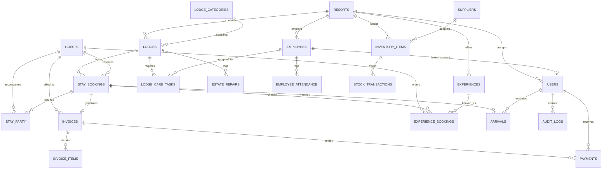
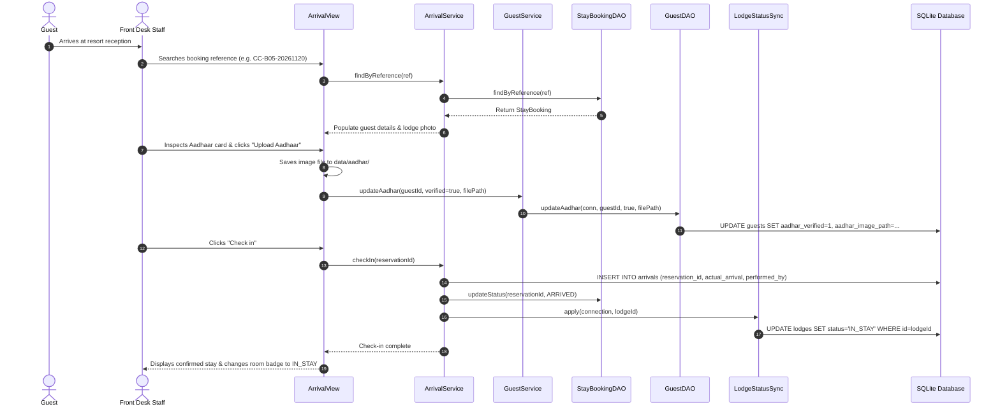
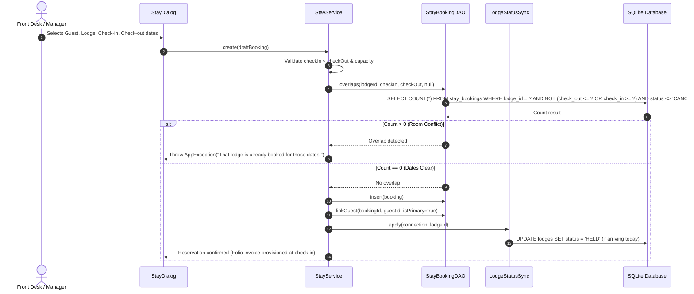

# CoralCove Resort Management System (PMS) — Complete Technical Documentation

> **Target Audience:** Developers, Software Engineers, and Academic Evaluators.  
> **Document Goal:** Provide an exhaustive, ground-up technical specification of the entire CoralCove codebase. After reading this document, any developer or evaluator will fully understand every architectural pattern, database entity, relational constraint, service layer algorithm, UI component, security mechanism, and operational workflow in the application.

---

## Table of Contents
1. [Executive Overview & System Architecture](#1-executive-overview--system-architecture)
2. [Technology Stack & Runtime Specifications](#2-technology-stack--runtime-specifications)
3. [Project Directory & Package Structure](#3-project-directory--package-structure)
4. [Complete Database Architecture & Schema Specification](#4-complete-database-architecture--schema-specification)
   - [4.1 Database Engine & Transaction Management](#41-database-engine--transaction-management)
   - [4.2 Database Migration Framework](#42-database-migration-framework)
   - [4.3 Entity-Relationship (ER) Diagram](#43-entity-relationship-er-diagram)
   - [4.4 Detailed Table Catalog & Relational Schema](#44-detailed-table-catalog--relational-schema)
5. [Domain Model & Entity Reference (`coralcove.model`)](#5-domain-model--entity-reference-coralcovemodel)
6. [Data Access Object (DAO) Catalog & SQL Layer (`coralcove.dao`)](#6-data-access-object-dao-catalog--sql-layer-coralcovedao)
7. [Service & Business Logic Layer (`coralcove.service`)](#7-service--business-logic-layer-coralcoveservice)
   - [7.1 Service Catalog & API Breakdown](#71-service-catalog--api-breakdown)
   - [7.2 Core Business Rules & Invariants](#72-core-business-rules--invariants)
8. [User Interface Architecture & View Catalog (`coralcove.ui`)](#8-user-interface-architecture--view-catalog-coralcoveui)
   - [8.1 JavaFX Application Lifecycle & Desktop Shell](#81-javafx-application-lifecycle--desktop-shell)
   - [8.2 UI Screens & View Breakdown](#82-ui-screens--view-breakdown)
   - [8.3 Modal Dialogs & Specialized Components](#83-modal-dialogs--specialized-components)
   - [8.4 UI Helpers, Asynchronous Threading & Rendering Utilities](#84-ui-helpers-asynchronous-threading--rendering-utilities)
9. [Security, Cryptography & Role-Based Access Control (RBAC)](#9-security-cryptography--role-based-access-control-rbac)
10. [Utilities, Export Engines & Formatting (`coralcove.util`)](#10-utilities-export-engines--formatting-coralcoveutil)
11. [End-to-End Operational Workflows & Sequence Diagrams](#11-end-to-end-operational-workflows--sequence-diagrams)
12. [Exam & Viva Technical Defense Guide](#12-exam--viva-technical-defense-guide)
13. [Setup, Execution & Deployment Runbook](#13-setup-execution--deployment-runbook)

---

## 1. Executive Overview & System Architecture

### 1.1 Business Domain
**CoralCove** is a luxury desktop **Property Management System (PMS)** and Resort Operations Platform designed for multi-property resort groups (featuring beach, lagoon, cliff, and garden properties). It integrates:
- Front-desk operations: Guest reservations, room inventory, rate calculation, Aadhaar KYC compliance verification, walk-in handling, and check-in / check-out processing.
- Point-of-Sale (POS) & Amenities: Curated excursions, wellness spa therapies, in-room dining, and restaurant billings.
- Folio Billing: Automated itemized invoice creation, payment recording (Cash, Card, UPI, Bank Transfer), tax computations, and balance reconciliation.
- Housekeeping & Estate Maintenance: Lodge turnover tasks, room status auto-synchronization, and defect work orders.
- Staff & Operations: Employee records, department-based attendance, and resort manager shift handovers.
- Reporting: Daily revenue run-rates, room type occupancy trends, guest lifetime spend tracking, inventory levels, and CSV/PDF export capabilities.

### 1.2 Architectural Pattern: Layered Clean Architecture
The application enforces strict unidirectional dependencies following a classic four-tier Clean Architecture:

```
+-------------------------------------------------------------------------+
|                        PRESENTATION LAYER (JavaFX)                      |
|  Views (Dashboard, Stays, Billing, etc.), Dialogs, TopBar, Sidebar, Fx  |
+-------------------------------------------------------------------------+
                                    |
                                    v
+-------------------------------------------------------------------------+
|                         SERVICE / BUSINESS LAYER                        |
|  StayService, BillingService, LodgeCareService, LodgeStatusSync, etc.   |
|  - Enforces transactions, invariants, RBAC checks, rate math            |
+-------------------------------------------------------------------------+
                                    |
                                    v
+-------------------------------------------------------------------------+
|                        DATA ACCESS OBJECT (DAO) LAYER                   |
|  StayBookingDAO, InvoiceDAO, GuestDAO, LodgeDAO, ReportDAO, Jdbc        |
|  - Pure JDBC queries, mapping ResultSets to strongly typed Models       |
+-------------------------------------------------------------------------+
                                    |
                                    v
+-------------------------------------------------------------------------+
|                       PERSISTENCE LAYER (SQLite 3)                      |
|  DatabaseManager, Connection Pool, DDL, WAL Mode, Foreign Key Checks   |
+-------------------------------------------------------------------------+
```

### 1.3 Key Architectural Invariants
1. **No Business Logic in Views**: UI classes only handle event wiring and rendering. All data mutations, rate quotes, and state transitions route through the Service layer.
2. **Explicit Transaction Boundaries**: All multi-statement write operations run through `Transactions.in(connection -> { ... })`. If any exception occurs, the transaction is automatically rolled back.
3. **Threading Isolation**: Long-running database operations run on background threads via `Fx.run(...)`, and UI mutations are safely dispatched back to the JavaFX Application Thread (`Platform.runLater`).
4. **Immutable Monetary Arithmetic**: All currency calculations strictly use `BigDecimal` with `HALF_UP` rounding to 2 decimal places via the `Money` utility, eliminating floating-point rounding errors.

---

## 2. Technology Stack & Runtime Specifications

| Layer / Concern | Technology | Version | Purpose |
| :--- | :--- | :--- | :--- |
| **Language** | Java (JDK) | **21 (LTS)** | Records, sealed interfaces, pattern matching, switch expressions, text blocks. |
| **GUI Framework** | OpenJFX (`javafx-controls`) | **21.0.6** | Modern desktop UI with hardware-accelerated scene graph and CSS styling. |
| **Embedded Database** | SQLite (via `sqlite-jdbc`) | **3.49.1.0** | Serverless, zero-config relational database with ACID guarantees. |
| **Cryptography** | Pure Java Cryptography (`javax.crypto`) | Built-in (JDK 21) | PBKDF2-HMAC-SHA256 (210,000 rounds) for salted password hashing. |
| **PDF Generation** | Custom Native Engine (`PDFGenerator`) | Custom built | Zero-dependency generation of valid PDF 1.4 documents and Java AWT Print API integration. |
| **Data Export** | Custom CSV Engine (`CSVExporter`) | Custom built | RFC 4180 compliant CSV stream generation with automatic delimiter escaping. |
| **Build & Packaging** | Apache Maven | **3.8+** | Dependency management, compilation, and `javafx-maven-plugin` execution. |
| **Testing** | JUnit 5 Jupiter | **5.11.4** | Automated unit and integration testing suite. |

---

## 3. Project Directory & Package Structure

```
coralcovejavafx/
├── data/                                 # Runtime persistent storage
│   ├── coralcove.db                      # SQLite relational database file
│   ├── aadhar/                           # Uploaded guest Aadhaar identification documents
│   └── avatars/                          # Uploaded employee/owner profile avatar photos
├── src/
│   ├── main/
│   │   ├── java/coralcove/
│   │   │   ├── Main.java                 # JavaFX Application entrypoint, lifecycle, splash & DB init
│   │   │   ├── config/
│   │   │   │   └── AppConfig.java        # Central application configurations, constants, and paths
│   │   │   ├── database/
│   │   │   │   ├── DatabaseInitializer.java # DDL creation, initial schema seeding, system admin setup
│   │   │   │   ├── DatabaseManager.java  # Connection factory, SQLite PRAGMA configuration, lifecycle
│   │   │   │   ├── DatabaseMigration.java# Version-tracked schema migrations (v1 -> v2)
│   │   │   │   └── Transactions.java     # Transaction wrapper with automated commit/rollback
│   │   │   ├── model/                    # Domain model entities and business enums
│   │   │   ├── dao/                      # Data Access Objects executing parameterized SQL queries
│   │   │   ├── service/                  # Business logic services, validators, coordinators
│   │   │   ├── ui/                       # Presentation layer: Shell, views, dialogs, styling
│   │   │   │   ├── arrivals/             # Fast check-in/out desk and Aadhaar verification UI
│   │   │   │   ├── billing/              # Invoice folios, itemized charges, and payment modal UI
│   │   │   │   ├── dashboard/            # Executive KPI metrics, occupancy bars, and daily cash flow
│   │   │   │   ├── employees/            # Staff directory, designations, and attendance ledger
│   │   │   │   ├── experiences/          # Dining, spa, excursion catalogs and order trackers
│   │   │   │   ├── guests/               # Guest CRM, VIP tags, Aadhaar document previews
│   │   │   │   ├── inventory/            # Resort stores, SKU stock management, adjustments
│   │   │   │   ├── lodgecare/            # Housekeeping tasks and maintenance defect logs
│   │   │   │   ├── lodges/               # Lodge unit catalog, zones, view aspects, status controls
│   │   │   │   ├── reports/              # Analytical reporting with PDF/CSV export
│   │   │   │   ├── settings/             # Multi-resort configuration, profile management, demo resets
│   │   │   │   └── stays/                # Comprehensive reservation calendar and bookings grid
│   │   │   └── util/                     # Cross-cutting utilities (Security, Money, Dates, PDF, CSV)
│   │   └── resources/coralcove/
│   │       ├── theme.css                 # Master luxury CSS stylesheet (gold & deep slate palette)
│   │       └── media/                    # Bundled graphics (avatars, sample IDs, zone photos)
│   └── test/java/coralcove/              # Automated test suites (Auth, Seed, Migration, Rules)
├── pom.xml                               # Maven project definition and build configuration
└── doc.md                                # Comprehensive system documentation
```

---

## 4. Complete Database Architecture & Schema Specification

### 4.1 Database Engine & Transaction Management
The persistence tier runs on **SQLite 3** via the `org.xerial:sqlite-jdbc` driver.
- **Connection String**: `jdbc:sqlite:<Path-to-data/coralcove.db>`
- **Environment Override**: The `CORALCOVE_DB` environment variable can override the database location (crucial for staging and CI/CD).
- **Enforced PRAGMAs**:
  - `PRAGMA foreign_keys = ON;`: Enforces referential integrity at the engine level.
  - `PRAGMA busy_timeout = 5000;`: Waits up to 5 seconds for lock release during concurrent read/write operations before throwing `SQLITE_BUSY`.
- **Atomic Transaction Runner (`Transactions.java`)**:
  ```java
  public static <T> T in(Work<T> work) {
      try (Connection connection = DatabaseManager.getConnection()) {
          boolean previous = connection.getAutoCommit();
          connection.setAutoCommit(false);
          try {
              T result = work.run(connection);
              connection.commit();
              return result;
          } catch (Exception ex) {
              connection.rollback();
              throw ex;
          } finally {
              connection.setAutoCommit(previous);
          }
      }
  }
  ```

### 4.2 Database Migration Framework
Database evolution is controlled by `DatabaseMigration.java` using a dedicated `schema_version` table:
- **Version 1**: Initial creation of 20 core tables (resorts, lodges, stays, invoices, guests, staff, inventory).
- **Version 2**: Non-destructive schema extension introducing user profile fields (`display_name`, `email`, `phone`, `avatar_path`) and guest KYC fields (`aadhar_verified`, `aadhar_image_path`).

### 4.3 Entity-Relationship (ER) Diagram



### 4.4 Detailed Table Catalog & Relational Schema

Below is the complete catalog of all 23 database tables (22 domain tables defined in `DatabaseInitializer` + 1 schema version migration table defined in `DatabaseMigration`):

#### 1. `schema_version`
Tracks applied database migration levels.
- `version` (`INTEGER PRIMARY KEY`): Migration version identifier (e.g., 1, 2).
- `applied_at` (`TEXT NOT NULL`): UTC timestamp string when migration was committed.

#### 2. `group_settings`
Global key-value configuration repository.
- `key` (`TEXT PRIMARY KEY`): Setting key (e.g., `'demo_loaded'`).
- `value` (`TEXT NOT NULL`): Serialized configuration value.

#### 3. `resorts`
Multi-property resort registry.
- `id` (`INTEGER PRIMARY KEY`): Unique surrogate ID.
- `name` (`TEXT NOT NULL UNIQUE`): Property title (e.g., "CoralCove Beach", "CoralCove Cliff").
- `location` (`TEXT NOT NULL`): Geographic city / destination.
- `coastline` (`TEXT`): Coastal region (e.g., "Malabar coast").
- `timezone` (`TEXT NOT NULL`): IANA timezone identifier (e.g., `'Asia/Kolkata'`).
- `tax_percent` (`TEXT NOT NULL`): Tax percentage applied to stays/services (e.g., `'12'`).
- `active` (`INTEGER NOT NULL DEFAULT 1`): 1 if operational, 0 if disabled.
- `is_sample` (`INTEGER NOT NULL DEFAULT 0`): Flag indicating demo seed record.

#### 4. `lodge_categories`
Room tier taxonomy.
- `id` (`INTEGER PRIMARY KEY`): Category ID.
- `name` (`TEXT NOT NULL UNIQUE`): Name (e.g., 'Pool Villa', 'Beach Cottage', 'Garden Suite', 'Cliff Cabin').
- `description` (`TEXT`): Detailed architectural blurb and feature highlights.

#### 5. `lodges`
Physical accommodation inventory.
- `id` (`INTEGER PRIMARY KEY`): Lodge surrogate ID.
- `resort_id` (`INTEGER NOT NULL`): FK to `resorts(id)`.
- `unit_code` (`TEXT NOT NULL`): Door/room code (e.g., 'B01', 'L05', 'C02').
- `zone` (`TEXT NOT NULL CHECK(zone IN ('BEACH','LAGOON','GARDEN','CLIFF'))`): Architectural zone.
- `view_aspect` (`TEXT NOT NULL CHECK(view_aspect IN ('SEA','GARDEN','POOL'))`): Primary scenic orientation.
- `lodge_category_id` (`INTEGER NOT NULL`): FK to `lodge_categories(id)`.
- `bed_config` (`TEXT`): Bed specification (e.g., '1 King', '2 Twin').
- `max_guests` (`INTEGER NOT NULL`): Maximum legal guest capacity.
- `price_per_night` (`TEXT NOT NULL`): Base rack rate per night as scale-2 string.
- `description` (`TEXT`): Marketing description.
- `amenities` (`TEXT`): Comma-separated amenity list.
- `status` (`TEXT NOT NULL CHECK(status IN ('READY','IN_STAY','HELD','TURNDOWN','REPAIR','CLOSED'))`): Operational housekeeping & reservation state.
- `is_sample` (`INTEGER NOT NULL DEFAULT 0`): Demo flag.
- *Constraints*: `UNIQUE (resort_id, unit_code)`.
- *Indexes*: `idx_rooms_number` on `unit_code`, `idx_rooms_status` on `status`.

#### 6. `guests`
Customer Relationship Management (CRM) directory.
- `id` (`INTEGER PRIMARY KEY`): Guest ID.
- `full_name` (`TEXT NOT NULL`): Primary name of guest.
- `phone` (`TEXT`): Contact phone number.
- `email` (`TEXT`): Email address.
- `gender` (`TEXT`): Optional gender identifier.
- `nationality` (`TEXT`): Nationality for regulatory reporting.
- `address` (`TEXT`): Residential address.
- `id_doc_type` (`TEXT`): Document classification ('Aadhaar', 'Passport', etc.).
- `id_doc_number` (`TEXT`): Masked or full government ID number.
- `preferences` (`TEXT`): Special requirements, dietary restrictions, allergies.
- `vip` (`TEXT NOT NULL DEFAULT 'STANDARD' CHECK(vip IN ('STANDARD','VIP'))`): VIP tier status.
- `registered_on` (`TEXT NOT NULL`): ISO registration date.
- `aadhar_verified` (`INTEGER NOT NULL DEFAULT 0`): 1 if verified via Aadhaar KYC check.
- `aadhar_image_path` (`TEXT`): Relative path to stored Aadhaar scan in `data/aadhar/` or resource bundle.
- `is_sample` (`INTEGER NOT NULL DEFAULT 0`): Demo flag.
- *Indexes*: `idx_guests_phone` on `phone`.

#### 7. `stay_bookings`
Core reservation contracts.
- `id` (`INTEGER PRIMARY KEY`): Booking surrogate ID.
- `booking_reference` (`TEXT NOT NULL UNIQUE`): Human-readable reservation code (e.g., `'CC-B01-20261120'`).
- `resort_id` (`INTEGER NOT NULL`): FK to `resorts(id)`.
- `guest_id` (`INTEGER NOT NULL`): FK to `guests(id)` (Primary guest).
- `lodge_id` (`INTEGER NOT NULL`): FK to `lodges(id)`.
- `check_in` (`TEXT NOT NULL`): Expected arrival date (`YYYY-MM-DD`).
- `check_out` (`TEXT NOT NULL`): Expected departure date (`YYYY-MM-DD`).
- `adults` (`INTEGER NOT NULL`): Number of adult guests.
- `children` (`INTEGER NOT NULL DEFAULT 0`): Number of child guests.
- `nights` (`INTEGER NOT NULL`): Duration of stay in calendar nights.
- `room_price` (`TEXT NOT NULL`): Base room rate total before discount/tax.
- `discount` (`TEXT NOT NULL`): Lump-sum discount amount.
- `tax` (`TEXT NOT NULL`): Computed tax based on resort's `tax_percent`.
- `total` (`TEXT NOT NULL`): Net contract value (`(room_price - discount) + tax`).
- `source` (`TEXT NOT NULL CHECK(source IN ('WALK_IN','WEBSITE','PHONE','TRAVEL_AGENT'))`): Channel of booking.
- `meal_plan` (`TEXT NOT NULL CHECK(meal_plan IN ('EP','CP','MAP','AP'))`): European, Continental, Modified American, or American Plan.
- `transfer` (`TEXT NOT NULL CHECK(transfer IN ('NONE','AIRPORT','JETTY'))`): Transportation transfer booking.
- `status` (`TEXT NOT NULL CHECK(status IN ('PENDING','CONFIRMED','ARRIVED','DEPARTED','CANCELLED','NO_SHOW'))`): Stay lifecycle state.
- `special_requests` (`TEXT`): Notes from guest.
- `created_at` (`TEXT NOT NULL`): Timestamp of creation.
- `is_sample` (`INTEGER NOT NULL DEFAULT 0`): Demo flag.
- *Indexes*: `idx_res_ref`, `idx_res_guest`, `idx_res_room`, `idx_res_in`, `idx_res_out`, `idx_res_status`.

#### 8. `stay_party`
Many-to-many relationship mapping additional party members to a booking.
- `reservation_id` (`INTEGER NOT NULL`): FK to `stay_bookings(id)`.
- `guest_id` (`INTEGER NOT NULL`): FK to `guests(id)`.
- `is_primary` (`INTEGER NOT NULL DEFAULT 0`): 1 if lead guest.
- *Primary Key*: `(reservation_id, guest_id)`.

#### 9. `arrivals`
Front-desk arrival/departure execution record.
- `id` (`INTEGER PRIMARY KEY`): Arrival ID.
- `reservation_id` (`INTEGER NOT NULL UNIQUE`): FK to `stay_bookings(id)`.
- `actual_arrival` (`TEXT NOT NULL`): Timestamp when guest arrived at front desk.
- `actual_departure` (`TEXT`): Timestamp when guest checked out.
- `performed_by` (`INTEGER`): FK to `users(id)` (Staff member executing action).

#### 10. `invoices`
Master billing folio.
- `id` (`INTEGER PRIMARY KEY`): Invoice ID.
- `invoice_number` (`TEXT NOT NULL UNIQUE`): Standard folio code (e.g., `'INV-CC-B01-20261120'`).
- `reservation_id` (`INTEGER NOT NULL`): FK to `stay_bookings(id)`.
- `guest_id` (`INTEGER NOT NULL`): FK to `guests(id)`.
- `subtotal` (`TEXT NOT NULL`): Sum of all attached `invoice_items`.
- `discount` (`TEXT NOT NULL`): Manual concession applied to total.
- `tax` (`TEXT NOT NULL`): Calculated tax amount.
- `total` (`TEXT NOT NULL`): Final payable amount (`(subtotal - discount) + tax`).
- `amount_paid` (`TEXT NOT NULL`): Cumulative sum of all accepted payments.
- `balance` (`TEXT NOT NULL`): Outstanding balance (`total - amount_paid`).
- `status` (`TEXT NOT NULL CHECK(status IN ('UNPAID','PARTIALLY_PAID','PAID','REFUNDED'))`): Payment status.
- `issued_at` (`TEXT NOT NULL`): Date/time issued.
- `is_sample` (`INTEGER NOT NULL DEFAULT 0`): Demo flag.

#### 11. `invoice_items`
Itemized line-item charges within a folio.
- `id` (`INTEGER PRIMARY KEY`): Item ID.
- `invoice_id` (`INTEGER NOT NULL`): FK to `invoices(id)`.
- `kind` (`TEXT NOT NULL CHECK(kind IN ('ROOM','RESTAURANT','LAUNDRY','MINIBAR','MISC'))`): Accounting classification.
- `description` (`TEXT NOT NULL`): Line item description.
- `qty` (`INTEGER NOT NULL`): Quantity billed.
- `unit_price` (`TEXT NOT NULL`): Price per unit.
- `line_total` (`TEXT NOT NULL`): Computed line sum (`qty * unit_price`).

#### 12. `payments`
Fiscal payment receipts.
- `id` (`INTEGER PRIMARY KEY`): Payment ID.
- `invoice_id` (`INTEGER NOT NULL`): FK to `invoices(id)`.
- `amount` (`TEXT NOT NULL`): Tendered payment amount.
- `method` (`TEXT NOT NULL CHECK(method IN ('CASH','CARD','UPI','BANK_TRANSFER'))`): Financial instrument.
- `reference` (`TEXT NOT NULL UNIQUE`): Transaction reference / UTR / receipt code.
- `paid_at` (`TEXT NOT NULL`): Payment execution timestamp.
- `received_by` (`INTEGER`): FK to `users(id)` (Staff member collecting funds).
- `note` (`TEXT`): Remarks or terminal authorization code.
- *Indexes*: `idx_pay_ref` on `reference`.

#### 13. `experiences`
Catalog of resort activities, spa offerings, and dining items.
- `id` (`INTEGER PRIMARY KEY`): Experience ID.
- `resort_id` (`INTEGER NOT NULL`): FK to `resorts(id)`.
- `name` (`TEXT NOT NULL`): Title (e.g., 'Sunset cruise', 'Ayurveda hour', 'Dinner thali').
- `category` (`TEXT NOT NULL`): 'Spa', 'Water', 'Excursion', 'Dining', 'Laundry', 'Minibar'.
- `price` (`TEXT NOT NULL`): Standard tariff.
- `active` (`INTEGER NOT NULL DEFAULT 1`): Catalog visibility.

#### 14. `experience_bookings`
Active guest orders and service bookings.
- `id` (`INTEGER PRIMARY KEY`): Order ID.
- `experience_id` (`INTEGER`): FK to `experiences(id)`.
- `reservation_id` (`INTEGER`): FK to `stay_bookings(id)` (Optional link for folio chargeback).
- `guest_id` (`INTEGER`): FK to `guests(id)`.
- `lodge_id` (`INTEGER`): FK to `lodges(id)` (For in-room delivery).
- `order_type` (`TEXT NOT NULL CHECK(order_type IN ('RESTAURANT','ROOM_SERVICE'))`): Service channel.
- `description` (`TEXT NOT NULL`): Order summary.
- `qty` (`INTEGER NOT NULL`): Quantity ordered.
- `unit_price` (`TEXT NOT NULL`): Unit price at time of order.
- `line_total` (`TEXT NOT NULL`): Total charged (`qty * unit_price`).
- `status` (`TEXT NOT NULL CHECK(status IN ('NEW','PREPARING','READY','SERVED','CANCELLED'))`): Order fulfillment pipeline.
- `slot_at` (`TEXT`): Scheduled time for activity.
- `invoice_item_id` (`INTEGER`): FK to `invoice_items(id)` once posted to room folio.
- `created_at` (`TEXT NOT NULL`): Order creation timestamp.
- `is_sample` (`INTEGER NOT NULL DEFAULT 0`): Demo flag.

#### 15. `lodge_care_tasks`
Housekeeping and room preparation tickets.
- `id` (`INTEGER PRIMARY KEY`): Task ID.
- `lodge_id` (`INTEGER NOT NULL`): FK to `lodges(id)`.
- `assignee_employee_id` (`INTEGER`): FK to `employees(id)` (Assigned attendant).
- `priority` (`TEXT NOT NULL CHECK(priority IN ('LOW','NORMAL','HIGH'))`): Task urgency.
- `status` (`TEXT NOT NULL CHECK(status IN ('PENDING','ASSIGNED','IN_PROGRESS','COMPLETED','INSPECTION_REQUIRED'))`): Housekeeping state.
- `notes` (`TEXT`): Instructions (e.g., "Replace towels, extra pillows").
- `inspection_status` (`TEXT NOT NULL DEFAULT 'NONE' CHECK(inspection_status IN ('NONE','PASSED','FAILED'))`): Supervisor sign-off.
- `created_at` (`TEXT NOT NULL`): Date created.
- `completed_at` (`TEXT`): Date completed.
- `is_sample` (`INTEGER NOT NULL DEFAULT 0`): Demo flag.

#### 16. `estate_repairs`
Facilities defect and engineering repair log.
- `id` (`INTEGER PRIMARY KEY`): Repair record ID.
- `lodge_id` (`INTEGER NOT NULL`): FK to `lodges(id)`.
- `reported_by` (`TEXT`): Reporter name or role.
- `description` (`TEXT NOT NULL`): Defect details (e.g., 'Air conditioning leaking', 'Deck board loose').
- `status` (`TEXT NOT NULL CHECK(status IN ('OPEN','IN_PROGRESS','RESOLVED'))`): Engineering state.
- `created_at` (`TEXT NOT NULL`): Defect report date.
- `is_sample` (`INTEGER NOT NULL DEFAULT 0`): Demo flag.

#### 17. `suppliers`
Vendor address book for resort inventory.
- `id` (`INTEGER PRIMARY KEY`): Supplier ID.
- `name` (`TEXT NOT NULL`): Vendor commercial name.
- `phone` (`TEXT`): Contact phone number.
- `email` (`TEXT`): Vendor contact email.
- `notes` (`TEXT`): Delivery terms, payment schedules.
- `is_sample` (`INTEGER NOT NULL DEFAULT 0`): Demo flag.

#### 18. `inventory_items`
Warehouse and linen/amenity stock catalog.
- `id` (`INTEGER PRIMARY KEY`): Item ID.
- `resort_id` (`INTEGER NOT NULL`): FK to `resorts(id)`.
- `sku` (`TEXT NOT NULL`): Stock Keeping Unit code (e.g., 'LIN-001', 'SPA-OIL-02').
- `name` (`TEXT NOT NULL`): Item name.
- `category` (`TEXT NOT NULL`): Stock category ('Linen', 'Toiletries', 'F&B', 'Cleaning').
- `supplier_id` (`INTEGER`): FK to `suppliers(id)`.
- `quantity` (`INTEGER NOT NULL`): Current on-hand balance.
- `min_quantity` (`INTEGER NOT NULL`): Low-stock reorder threshold.
- `unit` (`TEXT`): Measurement unit ('pcs', 'bottles', 'kg').
- `is_sample` (`INTEGER NOT NULL DEFAULT 0`): Demo flag.
- *Constraints*: `UNIQUE (resort_id, sku)`.

#### 19. `stock_transactions`
Auditable inventory movement ledger.
- `id` (`INTEGER PRIMARY KEY`): Transaction ID.
- `item_id` (`INTEGER NOT NULL`): FK to `inventory_items(id)`.
- `qty_delta` (`INTEGER NOT NULL`): Positive for stock-in, negative for consumption.
- `reason` (`TEXT NOT NULL CHECK(reason IN ('PURCHASE','ADJUSTMENT','CONSUMPTION'))`): Movement cause.
- `note` (`TEXT`): Reference po number or requisition notes.
- `created_at` (`TEXT NOT NULL`): Transaction date.

#### 20. `employees`
Human resources roster.
- `id` (`INTEGER PRIMARY KEY`): Employee ID.
- `resort_id` (`INTEGER NOT NULL`): FK to `resorts(id)`.
- `name` (`TEXT NOT NULL`): Full name.
- `phone` (`TEXT`): Phone number.
- `email` (`TEXT`): Email address.
- `designation` (`TEXT`): Official job title (e.g., 'Front office lead', 'Housekeeping supervisor').
- `department` (`TEXT NOT NULL`): 'Reception', 'Housekeeping', 'F&B', 'Maintenance', 'Accounts'.
- `salary` (`TEXT NOT NULL DEFAULT '0.00'`): Monthly compensation as string.
- `joining_date` (`TEXT`): Date hired.
- `status` (`TEXT NOT NULL DEFAULT 'ACTIVE' CHECK(status IN ('ACTIVE','INACTIVE'))`): Employment standing.
- `is_sample` (`INTEGER NOT NULL DEFAULT 0`): Demo flag.

#### 21. `employee_attendance`
Daily duty register.
- `id` (`INTEGER PRIMARY KEY`): Record ID.
- `employee_id` (`INTEGER NOT NULL`): FK to `employees(id)`.
- `work_date` (`TEXT NOT NULL`): Work date (`YYYY-MM-DD`).
- `status` (`TEXT NOT NULL CHECK(status IN ('PRESENT','ABSENT','LEAVE'))`): Attendance state.
- `note` (`TEXT`): Shift notes or leave reason.
- *Constraints*: `UNIQUE (employee_id, work_date)`.

#### 22. `users`
System accounts and security credentials.
- `id` (`INTEGER PRIMARY KEY`): User account ID.
- `username` (`TEXT NOT NULL UNIQUE`): Alphanumeric login identifier.
- `password_hash` (`TEXT NOT NULL`): Salted PBKDF2 hash (`pbkdf2$210000$<salt>$<hash>`).
- `role` (`TEXT NOT NULL CHECK(role IN ('ADMIN','MANAGER','FRONT_DESK','ATTENDANT'))`): Security role.
- `employee_id` (`INTEGER`): Optional FK to `employees(id)`.
- `resort_id` (`INTEGER`): Optional FK to `resorts(id)` (Restricts user to specific property).
- `must_change_password` (`INTEGER NOT NULL DEFAULT 0`): Forces password reset on next login.
- `active` (`INTEGER NOT NULL DEFAULT 1`): Account status flag.
- `created_at` (`TEXT NOT NULL`): Account creation date.
- `display_name` (`TEXT`): Full human display name (e.g., 'Aniket Sharma (Owner)').
- `email` (`TEXT`): User email address.
- `phone` (`TEXT`): User telephone contact.
- `avatar_path` (`TEXT`): Avatar filename in `data/avatars/` or preset resource name (`avatar-owner.png`).

#### 23. `audit_logs`
System-wide immutable security audit trail.
- `id` (`INTEGER PRIMARY KEY`): Log event ID.
- `user_id` (`INTEGER`): FK to `users(id)` who initiated the action.
- `action` (`TEXT NOT NULL`): Action code (e.g., 'CREATE_RESERVATION', 'CHECK_IN', 'TAKE_PAYMENT').
- `entity` (`TEXT NOT NULL`): Entity affected (e.g., 'StayBooking', 'Invoice', 'Lodge').
- `entity_id` (`TEXT`): Identifier of affected entity.
- `detail` (`TEXT`): Contextual message or delta description.
- `created_at` (`TEXT NOT NULL`): Timestamp of audit event.

---

## 5. Domain Model & Entity Reference (`coralcove.model`)

Every database entity corresponds to a strongly typed Java domain object in `coralcove.model`.

### 5.1 Enums & Business Classifications
- `Role`: Security levels:
  - `ADMIN`: System Owner / Superuser. Unrestricted access to all modules, financial metrics, and multi-resort switcher.
  - `MANAGER`: Property Manager. Access to all operational modules, reporting, and staff management; cannot edit core system settings.
  - `FRONT_DESK`: Receptionist. Restricted to Guest check-ins, reservations, folios, room status view, and experience bookings; cannot delete rooms or alter employee payroll.
  - `ATTENDANT`: Housekeeper / Maintenance technician. Restricted strictly to Dashboard metrics and Lodge Care housekeeping tasks.
- `AppModule`: Application screen identifiers (`DASHBOARD`, `STAYS`, `LODGES`, `GUESTS`, `ARRIVALS`, `BILLING`, `LODGE_CARE`, `EXPERIENCES`, `EMPLOYEES`, `INVENTORY`, `REPORTS`, `SETTINGS`).
- `LodgeStatus`: Physical room states:
  - `READY`: Clean, inspected, and ready for immediate guest arrival.
  - `IN_STAY`: Occupied by currently registered guests.
  - `HELD`: Reserved for an upcoming confirmed stay arriving today.
  - `TURNDOWN`: Guest checked out; requires housekeeping sanitization and linen change.
  - `REPAIR`: Blocked due to maintenance defect or facility repair.
  - `CLOSED`: Off-market for seasonal closure or deep renovation.
- `StayStatus`: Lifecycle stages of a reservation:
  - `PENDING` -> `CONFIRMED` -> `ARRIVED` -> `DEPARTED` (or `CANCELLED` / `NO_SHOW`).
- `InvoiceStatus`: Folio settlement states:
  - `UNPAID` (`balance == total`)
  - `PARTIALLY_PAID` (`0 < amount_paid < total`)
  - `PAID` (`balance <= 0`)
  - `REFUNDED`
- `PaymentMethod`: `CASH`, `CARD`, `UPI`, `BANK_TRANSFER`.
- `BookingSource`: `WALK_IN`, `WEBSITE`, `PHONE`, `TRAVEL_AGENT`.

### 5.2 Key Domain Classes
- `User`: Encapsulates identity, role, credentials, and profile. Provides `getEffectiveName()` which falls back to `displayName` -> `username` -> `"User"`.
- `StayBooking`: Encapsulates reservation dates, guest ID, lodge ID, party sizes, financial calculations (`roomPrice`, `discount`, `tax`, `total`), meal plans, and transfers.
- `Guest`: Encapsulates guest profile data, contact details, VIP designation, and Aadhaar KYC metadata (`aadharVerified`, `aadharImagePath`).
- `Lodge`: Encapsulates room inventory, zone, view, maximum guests, rack rate, amenities, and current status.
- `Invoice`: Encapsulates the master folio, linked reservation ID, guest ID, calculated subtotal, discounts, tax, total paid, and live balance.
- `Payment`: Encapsulates individual financial receipts with unique transaction references.

---

## 6. Data Access Object (DAO) Catalog & SQL Layer (`coralcove.dao`)

The DAO layer abstracts all raw SQL statement preparation and `ResultSet` mapping. Every DAO accepts an active `java.sql.Connection` object, allowing calling Services to orchestrate multiple DAO calls inside atomic transactions.

| DAO Class | Method Signature | Primary SQL Operation & Logic |
| :--- | :--- | :--- |
| **`UserDAO`** | `findByUsername(conn, username)` | `SELECT ... FROM users WHERE username = ?` |
| | `findById(conn, id)` | `SELECT ... FROM users WHERE id = ?` |
| | `list(conn)` | `SELECT ... FROM users ORDER BY id` |
| | `insert(conn, user)` | Inserts new user record, returning generated surrogate key. |
| | `updatePassword(conn, id, hash, mustChange)` | `UPDATE users SET password_hash = ?, must_change_password = ? WHERE id = ?` |
| | `updateProfile(conn, id, name, email, phone, avatar)` | `UPDATE users SET display_name = ?, email = ?, phone = ?, avatar_path = ? WHERE id = ?` |
| **`GuestDAO`** | `findById(conn, id)` | Fetches single guest record by ID. |
| | `search(conn, text)` | `SELECT ... FROM guests WHERE full_name LIKE ? OR phone LIKE ? OR email LIKE ?` |
| | `insert(conn, guest)` | Inserts new guest, returning generated ID. |
| | `update(conn, guest)` | Updates guest profile, document details, VIP status, and Aadhaar flags. |
| | `updateAadhar(conn, id, verified, path)` | Direct fast update of Aadhaar verification flag and image path. |
| | `countReservations(conn, guestId)` | `SELECT COUNT(*) FROM stay_bookings WHERE guest_id = ?` (guarantees safe deletion). |
| | `delete(conn, id)` | Deletes guest if no bookings exist. |
| **`LodgeDAO`** | `types(conn)` | `SELECT ... FROM lodge_categories ORDER BY id` |
| | `search(conn, text, zone, typeId, status)` | Dynamic SQL builder filtering by unit code, zone, category, and status. |
| | `findById(conn, id)` | Fetches complete lodge details by ID. |
| | `insert(conn, lodge)` | Inserts new physical lodge record. |
| | `update(conn, lodge)` | Updates unit code, zone, view, price, and amenities. |
| | `updateStatus(conn, id, status)` | `UPDATE lodges SET status = ? WHERE id = ?` *(Vacancy check orchestrated in `LodgeService.availableForStay`)* |
| **`StayBookingDAO`** | `overlaps(conn, lodgeId, in, out, excludeId)` | **Critical Room Booking Rule**: Validates date collisions (`NOT (check_out <= in OR check_in >= out)`). |
| | `insert(conn, reservation)` | Inserts booking contract with unique reference code. |
| | `update(conn, reservation)` | Modifies dates, party count, prices, and transfer choices. |
| | `updateStatus(conn, id, status)` | Transitions booking status (`CONFIRMED`, `ARRIVED`, etc.). |
| | `linkGuest(conn, resId, guestId, primary)`| Inserts into `stay_party` junction table. |
| | `findByReference(conn, ref)` | Looks up booking by reference code (used during front desk check-in). |
| | `search(conn, ref, guest, from, to, status)`| Multi-parameter search across reservations with date range filtering. |
| **`InvoiceDAO`** | `findByReservation(conn, resId)` | Finds master folio linked to a booking. |
| | `insert(conn, invoice)` | Generates new invoice folio. |
| | `addItem(conn, invId, kind, desc, qty, price, total)` | Appends line-item charge to folio. |
| | `items(conn, invId)` | Retrieves all itemized charges for an invoice. |
| | `addPayment(conn, payment)` | Records payment receipt and validates unique transaction reference. |
| | `payments(conn, invId)` | Retrieves payment history for an invoice. |
| | `updateTotals(conn, invoice)` | Synchronizes subtotal, tax, paid amount, and outstanding balance. |
| **`LodgeCareDAO`** | `search(conn, status, priority)` | Retrieves housekeeping tasks filtered by urgency and completion status. |
| | `insert(conn, task)` | Schedules a room cleaning ticket. |
| | `update(conn, task)` | Updates housekeeping ticket status and supervisor inspection grade. |
| | `openRepairs(conn)` | Retrieves active estate repair tickets (`OPEN` or `IN_PROGRESS`). |
| | `insertRepair(conn, lodgeId, rep, desc)` | Logs new facilities defect ticket. |
| **`InventoryDAO`** | `search(conn, text, category)` | Searches warehouse stock by SKU/name and category. |
| | `adjust(conn, itemId, delta, reason, note, at)` | Atomically adjusts stock quantity and writes an auditable `stock_transactions` entry. |
| | `history(conn, itemId)` | Retrieves movement history for a given SKU. |
| **`EmployeeDAO`** | `search(conn, text, dept)` | Searches staff directory by name and department. |
| | `markAttendance(conn, empId, date, status, note)` | Inserts or updates daily attendance record (`ON CONFLICT DO UPDATE`). |
| | `attendance(conn, date)` | Returns full attendance roster for a specific calendar date. |
| **`ReportDAO`** | `occupancy(conn, from, to)` | Calculates percentage room occupancy for date windows. |
| | `revenueReport(conn, from, to, grain)` | Aggregates income grouped by Day, Month, or Department. |
| | `outstanding(conn)` | Lists all unpaid and partially paid customer folios. |
| **`AuditDAO`** | `log(conn, userId, act, entity, id, detail)` | Writes immutable audit trail record. |
| **`SettingsDAO`** | `get(conn, key)` / `put(conn, key, val)` | Reads and writes configuration properties in `group_settings`. |

---

## 7. Service & Business Logic Layer (`coralcove.service`)

The Service Layer acts as the transaction coordinator, validator, and enforcer of domain invariants.

### 7.1 Service Catalog & API Breakdown

#### `AuthenticationService`
- `User login(String username, String password)`: Validates credentials using `PasswordHasher.verify`. Rejects inactive accounts and sets the authenticated user into `Session`.
- `void changePassword(long userId, String current, String next)`: Enforces password strength rules, verifies the old password, and updates hash with `must_change_password = 0`.
- `void updateProfile(long userId, String name, String email, String phone, String avatarPath)`: Updates personal info and avatar image reference.
- `void createUser(String username, String password, Role role)`: Validates unique username, hashes password, and creates account.

#### `StayService`
- `StayBooking create(StayBooking draft)`:
  1. Validates that `checkIn` is strictly before `checkOut` and guest count complies with lodge capacity.
  2. Calls `StayBookingDAO.overlaps` to mathematically prove that the target lodge is vacant for all requested nights.
  3. Generates a unique booking reference (`"GS" + YYYYMMDD + "-" + 4-digit random` via `nextReference()`, or standard sample codes like `CC-B01-YYYYMMDD`).
  4. Inserts the booking contract into `stay_bookings` and links the guest via the `stay_party` junction table.
  5. Triggers `LodgeStatusSync.apply` to update room state (e.g., sets room to `HELD` if arrival is scheduled for today).
  *(Note: Master folio invoices are provisioned during front-desk check-in via `ArrivalService.checkIn()` or on-demand via `BillingService.ensureForReservation()`)*.
- `void cancel(long reservationId)`: Sets stay status to `CANCELLED`, adjusts invoice status, and frees the lodge back to `READY`.
- `void markNoShow(long reservationId)`: Flags guest as `NO_SHOW` and releases room hold.

#### `ArrivalService`
- `StayBooking checkIn(long reservationId)`:
  1. Verifies stay is currently `CONFIRMED` or `PENDING`.
  2. Ensures today matches check-in date (or authorized override).
  3. Creates an entry in `arrivals` recording the timestamp and front desk user.
  4. Updates stay status to `ARRIVED`.
  5. Transitions lodge status to `IN_STAY`.
- `StayBooking checkOut(long reservationId)`:
  1. Checks invoice balance; warns or blocks if folio balance is outstanding.
  2. Records `actual_departure` in `arrivals`.
  3. Updates stay status to `DEPARTED`.
  4. Transitions lodge status to `TURNDOWN` (triggering housekeeping alert).

#### `BillingService`
- `Quote quote(BigDecimal roomSubtotal, BigDecimal discount)`: Computes tax and net payable based on resort percentage.
- `Payment takePayment(long invoiceId, BigDecimal amount, PaymentMethod method, String ref, boolean refund)`:
  1. Validates unique reference code.
  2. Adds record to `payments`.
  3. Calls `recalc(connection, invoiceId)` to re-sum all payments and invoice items, dynamically updating invoice status to `PAID` or `PARTIALLY_PAID`.
- `void addCharge(long invoiceId, String kind, String desc, int qty, BigDecimal unitPrice)`: Posts incidentals (room service, spa, laundry) directly to the folio.

#### `LodgeCareService` & `LodgeStatusSync`
- `void create(long lodgeId, Long assigneeId, String priority, String notes)`: Creates housekeeping cleaning order.
- `void update(long taskId, Long assigneeId, String priority, String status, String inspection, String notes)`: Updates task; when marked `COMPLETED` with `PASSED` inspection, invokes `LodgeStatusSync` to automatically transition the lodge from `TURNDOWN` to `READY`.
- `LodgeStatusSync.apply(connection, lodgeId)`: State machine synchronizer. Evaluates open repairs -> current stays -> today's arrivals -> turndown tasks, ensuring the lodge's displayed status always reflects ground truth.

#### `GuestService`
- `void updateAadhar(long guestId, boolean verified, String imagePath)`: Updates guest Aadhaar KYC verification status and document file pointer.
- `GuestHistory history(long guestId)`: Computes lifetime stays and total revenue generated by a guest; automatically upgrades guest to `VIP` if stay count exceeds 3 or spend exceeds ₹50,000.

#### `DashboardService`
- `Snapshot load()`: Executes high-speed aggregate queries via `ReportDAO` to assemble real-time KPI metrics: total lodges, occupied count, today's arrivals, today's departures, turndown queue, daily revenue, and 14-day occupancy trend array.

---

## 8. User Interface Architecture & View Catalog (`coralcove.ui`)

### 8.1 JavaFX Application Lifecycle & Desktop Shell
`Main.java` extends `javafx.application.Application`:
1. **Bootstrapping**: Launches `start(Stage primary)`. Sets minimum window bounds (`1200x750`) and default resolution (`1280x800`).
2. **Theme Injection**: Loads `/coralcove/theme.css` into the master Scene stylesheet collection.
3. **Asynchronous Initializer**: Dispatches `DatabaseManager.init(...)` and database migration to a background thread while displaying a branded splash message.
4. **Authentication Gate**: Renders `LoginView`. Once `AuthenticationService.login` succeeds, transitions stage root to `ShellView` using a smooth fade-in animation (`Fx.fadeIn`).

### 8.2 Desktop Shell Layout (`ShellView.java`)
The application interface uses a responsive `BorderPane`:
- **Top (`TopBar.java`)**: Displays active screen title, multi-resort switcher (for Admins), authenticated User Profile Pill (avatar, name, role badge), password change trigger, and logout button.
- **Left (`Sidebar.java`)**: Vertical navigation rail containing the brand logo and module buttons dynamically filtered by user permissions (`AuthorizationService.allows`).
- **Center (`StackPane` + `ScrollPane`)**: Houses the active screen inside a styled `desk-scroll` container. Implements lazy instantiation and view caching via `EnumMap<AppModule, Parent>`.

### 8.3 Screen & View Catalog

| View Class | Module | Key Controls & Data Visualizations | Actions Supported |
| :--- | :--- | :--- | :--- |
| **`DashboardView`** | `DASHBOARD` | 4 Metric summary cards (Occupancy %, Revenue, In-Stay, Turndown), Occupancy bar charts, Arrivals/Departures split tables. | Real-time metric refresh, quick-navigation to arrivals. |
| **`StayView`** | `STAYS` | Hero banner photo, date picker search bar, status dropdown, paginated TableView of bookings. | New Stay (opens `StayDialog`), Edit Stay, Cancel Stay, Mark No-Show. |
| **`ArrivalView`** | `ARRIVALS` | Reference search field, arrival lodge zone photo card (300x200), guest summary, Aadhaar KYC verification checkbox, document upload button, click-to-enlarge modal viewer, Expected Arrivals table. | One-click Check-in, One-click Check-out, fast Aadhaar document verification. |
| **`LodgeView`** | `LODGES` | Zone filter pills (Beach, Lagoon, Cliff, Garden), TableView of all units with status badges, bottom horizontal photo card carousel. | New Lodge, Edit Lodge, Change Room Status, Delete. |
| **`GuestView`** | `GUESTS` | Search field, guest TableView with Aadhaar status column (`✓ Verified` / `Pending`), right-side Guest Summary panel with lifetime spend and document thumbnail. | New Guest, Edit Guest, View Aadhaar Document, Delete. |
| **`BillingView`** | `BILLING` | Reservation selector, master folio summary (Subtotal, Tax, Paid, Balance), itemized charge lines TableView, payment ledger table. | Add Incidental Charge, Apply Discount, Open Payment Modal, Print Folio / Save PDF. |
| **`LodgeCareView`**| `LODGE_CARE`| Housekeeping ticket queue, priority chips (HIGH, NORMAL, LOW), attendant assignment dropdown, Facilities Defect repair log. | Create Cleaning Task, Update Status, Inspector Pass/Fail Sign-off, Log Maintenance Defect. |
| **`ExperienceView`**| `EXPERIENCES`| Resort Experience Catalog grid with cover photos, Dining / Room Service active order pipeline table. | Place Experience Order, Advance Order (`NEW` -> `PREPARING` -> `READY` -> `SERVED`), Post to Room Folio. |
| **`EmployeeView`** | `EMPLOYEES` | Department filter tabs, employee directory TableView, Daily Attendance Register grid with status radio buttons. | Add/Edit Employee, Save Daily Attendance, Export Attendance Report. |
| **`InventoryView`**| `INVENTORY` | SKU search field, stock level TableView with low-stock alerts, Supplier address book. | Add SKU, Adjust Stock (In/Out/Waste), Add Supplier, View Movement Audit History. |
| **`ReportsView`**  | `REPORTS` | Report category selector (Revenue, Occupancy, Outstanding Balances, Room Performance), date range picker, Preview Table. | Generate Report, Export to CSV (`CSVExporter`), Export/Print PDF (`PDFGenerator`). |
| **`SettingsView`** | `SETTINGS` | Resort property card, Tax percentage editor, "My Profile" card with instant avatar upload and editor, Demo Data Load/Reset controls. | Update Resort Profile, Upload Personal Avatar, Change Password, Load/Reset Showcase Demo Data. |

### 8.4 Modal Dialogs & Specialized Components
- **`ProfileDialog.java`**: Dedicated modal dialog for users (Owner/Employee) to edit their Display Name, Email, Phone, upload custom profile pictures with automatic circular cropping, or select from built-in role avatars (`avatar-owner.png`, `avatar-manager.png`, `avatar-frontdesk.png`).
- **`GuestDialog.java`**: Guest creation/editing dialog featuring full personal fields, ID document inputs, an **Aadhaar Verified** checkbox, an **Upload Aadhaar Card** file chooser, a live thumbnail preview, and a **Sample Card** autofill button for instant testing.
- **`ProfileDialog.java`**: Dedicated modal dialog for account details and avatar customization. Features an interactive circular avatar preview with luxury gold stroke, a three-preset avatar palette picker, local file upload button, user email, phone, and full name fields, and a pinned bottom button bar containing an explicit `Save Profile` action button (`defaultButton(true)`) and `Cancel` button. The form body is contained inside a styled `ScrollPane` with responsive column constraints to prevent text crowding.
- **`ChangePasswordDialog.java`**: Secure modal dialog enforcing password policy. Features masked input fields for current password, new password, and confirmation, real-time client-side length and character complexity checks, and clean form spacing (`Insets(18, 24, 14, 24)`).
- **`Dialogs.java`**: Standardized dialog creation factory for the entire application. Configures `GridPane` layouts with generous edge margins (`Insets(20, 26, 16, 26)`), generous horizontal and vertical gaps (`hgap=18, vgap=12`), and dynamic `ColumnConstraints` set to `Priority.ALWAYS` with `Double.MAX_VALUE`. Wraps form content in an auto-fitting `ScrollPane` so that dialogs scale smoothly across low and high DPI screens without clipping.
- **`StayDialog.java`**: Reservation creation wizard. Features guest selection, lodge selection filtered by availability, check-in / check-out date pickers with live rate calculation, meal plans, and transfer preferences.
- **`AadharUtils.java`**: Manages secure storage of uploaded Aadhaar images into `data/aadhar/`, thumbnail card rendering, and full-screen modal image inspection with zoom and pan support.
- **`AvatarUtils.java`**: Manages user profile photos in `data/avatars/`. Implements proportional cover scaling (`object-fit: cover`), circular clipping with a luxury gold stroke ring, and automated fallback to monogram initials (e.g., "AS").
- **`ResortArt.java`**: Centralized image asset manager and icon factory. Provides cached loading of resort cover photography and application logo icons (`app-icon.png` and `icon.png`), offering programmatic helpers like `ResortArt.icon(size)` with smooth bicubic resampling for UI badges, navigation rails, and dialog banners.
- **`Main.java` Stage Icons**: Injects multi-resolution application icons (16x16, 32x32, 48x48, 64x64, 128x128, 256x256) into the primary JavaFX `Stage.getIcons()`, ensuring crisp rendering in Windows taskbars, window title bars, and Alt-Tab task switchers.
- **`ScreenHeader.java`**: Prominent top banner component (height: 220px) on major screens. Employs responsive `object-fit: cover` scaling with rounded corner clipping, ensuring high-resolution resort photos never stretch or vertically compress.
- **`Fx.java`**: UI Swiss Army knife:
  - `Fx.run(backgroundSupplier, uiConsumer)`: Runs database queries off the UI thread and executes the callback on `Platform.runLater`.
  - `Fx.button(...)`, `Fx.chip(...)`, `Fx.bar(...)`, `Fx.fadeIn(...)`: Standardized UI element factories enforcing brand design consistency.

---

## 9. Security, Cryptography & Role-Based Access Control (RBAC)

### 9.1 Password Hashing Architecture (`PasswordHasher.java`)
CoralCove does not store plaintext passwords. Passwords are secured using **PBKDF2 with HMAC-SHA256** complying with NIST SP 800-63B standards:
- **Algorithm**: `PBKDF2WithHmacSHA256`
- **Iteration Count**: `210,000` rounds
- **Salt**: 16 bytes of cryptographically secure random bytes generated via `java.security.SecureRandom`.
- **Derived Key Length**: 256 bits (32 bytes).
- **Serialized Format**: `pbkdf2$<iterations>$<base64-salt>$<base64-hash>`
- **Constant-Time Verification**: Uses `MessageDigest.isEqual(...)` to compare expected and actual byte arrays, completely preventing timing side-channel attacks.

### 9.2 Role-Based Access Control (RBAC) Matrix
Permissions are enforced at both the UI navigation level (`Sidebar.java`) and the business service level (`AuthorizationService.java`):

| Application Module | Feature / Operation | ADMIN (Owner) | MANAGER | FRONT_DESK | ATTENDANT |
| :--- | :--- | :---: | :---: | :---: | :---: |
| **`DASHBOARD`** | View Business Metrics | Yes | Yes | Yes | Limited |
| **`STAYS`** | Create / Edit / Cancel Bookings | Yes | Yes | Yes | No |
| **`LODGES`** | View Lodge Inventory | Yes | Yes | Yes | No |
| | Add / Edit / Delete Lodges | Yes | Yes | No | No |
| **`GUESTS`** | View Guests & Aadhaar Status | Yes | Yes | Yes | No |
| | Edit KYC & Upload Aadhaar | Yes | Yes | Yes | No |
| **`ARRIVALS`** | Check-in / Check-out Guests | Yes | Yes | Yes | No |
| **`BILLING`** | View Folios & Accept Payments | Yes | Yes | Yes | No |
| | Post Adjustments & Refunds | Yes | Yes | No | No |
| **`LODGE_CARE`**| Assign & Update Cleaning Tasks | Yes | Yes | View Only | Yes |
| | Sign off Supervisor Inspection | Yes | Yes | No | No |
| **`EXPERIENCES`**| Order Dining & Activities | Yes | Yes | Yes | No |
| **`EMPLOYEES`**  | Staff Directory & Attendance | Yes | Yes | No | No |
| **`INVENTORY`**  | Stock Control & Purchasing | Yes | Yes | No | No |
| **`REPORTS`**    | Financial & Performance Reports | Yes | Yes | No | No |
| **`SETTINGS`**   | Multi-Resort Config & Demo Data | Yes | No | No | No |
| **Profile**      | Edit Personal Avatar & Details | Yes | Yes | Yes | Yes |

---

## 10. Utilities, Export Engines & Formatting (`coralcove.util`)

### 10.1 Zero-Dependency Native PDF Generator (`PDFGenerator.java`)
To avoid heavy external dependencies (such as iText or Apache PDFBox), CoralCove implements a native PDF 1.4 byte compiler:
- Writes raw PDF structural dictionary objects (`Catalog`, `Pages`, `Page`, `Font`, `Contents`).
- Streams plain-text lines with Helvetica font metrics and automatic line-height increments.
- Directly links to the Java Desktop Printing pipeline (`java.awt.print.PrinterJob`), enabling physical hard-copy receipt printing.

### 10.2 RFC 4180 CSV Export Engine (`CSVExporter.java`)
- Takes arbitrary column headers and tabular string rows.
- Escapes internal double quotes (`""`), wraps cells containing commas, newlines, or quotes in standard CSV delimiters, and outputs UTF-8 encoded files.

### 10.3 Monetary Calculations (`Money.java` & `CurrencyUtils.java`)
- Rejects floating-point primitives (`double`, `float`) to avoid IEEE 754 precision loss.
- Always parses and stores amounts as `BigDecimal` with `.setScale(2, RoundingMode.HALF_UP)`.
- `CurrencyUtils.format` formats numbers with the Indian Rupee symbol (`₹`) and comma grouping (e.g., `₹2,01,600.00`).

### 10.4 Date & Time Standardization (`DateUtils.java`)
- Standardizes internal storage to ISO 8601 strings (`YYYY-MM-DD` and `YYYY-MM-DDTHH:MM:SS`).
- Standardizes human-facing desktop display to `dd-MM-yyyy` (e.g., `20-11-2026`).
- Resolves timezones dynamically from the resort's operational settings (defaulting to `Asia/Kolkata`).

---

## 11. End-to-End Operational Workflows & Sequence Diagrams

### 11.1 Workflow 1: Guest Check-in & Aadhaar KYC Verification



### 11.2 Workflow 2: Reservation Booking & Overlap Collision Prevention



---

## 12. Exam & Viva Technical Defense Guide

This section equips teammates to confidently answer anticipated technical questions from examiners or architectural reviewers.

### Q1: Why use embedded SQLite instead of an external MySQL or PostgreSQL database server?
**Answer:**
1. **Zero-Configuration Deployment**: CoralCove is designed as a self-contained desktop PMS application. SQLite requires no background daemons, socket configurations, or external service dependencies; the database is a portable file (`data/coralcove.db`).
2. **ACID Reliability**: SQLite provides full ACID compliance with write-ahead logging (WAL) and crash-safe transactional integrity.
3. **Low Latency**: Because the engine runs in-process via JDBC without network hops or serialization overhead, read queries complete in sub-millisecond times.
4. **Architectural Isolation**: All SQL operations are encapsulated inside DAOs. If the resort group ever decides to migrate to PostgreSQL or Oracle, only the DAO SQL dialect and connection string change—the domain models, services, and JavaFX UI remain untouched.

### Q2: How does the application prevent race conditions and UI freezes during database calls?
**Answer:**
- **Worker Threading via `Fx.run`**: JavaFX is single-threaded; running SQL queries on the main application thread would freeze the UI. `Fx.run(supplier, consumer)` dispatches the database query to a background worker thread and safely schedules the UI consumer callback on `Platform.runLater` once data arrives.
- **SQLite Concurrency & Busy Timeout**: SQLite allows concurrent readers but serializes writers. To prevent `SQLITE_BUSY` crashes during overlapping writes, `DatabaseManager` configures `PRAGMA busy_timeout = 5000`, instructing SQLite to wait up to 5 seconds for lock release.

### Q3: Why is floating-point math (`double` or `float`) prohibited for monetary fields?
**Answer:**
`double` and `float` use binary IEEE 754 representations, which cannot represent base-10 decimal fractions accurately (e.g., `0.1 + 0.2 = 0.30000000000000004`). In financial billing, this causes cent-level discrepancies that fail accounting reconciliation. CoralCove strictly uses `BigDecimal` with scale 2 and `RoundingMode.HALF_UP` encapsulated within the `Money` utility, guaranteeing exact currency arithmetic.

### Q4: How does the PBKDF2 password hasher defend against brute-force attacks?
**Answer:**
- **Key Stretching (210,000 Rounds)**: PBKDF2 forces the CPU to compute SHA-256 HMAC 210,000 times consecutively for each password attempt, drastically slowing down offline GPU/ASIC cracking attempts.
- **Per-User Salt (16 Bytes)**: A unique cryptographic salt is generated for every password, neutralizing pre-computed Rainbow Table attacks.
- **Constant-Time Comparison**: `MessageDigest.isEqual` performs a constant-time comparison, eliminating timing side-channel attacks where an attacker deduces password characters based on response latency.

### Q5: Explain the mathematical logic behind room booking collision detection.
**Answer:**
In `StayBookingDAO.overlaps()`, two date ranges `[A_in, A_out]` and `[B_in, B_out]` do **not** overlap if and only if:
$$\text{Existing.checkout} \le \text{New.checkin} \quad \text{OR} \quad \text{Existing.checkin} \ge \text{New.checkout}$$
By applying De Morgan's Laws, the query identifies a collision if:
$$\text{NOT } (\text{check\_out} \le \text{new\_in} \quad \text{OR} \quad \text{check\_in} \ge \text{new\_out})$$
Filtered by active bookings (`status <> 'CANCELLED'`), this guarantees that consecutive bookings can share the same turnover day (e.g., Guest A departs on 24-11-2026 at 11:00 AM, and Guest B checks in on 24-11-2026 at 2:00 PM) without false conflicts.

### Q6: How does CoralCove handle Indian Aadhaar KYC regulatory compliance?
**Answer:**
1. **Consent & Verification**: The front desk explicitly records customer verification status (`aadhar_verified = 1`).
2. **Document Image Storage**: Uploaded scans are written to a restricted local directory (`data/aadhar/`), with file references stored in the database.
3. **Data Masking**: Government identity numbers are formatted with standard masking (e.g., `XXXX-XXXX-1008`) to protect Personally Identifiable Information (PII).

---

## 13. Setup, Execution & Deployment Runbook

### 13.1 System Prerequisites
- **Java Development Kit (JDK)**: OpenJDK 21 or Oracle JDK 21 (LTS).
- **Apache Maven**: Version 3.8.0 or higher.
- **Operating System**: Windows 10/11, macOS, or Linux.

### 13.2 Build & Execution Commands
Execute the following commands from the project root directory:

```powershell
# 1. Clean and compile the Java source files
mvn clean compile

# 2. Run the complete automated test suite (18 unit tests)
mvn test

# 3. Launch the JavaFX CoralCove application
mvn javafx:run
```

### 13.3 Default Credentials & Showcase Data
On initial startup, `DatabaseInitializer` and `DemoDataService` automatically seed the database if empty:
- **Default Admin Account**:
  - **Username**: `admin`
  - **Password**: `Admin@123`
  - **Role**: `ADMIN` (Owner)
- **Additional Seeded Accounts**:
  - `beach.desk` / `Admin@123` (Role: `FRONT_DESK` at Beach Resort)
  - `cliff.mgr` / `Admin@123` (Role: `MANAGER` at Cliff Resort)
- **Showcase Data Included**:
  - 2 Resorts (`CoralCove Beach` in Kochi, `CoralCove Cliff` in Varkala).
  - 30 Lodges across 4 distinct zones (Beach, Lagoon, Garden, Cliff).
  - 12 Guests pre-populated with Aadhaar KYC documents and VIP status.
  - Active and departing stay reservations with linked invoices and receipts.
  - Spa, Dining, and Excursion activity menus.
  - 10 Employees with daily attendance records.
  - Warehouse inventory catalog with low-stock alerts.

### 13.4 Database Maintenance & Reset
- To completely reset the database to a blank slate, delete `data/coralcove.db` and re-run the application; migrations and seed scripts will re-initialize automatically.
- Alternatively, log in as `admin`, navigate to **Settings**, and click **"Reset demonstration data"** to delete all sample rows while preserving real production records.
