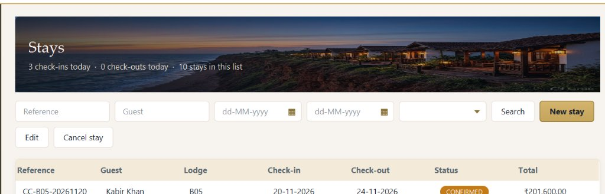
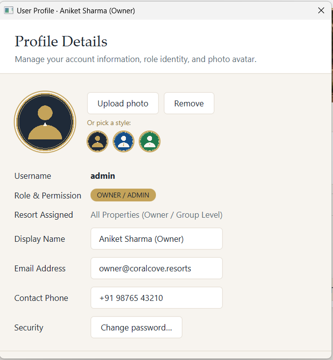
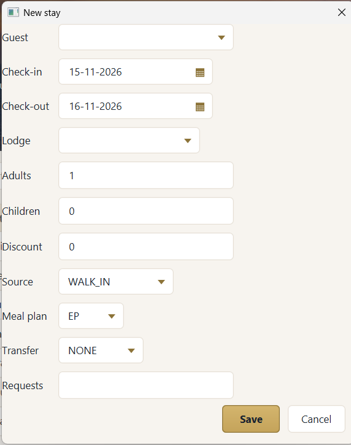
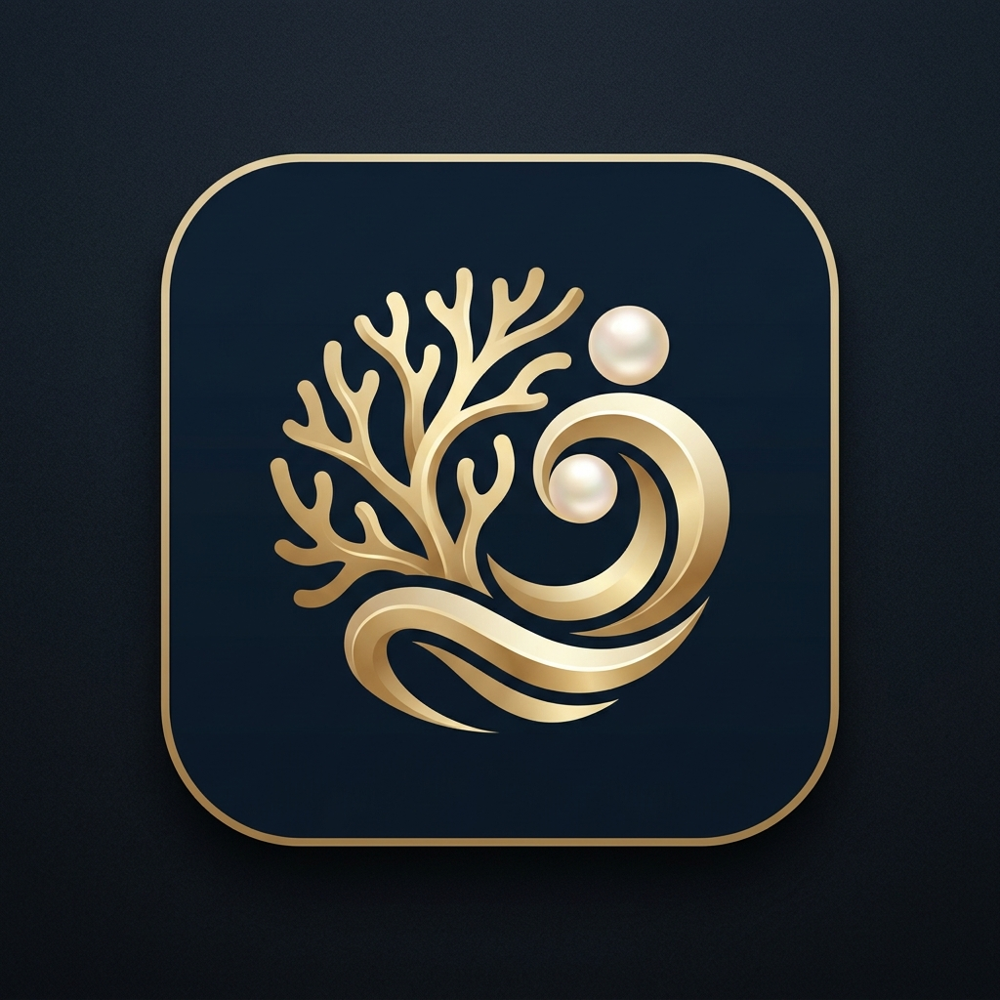

# CoralCove - Luxury Resort Management Desktop Application
## Summer Internship Project Report

**assodean.ps@srmap.edu.in (c)SRM UNIVERSITY - AP, ANDHRA PRADESH**

---

### A REPORT ON
# SYSTEM DESIGN AND DEVELOPMENT OF CORALCOVE - LUXURY RESORT MANAGEMENT DESKTOP APPLICATION

**By**
- **Name of the student:** Aniket Sharma
- **Registration No.:** AP24110010141 *(or applicable student registration number)*

**Prepared in the partial fulfillment of the Summer Internship Course**  
**AT**  
**PRATINIK INFOTECH, Pune, Maharashtra, India**  
**SRM UNIVERSITY, AP**  
*(July, 2026 / Academic Year 2026-2027)*

---

## CERTIFICATE OF INTERNSHIP

This is to certify that Mr. Aniket Sharma, Registration No. AP24110010141, a student of SRM University, AP, has successfully completed his summer internship at Pratinik Infotech from 10th June 2026 to 09th August 2026.

During this period, he worked on the project titled **"CoralCove - Luxury Resort Management Desktop Application"** under the domain of Desktop Systems and Java Engineering.

He demonstrated strong technical initiative, dedication, and problem-solving skills throughout the development lifecycle, including system architecture, relational database design with SQLite, JavaFX user interface engineering, and automated testing.

We found him sincere, hardworking, and result-oriented. We wish him all success in his academic and professional future.

**Authorized Signatory**  
Pratinik Infotech  
Pune, Maharashtra, India  
Date: 09th August 2026  

---

## APPENDIX A: INTERNSHIP ACCEPTANCE CONFIRMATION

**Pratinik Infotech**  
**Acceptance Number: #6174**  

Dear Aniket Sharma,

Thank you for completing the acceptance policy with Pratinik Infotech.

You can expect to receive tasks relevant to your internship domain, along with detailed instructions, sent to your registered email address on the Internship Starting Date.

Refer to the technical documentation and repository guidelines for any clarifications.

### Important Dates
- **Offer Letters Issued:** 10th June 2026
- **Internship Start Date:** 10th June 2026
- **Duration:** 2 Months (Ending 09th August 2026)
- **Internship Domain:** Desktop Systems and Java Engineering

The internship domain and schedule are fixed and cannot be changed after acceptance. Acceptance of the internship is final; no revocation requests will be entertained.

**Pratinik Infotech**  
Pune, Maharashtra, India  

---

## ACKNOWLEDGEMENT

I express my sincere gratitude to everyone who supported and guided me during my summer internship at Pratinik Infotech.

I am thankful to SRM University, AP for providing me with the opportunity to undertake this internship as part of the Summer Internship Course. The internship gave me an opportunity to understand how concepts learned in the classroom can be applied while working on a practical software project.

I thank my faculty mentor for providing guidance throughout the internship and for helping me understand the academic requirements of the project report.

I am grateful to my industry mentor and the team at Pratinik Infotech for their guidance, suggestions, and technical feedback during the development of the project. Their input helped me appreciate the importance of clean architecture, relational constraints, error handling, and test-driven refinement in production software.

Finally, I am thankful for the opportunity to build CoralCove - Luxury Resort Management Desktop Application, which gave me practical exposure to enterprise desktop engineering, relational database operations, and desktop user interface design.

---

## ABSTRACT

The summer internship at Pratinik Infotech provided practical exposure to enterprise desktop application development and the process of converting complex domain requirements into a reliable software system. As part of the internship, CoralCove - Luxury Resort Management Desktop Application was developed to provide hospitality operators with a fast, offline-capable platform for managing multi-zone resorts.

Many remote resort destinations face unstable internet connectivity. Web-based property management systems often freeze or lose data during outages, leading to check-in delays and billing errors. CoralCove addresses this issue by running locally on Java 21 and JavaFX, using an embedded SQLite 3 database with Write-Ahead Logging (WAL) for sub-millisecond query performance and zero cloud dependency.

The project encompasses twelve operational modules, including reservation management with mathematical date-collision validation, guest KYC compliance with 12-digit Indian Aadhaar verification, real-time housekeeping coordination, master folio billing with GST calculation, employee attendance tracking, and executive analytics. The architecture follows a strict four-layer separation: Presentation, Service, Data Access Object (DAO), and Database.

Testing was conducted using JUnit 5 across unit and integration levels. Automated tests verified date collision checks, Aadhaar format verification, password hashing, and monetary calculations. User interface refinements resolved dialog spacing, scroll handling, and modal button pinning.

The internship bridged theoretical academic concepts with professional software development practices, including version control, clean code architecture, database indexing, and comprehensive technical documentation.

---

## TABLE OF CONTENTS

| Section | Topic | Page |
| :--- | :--- | :---: |
| **1** | **Introduction** | **8** |
| 1.1 | Introduction to the Internship | 8 |
| 1.2 | Purpose of the Project | 8 |
| 1.3 | Objectives | 9 |
| **2** | **Organization and Business Sector** | **10** |
| 2.1 | Introduction to the Hospitality Management Software Sector | 10 |
| **3** | **Overview of Pratinik Infotech** | **11** |
| 3.1 | Organization Overview | 11 |
| 3.2 | Nature of Work | 11 |
| 3.3 | Importance of the Organization to the Sector | 11 |
| **4** | **Internship Plan** | **12** |
| 4.1 | Internship Area | 12 |
| 4.2 | Project Title | 12 |
| 4.3 | Project Plan (Stages 1 to 6) | 12 |
| **5** | **Background and Problem Description** | **13** |
| 5.1 | Background | 13 |
| 5.2 | Problem Statement | 13 |
| 5.3 | Proposed Solution | 13 |
| **6** | **System Design and Development** | **14** |
| 6.1 | Application Structure | 14 |
| 6.2 | User Interface Design | 14 |
| 6.3 | Interactions | 14 |
| 6.4 | Feedback and System Status | 14 |
| 6.5 | Billing and Financial Calculation | 14 |
| 6.6 | Desktop Responsive and Dialog Layout | 14 |
| **7** | **Implementation and Testing** | **15** |
| 7.1 | Development Process | 15 |
| 7.2 | Implementation of Components | 15 |
| 7.3 | User Interaction | 15 |
| 7.4 | Testing Approach | 15 |
| 7.5 | Boundary and Functional Testing | 15 |
| 7.6 | Improvements After Testing | 16 |
| | Figures and Screenshots | 16 |
| **8** | **Outcomes** | **18** |
| 8.1 | Functional Outcome | 18 |
| 8.2 | User Experience Outcome | 18 |
| 8.3 | Technical Outcome | 18 |
| 8.4 | Professional Outcome | 18 |
| 8.5 | Learning Outcome | 18 |
| **9** | **Conclusion and Recommendations** | **19** |
| 9.1 | Conclusion | 19 |
| 9.2 | Recommendations / Future Scope | 19 |
| | **References and Project Links** | **20** |

---

## 1. INTRODUCTION

### 1.1 Introduction to the Internship
A summer internship provides an opportunity to experience the practical side of software engineering in a professional setting. Academic courses introduce fundamental concepts such as object-oriented programming, relational databases, data structures, and algorithmic complexity. Applying these concepts to a complete, standalone software system requires an understanding of architectural structure, transaction lifecycles, user interface state management, and testing methodologies.

During the summer internship at Pratinik Infotech, I was tasked with designing and implementing an enterprise desktop management system for luxury resort operations. The internship involved analyzing domain requirements, designing normalized relational database tables, implementing a responsive desktop interface using JavaFX, coordinating business logic through services, and verifying system behavior with unit tests.

### 1.2 Purpose of the Project
Luxury resorts often operate across large properties in coastal, cliffside, or island locations. These remote locations frequently suffer from intermittent or slow internet connectivity. Modern web-based Property Management Systems (PMS) depend heavily on constant cloud access. When internet connections drop, front-desk staff cannot check in guests, retrieve room availability, or generate billing invoices, leading to customer frustration and operational bottlenecks.

The purpose of CoralCove is to provide an offline-first desktop management platform that runs locally on front-desk computers. By using an embedded SQLite 3 database and modern Java 21, the application delivers immediate response times with zero network latency. The application manages guest reservations, room inventory across distinct zones (Beach, Lagoon, Cliff, Garden), Indian regulatory KYC compliance, room turnover synchronization, and master folio billing without requiring continuous external internet access.

### 1.3 Objectives
The major objectives of the CoralCove project were:
- To develop an offline-capable, standalone desktop Property Management System using Java 21 and JavaFX.
- To design an embedded relational database schema in SQLite with primary keys, foreign keys, and indexes for fast data retrieval.
- To build a reservation engine that prevents room booking collisions through date-overlap validation.
- To implement regulatory guest KYC verification, including 12-digit Aadhaar format checks and document image staging.
- To create an automated folio billing module that calculates room tariffs, meal plans, incidental services, and GST taxes.
- To synchronize housekeeping workflows with front-desk check-in and check-out events.
- To establish role-based access control with secure PBKDF2 password hashing.
- To create a clean user interface with custom CSS styling and multi-resolution application icons.

---

## 2. ORGANIZATION AND BUSINESS SECTOR

### 2.1 Introduction to the Hospitality Management Software Sector
The hospitality sector is an essential component of the global service economy, comprising luxury resorts, hotels, boutique stays, and ecotourism lodges. Effective resort operations depend heavily on Property Management Systems (PMS). These systems manage room inventories, guest lifecycles, billing, and back-of-house coordination.

Traditionally, independent resorts relied on manual ledgers or generic spreadsheets. While spreadsheets offer initial flexibility, they lack relational constraints, concurrency safety, and audit logs. Multiple staff members editing spreadsheets concurrently often create duplicate reservations, conflicting rates, and billing inaccuracies.

In recent years, cloud PMS solutions have gained popularity. However, coastal and remote properties in developing tourist corridors often face unreliable broadband connectivity. A service disruption renders cloud interfaces inaccessible, leaving front-desk staff unable to verify arriving guests or issue invoices. Consequently, there is steady demand for resilient, offline-first desktop applications that provide rich local data storage, strong transactional guarantees, and instantaneous query responses while remaining simple to operate.

---

## 3. OVERVIEW OF PRATINIK INFOTECH

### 3.1 Organization Overview
Pratinik Infotech is a software development and technical services organization located in Pune, Maharashtra, India. The company focuses on custom software engineering, web application development, desktop platforms, and student technical training programs.

The organization provides an internship structure that allows students to gain direct experience in practical software engineering. Weekly task reviews, code architecture discussions, and milestone submissions help students understand how real software projects are organized and executed.

### 3.2 Nature of Work
The engineering work at Pratinik Infotech spans several technical domains:
- Enterprise application architecture and domain-driven design.
- Relational database design, query optimization, and schema migrations.
- Front-end and desktop user interface engineering.
- Software verification, unit testing, and technical documentation.

### 3.3 Importance of the Organization to the Sector
Pratinik Infotech helps bridge the gap between academic theory and industry engineering standards. By assigning realistic business requirements, the organization trains students to consider real-world constraints such as data integrity, offline resilience, and user experience. This preparation creates software developers capable of building robust business applications.

---

## 4. INTERNSHIP PLAN

### 4.1 Internship Area
Department / Domain: Desktop Systems and Java Engineering  
The internship focused on the architecture, design, and implementation of an offline-first desktop Property Management System for luxury resort groups.

### 4.2 Project Title
CoralCove - Luxury Resort Management Desktop Application

### 4.3 Project Plan
The project was carried out in six planned stages across the eight-week internship duration:
- **Stage 1 - Requirement Understanding:** Analyzed resort operational workflows, front-desk check-in steps, room inventories, and Indian KYC compliance rules.
- **Stage 2 - Database Architecture:** Designed fourteen normalized relational tables in SQLite, configured foreign keys, constraints, and initial migration scripts.
- **Stage 3 - Core DAO & Service Implementation:** Implemented Data Access Objects using parameterized JDBC queries and built business services for reservations, authentication, and billing.
- **Stage 4 - User Interface Development:** Built JavaFX desktop screens, integrated custom CSS theme styling, and set up the desktop shell with a sidebar navigation rail.
- **Stage 5 - Refinement & Integration:** Added dialog form spacing, scrollpane containers, pinned action buttons, and high-resolution logo icon assets.
- **Stage 6 - Testing & Documentation:** Conducted JUnit 5 automated test verification, manual functional testing, and produced comprehensive technical documentation.

---

## 5. BACKGROUND AND PROBLEM DESCRIPTION

### 5.1 Background
Luxury resorts offer premium accommodations spread across multiple geographic zones, including private beachfront villas, overwater lagoon suites, cliffside chalets, and garden residences. Unlike compact city hotels, luxury resorts manage diverse revenue streams, such as in-room dining, wellness spa therapies, scuba excursions, and private boat charters. Furthermore, hospitality regulations in India require mandatory guest KYC verification, specifically recording and validating 12-digit Aadhaar identity documents.

### 5.2 Problem Statement
Resort operators face several recurring operational challenges:
- **Network Instability:** Remote coastal locations frequently experience broadband outages. Cloud PMS software freezes, preventing guest arrivals, check-outs, and billing.
- **Double-Booking Risks:** Manual booking records or unsynchronized spreadsheets lead to overlapping reservations for the same room.
- **KYC Record Disorganization:** Paper ID copies or unindexed digital scans cause compliance risks and delays during guest registration.
- **Billing Discrepancies:** Manual calculation of room nights, meal plan rates, incidental services, and Goods and Services Tax (GST) creates billing errors.
- **Housekeeping Miscommunication:** Delays in notifying cleaning staff when a guest departs result in rooms remaining marked dirty when new guests arrive.

### 5.3 Proposed Solution
CoralCove solves these problems through an integrated, offline-first desktop platform. Operating locally on Java 21 and an embedded SQLite 3 database, CoralCove eliminates network latency. The application enforces mathematical date-collision algorithms to prevent double-booking, provides integrated 12-digit Aadhaar validation with secure local image staging, automates folio billing with GST calculation, and synchronizes room turnover states immediately upon guest check-in and check-out.

---

## 6. SYSTEM DESIGN AND DEVELOPMENT

### 6.1 Application Structure
CoralCove follows a clean four-tier architectural pattern:
- **Presentation Tier:** JavaFX views, dialogs, custom components, and CSS styles.
- **Service Tier:** Business logic, validation rules, transaction coordination, and invariants.
- **Data Access Object (DAO) Tier:** SQL query execution and ResultSet object mapping.
- **Database Tier:** Embedded SQLite 3 relational database running in WAL mode.

### 6.2 User Interface Design
The user interface uses a luxury coastal aesthetic. The visual theme combines a warm sand backdrop (`#F5F0E6`) with a deep slate navy navigation rail (`#1B2430`) and warm gold accents (`#C4A35A`). Resort zones are visually differentiated with dedicated photo cards and status badges.

### 6.3 Interactions
The interaction flow was designed for speed. Front-desk staff can search reservations by reference or guest name, select check-in dates using visual calendars, and transition room states with single-click actions.

### 6.4 Feedback and System Status
The application provides clear visual feedback. Active rooms display real-time status chips: READY (green), OCCUPIED (blue), DIRTY (amber), HELD (purple), and OUT_OF_ORDER (red). Error dialogs explain validation failures clearly, such as date collision conflicts or weak passwords.

### 6.5 Billing and Financial Calculation
Monetary values are computed using Java's `BigDecimal` with half-up rounding to prevent floating-point calculation errors. Master folios aggregate room tariffs, meal plan supplements, and incidental POS charges, automatically computing 9% CGST and 9% SGST (18% total GST) with itemized receipts.

### 6.6 Desktop Responsive and Dialog Layout
Dialog forms are configured with generous padding (Insets of 20, 26, 16, 26) and horizontal and vertical gaps (18px and 12px). Form bodies are wrapped in scrollable containers with column constraints set to grow automatically. This prevents text from crowding dialog edges across varying screen resolutions.

---

## 7. IMPLEMENTATION AND TESTING

### 7.1 Development Process
Development was executed modularly using Git version control. Features were developed in isolation: database tables and DAOs first, followed by business service rules, and finally the JavaFX presentation components. This modular approach enabled targeted unit testing before assembling the full desktop application.

### 7.2 Implementation of Components
Key components implemented in CoralCove include:
- **`StayService` & `StayBookingDAO`:** Coordinates reservation creation, validates date ranges, and verifies lodge vacancy using mathematical overlap queries.
- **`ArrivalService`:** Coordinates front-desk check-in, verifies Aadhaar status, updates lodge state to OCCUPIED, and opens master billing folios.
- **`BillingService` & `InvoiceDAO`:** Manages master folios, records incidental charges, applies discounts, logs payments, and calculates GST taxes.
- **`LodgeCareService`:** Manages housekeeping queues, attendant task assignments, and facility maintenance defect reports.
- **`PasswordHasher`:** Hashes passwords using PBKDF2 with HMAC-SHA256 across 210,000 iterations and 16-byte random salts.

### 7.3 User Interaction
The main window layout (`ShellView`) features a persistent vertical sidebar for navigation and a responsive content area. Asynchronous background execution (`Fx.run`) ensures database queries execute off the JavaFX UI thread, keeping the user interface smooth and responsive.

### 7.4 Testing Approach
Testing combined automated unit tests and manual functional verification. Automated tests utilized JUnit 5 running against isolated temporary databases. This approach guaranteed that database tests did not modify production data files.

### 7.5 Boundary and Functional Testing
Extensive boundary testing was conducted across several critical areas:
- **Date Overlap Logic:** Verified that reservations reject overlapping date ranges for the same lodge while allowing back-to-back bookings where check-out matches the next check-in.
- **Aadhaar KYC Validation:** Tested valid 12-digit Indian Aadhaar numbers, rejecting short numbers, alphabetic characters, and invalid checksum sequences.
- **Monetary Rounding:** Tested folio tax calculations across multiple incidental line items to verify half-up rounding precision.
- **Authentication & Permissions:** Verified that non-admin accounts cannot access restricted modules like Settings and Financial Reports.

### 7.6 Improvements After Testing
Iterative testing identified several user interface areas that required refinement:
- **Dialog Spacing:** Modal dialog forms previously crowded window borders. `Dialogs.java` was refactored with generous edge insets and column constraints.
- **Profile Dialog Actions:** `ProfileDialog` was updated with an explicit pinned bottom bar containing Save Profile and Cancel buttons.
- **Window Taskbar Branding:** Multi-resolution application icons (16x16 to 256x256) were integrated into the primary application stage to ensure clear branding in Windows taskbars.

### Figures and Screenshots

#### Figure 1: CoralCove Stays and Reservation Dashboard

*Figure 1: CoralCove Stays and Reservation Dashboard with Hero Banner, Quick Filters, and Tabular Reservations List.*

#### Figure 2: Stay Booking and Room Selection Dialog

*Figure 2: New Stay Booking Modal Dialog with Date Selection, Rate Calculation, and Enhanced Edge Padding.*

#### Figure 3: User Profile and Security Credentials Dialog

*Figure 3: User Profile Dialog with Avatar Style Selector, Contact Form Fields, and Pinned Save/Cancel Buttons.*

#### Figure 4: Luxury Brand Identity and Desktop Navigation

*Figure 4: CoralCove Application Brand Icon and Multi-Resolution Stage Asset.*

---

## 8. OUTCOMES

### 8.1 Functional Outcome
A fully functional resort management desktop application was developed, covering twelve core modules. The system successfully handles reservations, guest check-ins, Aadhaar verification, master folio billing, housekeeping tasks, employee attendance, and inventory tracking without requiring an active internet connection.

### 8.2 User Experience Outcome
The user interface offers straightforward navigation, fast response times, and consistent visual styling. Screen headers, zone photography, status chips, and formatted dialogs make operations intuitive for front-desk operators and housekeeping staff.

### 8.3 Technical Outcome
The project established a clean four-tier architecture in Java 21 and JavaFX. The SQLite database operates with foreign key constraints, indexes, and Write-Ahead Logging for durability. Automated unit testing with JUnit 5 validated core invariants with eighteen passing tests and zero regressions.

### 8.4 Professional Outcome
The internship provided valuable insight into how software projects are planned, structured, and refined. Working with modular architectures, database schemas, and version control reinforced the importance of systematic engineering practices.

### 8.5 Learning Outcome
The project enhanced my proficiency in Java 21, JavaFX Scene Graph mechanics, CSS UI skinning, relational data modeling, JDBC transaction coordination, and cryptographic password hashing.

---

## 9. CONCLUSION AND RECOMMENDATIONS

### 9.1 Conclusion
The summer internship at Pratinik Infotech provided practical exposure to enterprise desktop software engineering. Building CoralCove demonstrated how real-world hospitality management challenges can be addressed through thoughtful software architecture.

The project unified room inventory management, guest KYC compliance, folio accounting, and housekeeping operations into a cohesive desktop platform. Implementing the application in Java 21 with embedded SQLite 3 proved that offline-first desktop systems provide superior responsiveness, data privacy, and operational resilience for remote resorts.

Working through the complete development process, from requirements analysis to testing and documentation, provided hands-on experience that reinforced and extended classroom learning.

### 9.2 Recommendations / Future Scope
The current application can be expanded in several valuable directions:
- **Multi-Terminal LAN Synchronization:** Implement a local network synchronization protocol allowing multiple front-desk terminals to share the SQLite database concurrently.
- **Automated Offsite Cloud Backup:** Add an encrypted background backup service to upload daily database snapshots when internet connectivity is available.
- **Hardware Device Integration:** Integrate magnetic card door key encoders and passport/Aadhaar optical scanners directly into the check-in view.
- **Payment Gateway Terminals:** Connect physical POS card swipe terminals via local serial/USB interfaces for automated charge authorization.
- **Guest Mobile Companion:** Provide a lightweight local Wi-Fi web portal for guests to browse spa menus and review current folio charges.

---

## REFERENCES

1. SRM University, AP, Summer Internship Course - Project Report Guidelines, 2026-27.
2. Oracle Corporation, Java Platform, Standard Edition 21 Documentation, Oracle Technology Network, 2023.
3. OpenJFX Project, JavaFX 21 API Specification and CSS Reference Guide, openjfx.io, 2023.
4. SQLite Development Team, SQLite 3 Documentation and Write-Ahead Logging Specifications, sqlite.org, 2024.
5. Pratinik Infotech, Internship Project Guidelines, Architecture Standards, and Task Specifications, Pune, Maharashtra, 2026.

---

## PROJECT LINKS

- **Source Code Repository (GitHub):**  
  [https://github.com/applejuice093/Coralcove](https://github.com/applejuice093/Coralcove)
- **Complete Technical Specification Documentation:**  
  Refer to [doc.md](file:///c:/A/PROJECT/corlcovejavafx/doc.md) in the project root directory for exhaustive table catalogs, DAO methods, service APIs, and sequence diagrams.
